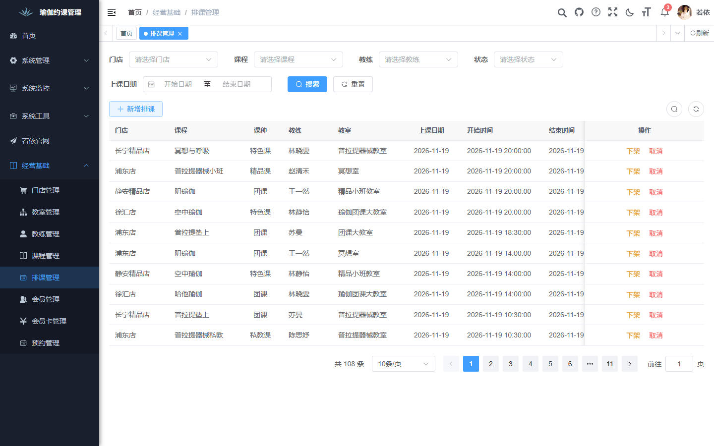
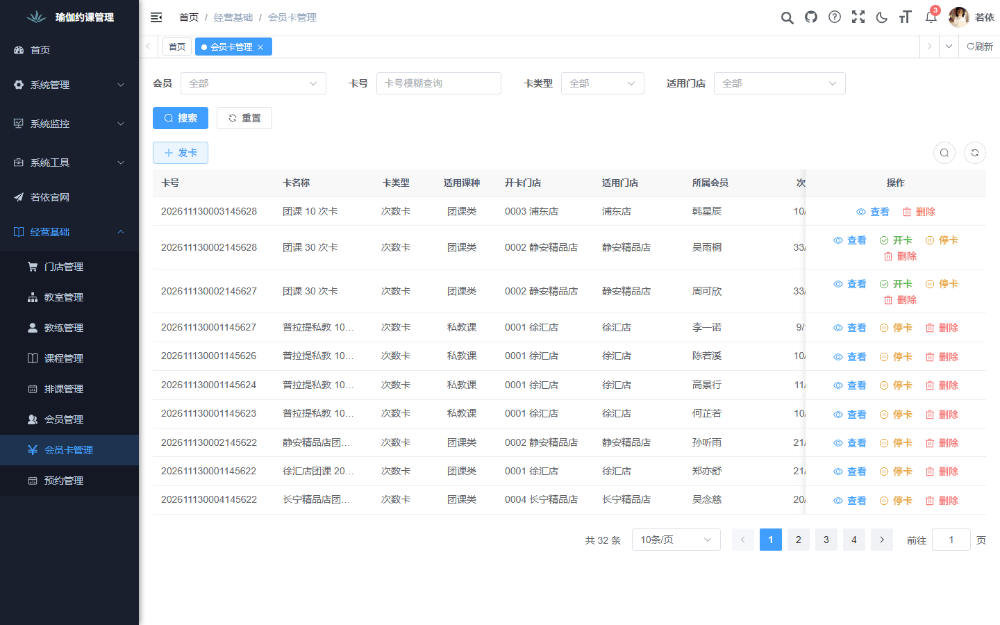
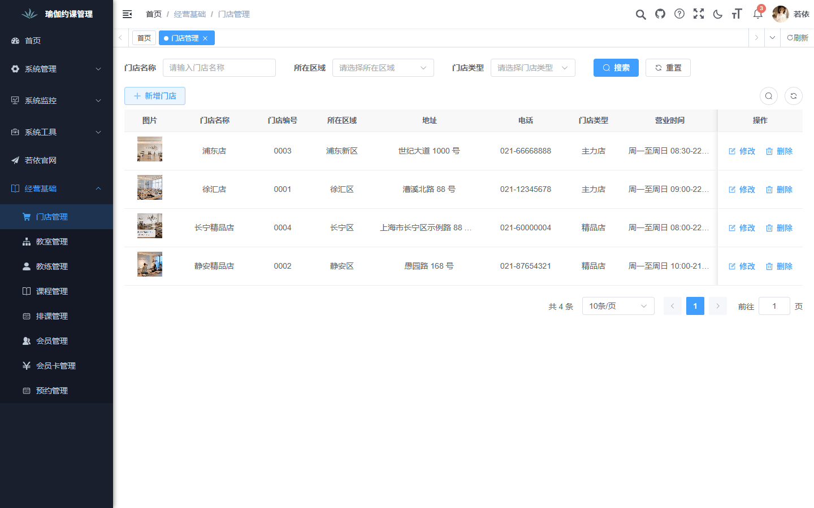
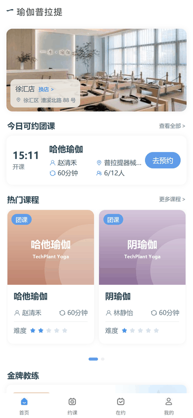
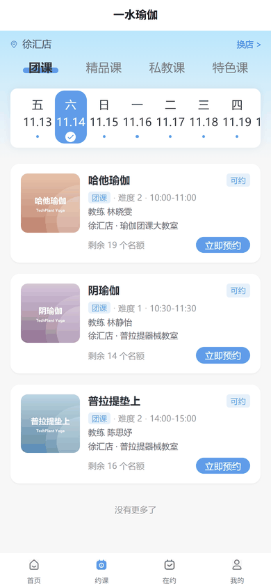
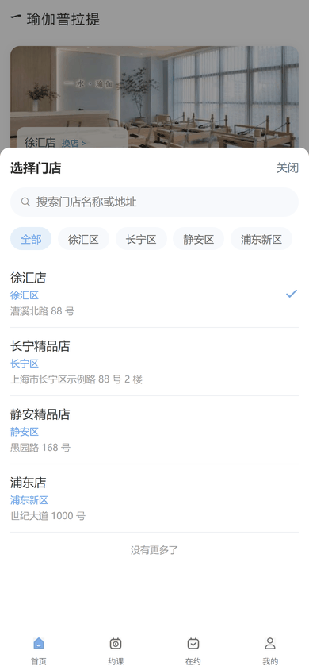

# TechPlant Yoga

[简体中文](./README.md) | English

A booking and operations system for yoga and pilates studios: staff schedule classes and issue membership cards in the admin console, and members pick a studio, book classes, and check in from the mini program or H5.

[](./LICENSE)


## Screenshots

**Admin console**

<table>
  <tr>
    <td></td>
    <td></td>
    <td></td>
  </tr>
  <tr align="center"><td>Schedules</td><td>Membership cards</td><td>Stores</td></tr>
</table>

**User H5**

<table>
  <tr>
    <td></td>
    <td></td>
    <td></td>
  </tr>
  <tr align="center"><td>Home</td><td>Book a class</td><td>Choose a store</td></tr>
</table>

## Features

- **Stores and classrooms**: manage each store's district, opening hours, address, and photo, plus the classrooms inside it.
- **Coaches**: coach profiles with avatar, bio, and gallery; gold coaches are featured on the user home page.
- **Courses**: four course types (group, boutique, private, and special), each with a cover, description, and difficulty.
- **Schedules**: schedule classes for the next 14 days by store, classroom, and coach, with coach and course time-conflict checks; publish, unpublish, or cancel.
- **Members**: create member profiles in the console or let members self-register with a phone number; members are grouped by level.
- **Membership cards**: times cards and annual cards, with issue, activate, and stop steps, limited to specific stores and course types.
- **Reservations**: members book classes and sessions are deducted automatically; full classes accept a waitlist, bookings can be cancelled before class, and members check in on site. Under-enrolled classes are cancelled automatically and sessions are refunded.

## Quick Start

You need JDK 8, Maven, Node.js 20.19+, and Docker. From the repository root:

```powershell
docker compose up -d --wait   # start MySQL and Redis; init scripts are imported on first start
start.bat                     # build and start the backend, admin console, and user H5
```

| Service | URL |
| --- | --- |
| Backend | http://localhost:8080 |
| Admin console | http://localhost (account `admin / admin123`) |
| User H5 | http://localhost:9090 |

Stop the services with `stop.bat`, then run `docker compose down`. For manual SQL import, backend configuration, OSS image storage, and HBuilderX / WeChat DevTools debugging, see [Local development setup](docs/编码开发/本地开发环境搭建.md) (Chinese).

## Tech Stack

| Module | Technology |
| --- | --- |
| Backend | Java 8, Spring Boot 2.5.15, RuoYi 3.9.2, Spring Security, MyBatis-Plus 3.5.5, Druid, Swagger, Maven multi-module |
| Data and storage | MySQL 8.0, Redis 7, Alibaba Cloud OSS (business images) |
| Admin console | Vue 3.5, Vite 6, Element Plus 2.13, Pinia 3, Axios, Vue Router 4 |
| User app | uni-app (Vue 3), Pinia, released as a WeChat Mini Program and H5 |

## Project Structure

```text
techplant-yoga/
├─ backend/             # RuoYi backend: ruoyi-admin bootstrap, ruoyi-yoga business module, etc.
│  ├─ ruoyi-yoga/       # Yoga business module
│  └─ sql/              # Base tables and yoga business init scripts
├─ frontend/
│  ├─ pc/               # Operations admin console (Vue 3 + Element Plus)
│  └─ uni-app/          # User mini program and H5
├─ docs/                # Requirements, design, testing, and development docs
├─ tools/               # Local start/stop scripts and other tools
├─ docker-compose.yml   # Local MySQL and Redis
├─ start.bat            # One-click start
└─ stop.bat             # One-click stop
```

## Documentation

All documents are written in Chinese.

| Category | Documents |
| --- | --- |
| Requirements | [Requirements analysis](docs/需求分析/需求分析.md), [Use case overview](docs/需求分析/用例总览.md), [Feature list](docs/需求文档/功能清单汇总.md), [MVP business flow](docs/需求文档/MVP业务流程图.md) |
| Design | [High-level design](docs/概要设计/概要设计.md), [Detailed design](docs/详细设计/), [User API design](docs/详细设计/用户端接口详细设计.md) |
| Product analysis | [User pages and navigation](docs/产品分析/用户端页面与跳转梳理.md), [User pages and objects](docs/产品分析/用户端页面与对象.md) |
| Development | [Local development setup](docs/编码开发/本地开发环境搭建.md), [AI Agent development guide](docs/编码开发/AI%20Agent开发手册.md), [Project infrastructure](docs/编码开发/项目基础设施.md) |
| Testing | [AI Agent testing guide](docs/系统测试/AI%20Agent测试手册.md), [Reservation concurrency and transactions](docs/系统测试/预约并发与事务核对.md) |
| Doc conventions | Single sources of truth and maintenance rules: [Local development setup · conventions](docs/编码开发/本地开发环境搭建.md#14文档约定) |

## License

This project is licensed under the [MIT License](./LICENSE).
