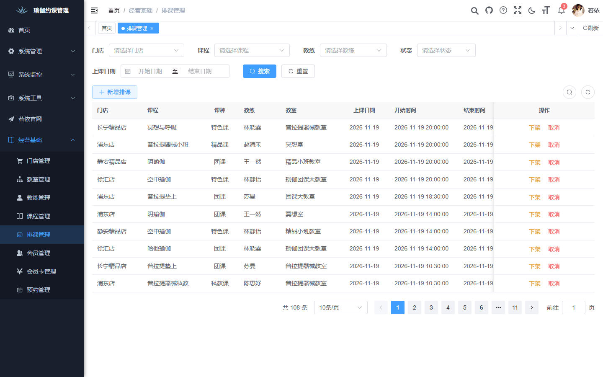
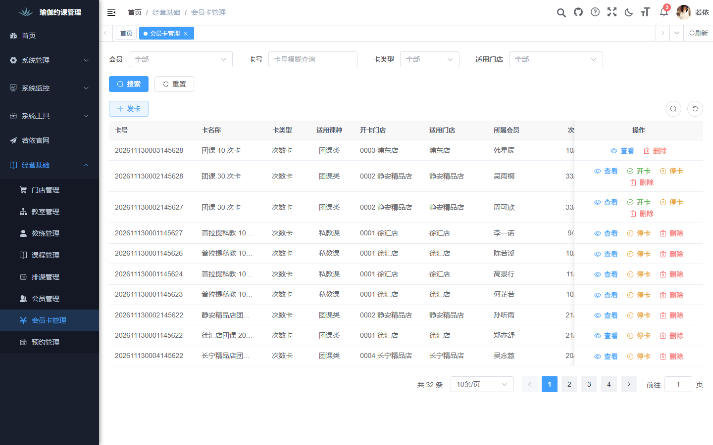
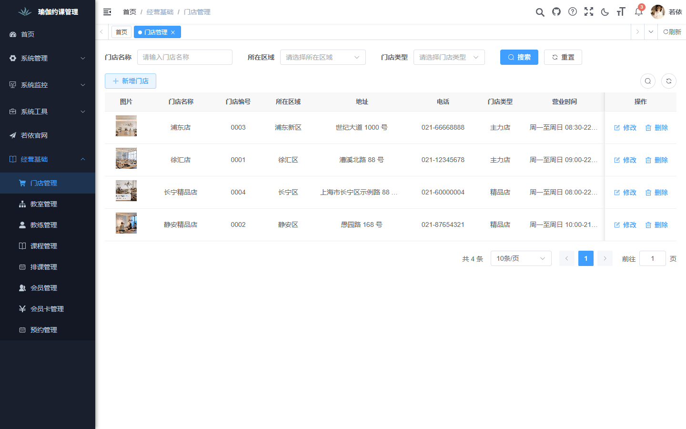
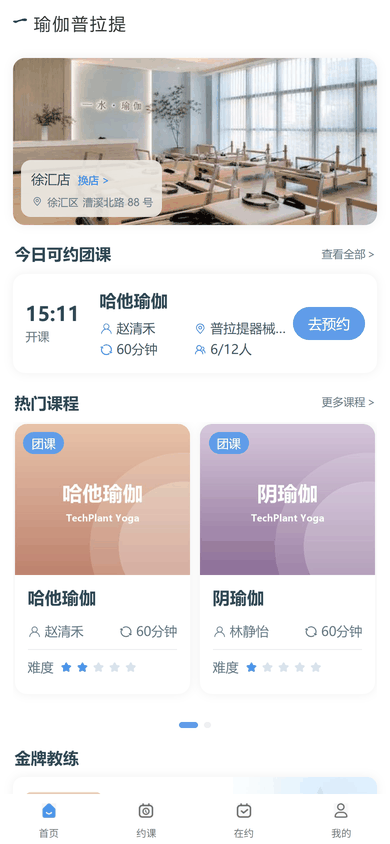
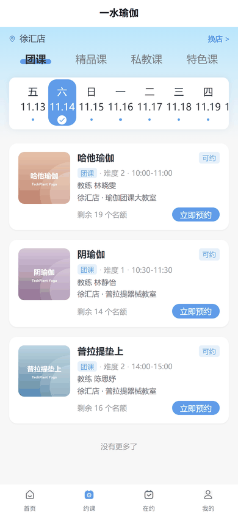
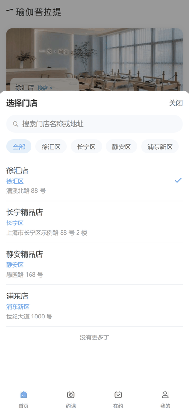

# TechPlant Yoga

简体中文 | [English](./README.en.md)

瑜伽普拉提门店的约课与运营管理系统：运营人员在管理端排课、发卡，会员在小程序或 H5 上选店、约课、签到。

[](./LICENSE)


## 界面预览

**管理端**

<table>
  <tr>
    <td></td>
    <td></td>
    <td></td>
  </tr>
  <tr align="center"><td>排课管理</td><td>会员卡管理</td><td>门店管理</td></tr>
</table>

**用户端 H5**

<table>
  <tr>
    <td></td>
    <td></td>
    <td></td>
  </tr>
  <tr align="center"><td>首页</td><td>约课</td><td>选择门店</td></tr>
</table>

## 功能特性

- **门店与教室**：维护多家门店的区域、营业时间、地址和门店图片，每家门店下管理各自的教室。
- **教练**：教练档案含头像、简介和相册，可设为金牌教练并在用户端首页推荐。
- **课程**：团课、精品课、私教课、特色课四类课程，带封面、介绍和难度。
- **排课**：按门店、教室、教练排未来 14 天的课，自动检查教练和课程的时间冲突，支持上架、下架和取消。
- **会员**：管理端建档或会员用手机号自助注册，按等级区分会员。
- **会员卡**：次数卡和年卡两种卡型，发卡、开卡、停卡全流程，按门店和课种限定适用范围。
- **预约**：会员选课预约并自动扣次，满员可排队补位，开课前可取消、到店签到；人数不足的课程自动取消并返还次数。

## 快速开始

需要 JDK 8、Maven、Node.js 20.19+ 和 Docker。在仓库根目录执行：

```powershell
docker compose up -d --wait   # 启动 MySQL 与 Redis，首次启动自动导入初始化脚本
.\start.bat                     # 构建并启动后端、管理端、用户端 H5
```

| 服务 | 地址 |
| --- | --- |
| 后端 | http://localhost:8080 |
| 管理端 | http://localhost （账号 `admin / admin123`） |
| 用户端 H5 | http://localhost:9090 |

停止服务用 `stop.bat`，再执行 `docker compose down`。手动导入 SQL、后端配置、OSS 图片存储、HBuilderX 和微信开发者工具调试等完整步骤见 [本地开发环境搭建](docs/编码开发/本地开发环境搭建.md)。

## 技术栈

| 模块 | 技术 |
| --- | --- |
| 后端 | Java 8、Spring Boot 2.5.15、RuoYi 3.9.2、Spring Security、MyBatis-Plus 3.5.5、Druid、Swagger、Maven 多模块 |
| 数据与存储 | MySQL 8.0、Redis 7、阿里云 OSS（业务图片） |
| 管理端 | Vue 3.5、Vite 6、Element Plus 2.13、Pinia 3、Axios、Vue Router 4 |
| 用户端 | uni-app（Vue 3）、Pinia，发布为微信小程序和 H5 |

## 项目结构

```text
techplant-yoga/
├─ backend/             # RuoYi 后端：ruoyi-admin 启动模块、ruoyi-yoga 业务模块等
│  ├─ ruoyi-yoga/       # 瑜伽业务模块
│  └─ sql/              # 基础表和瑜伽业务初始化脚本
├─ frontend/
│  ├─ pc/               # 运营管理端（Vue 3 + Element Plus）
│  └─ uni-app/          # 用户端小程序与 H5
├─ docs/                # 需求、设计、测试与开发文档
├─ tools/               # 本地启停脚本等工具
├─ docker-compose.yml   # 本地 MySQL 与 Redis
├─ start.bat            # 一键启动
└─ stop.bat             # 一键停止
```

## 文档导航

| 分类 | 文档 |
| --- | --- |
| 需求 | [需求分析](docs/需求分析/需求分析.md)、[用例总览](docs/需求分析/用例总览.md)、[功能清单汇总](docs/需求文档/功能清单汇总.md)、[MVP 业务流程图](docs/需求文档/MVP业务流程图.md) |
| 设计 | [概要设计](docs/概要设计/概要设计.md)、[详细设计目录](docs/详细设计/)、[用户端接口详细设计](docs/详细设计/用户端接口详细设计.md) |
| 产品分析 | [用户端页面与跳转梳理](docs/产品分析/用户端页面与跳转梳理.md)、[用户端页面与对象](docs/产品分析/用户端页面与对象.md) |
| 开发 | [本地开发环境搭建](docs/编码开发/本地开发环境搭建.md)、[AI Agent 开发手册](docs/编码开发/AI%20Agent开发手册.md)、[项目基础设施](docs/编码开发/项目基础设施.md) |
| 测试 | [AI Agent 测试手册](docs/系统测试/AI%20Agent测试手册.md)、[预约并发与事务核对](docs/系统测试/预约并发与事务核对.md) |
| 文档约定 | 文档唯一出处与维护规则见 [本地开发环境搭建 · 文档约定](docs/编码开发/本地开发环境搭建.md#14文档约定) |

## License

本项目使用 [MIT License](./LICENSE)。
