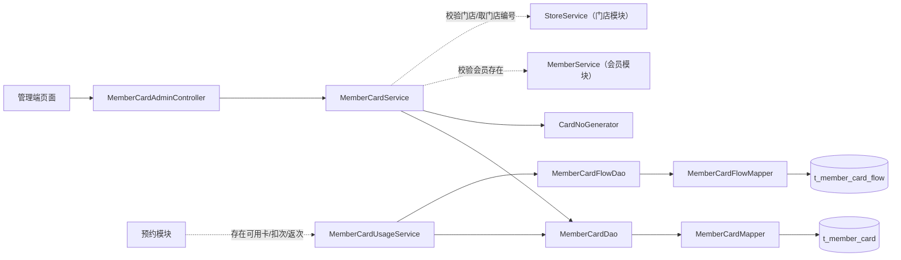

# 瑜伽普拉提会员卡管理详细设计文档

# 1、数据架构

## 1.1 数据库 ER 模型

略

## 1.2 数据库逻辑模型

### 1.2.1 `t_member_card` 字段定义

| 字段 | 中文名 | 类型 | 必填 | 默认值 | 说明 |
|---|---|---|---|---|---|
| `id` | 会员卡ID | bigint unsigned | 是 | — | 雪花 ID |
| `member_id` | 所属会员 | bigint unsigned | 是 | — | 关联 `t_member.id`；**跨模块引用，不建物理外键** |
| `open_store_id` | **开卡门店** | bigint unsigned | 是 | — | **发卡时录入**；**卡号里的门店编号取自它**；与「适用门店」是两个字段（`BR-会员卡-016`、`BR-门店-011`） |
| `activate_time` | 开卡时间 | datetime | 否 | NULL | 开卡时写入 |
| `card_no` | 卡号 | varchar(64) | 是 | — | 服务端生成、全平台唯一；组成见 §1.2.3 |
| `card_name` | 卡名称 | varchar(64) | 是 | — | 如"私教次卡""普拉提次卡"，由发卡人填写 |
| `card_type` | 卡类型 | tinyint | 是 | — | `1` 次数卡；`2` 年卡（可扩展） |
| `course_scope` | 适用课种范围 | tinyint | 是 | — | `1` 团课类（团课／精品课／特色课）；`2` 私教课（`BR-会员卡-018`） |
| `store_id` | **适用门店** | bigint unsigned | 否 | NULL | **次数卡必填**；**年卡必须为 NULL**（`BR-会员卡-003`）。**与开卡门店不同**：办卡门店 ≠ 可用门店 |
| `purchase_times` | 购买次数 | int | 否 | NULL | 仅次数卡；≥ 0 |
| `gift_times` | 赠送次数 | int | 否 | NULL | 仅次数卡；≥ 0 |
| `remaining_times` | 剩余次数 | int | 否 | NULL | 仅次数卡；发卡时 = 购买 ＋ 赠送（`BR-会员卡-012`） |
| `valid_period_unit` | 有效期单位 | tinyint | 否 | NULL | 开卡前为 NULL；开卡时次数卡写 `1`（月），年卡写 `2`（年） |
| `valid_period_count` | 有效期数量 | int | 否 | NULL | 次数卡 ∈ {3,6,12}（月）；年卡固定 1（年） |
| `valid_start_time` | 有效期起 | datetime | 否 | NULL | **开卡时写入**：开卡日 `00:00:00` |
| `valid_end_time` | 有效期止 | datetime | 否 | NULL | **开卡时写入**：见 §1.2.3 的有效期约定 |
| `stop_time` | 停卡时间 | datetime | 否 | NULL | 停卡时写入 |
| `stop_reason` | 停卡原因 | varchar(255) | 否 | NULL | 停卡时必填 |
| `create_by` | 创建人 | bigint unsigned | 否 | NULL | 公共审计填充 |
| `create_time` | 创建时间 | datetime | 是 | CURRENT_TIMESTAMP | 公共审计填充 |
| `update_by` | 更新人 | bigint unsigned | 否 | NULL | 公共审计填充 |
| `update_time` | 更新时间 | datetime | 是 | CURRENT_TIMESTAMP | ON UPDATE |

### 1.2.2 枚举值

| 枚举 | 值 | 文案 |
|---|---:|---|
| `card_type` | 1 | 次数卡 |
| `card_type` | 2 | 年卡 |
| `course_scope` | 1 | 团课类 |
| `course_scope` | 2 | 私教课 |
| `valid_period_unit` | 1 | 月 |
| `valid_period_unit` | 2 | 年 |

## 1.3 数据库物理模型

### 1.3.1 建表语句

```sql
CREATE TABLE `t_member_card` (
  `id`                 bigint unsigned NOT NULL COMMENT '会员卡ID',
  `member_id`          bigint unsigned NOT NULL COMMENT '所属会员ID',
  `open_store_id`      bigint unsigned NOT NULL COMMENT '开卡门店ID',
  `card_no`            varchar(64)  NOT NULL COMMENT '卡号',
  `card_name`          varchar(64)  NOT NULL COMMENT '卡名称',
  `card_type`          tinyint      NOT NULL COMMENT '卡类型：1次数卡 2年卡',
  `course_scope`       tinyint      NOT NULL COMMENT '适用课种范围：1团课类 2私教课',
  `store_id`           bigint unsigned DEFAULT NULL COMMENT '适用门店（次数卡必填，年卡为空）',
  `purchase_times`     int          DEFAULT NULL COMMENT '购买次数（仅次数卡）',
  `gift_times`         int          DEFAULT NULL COMMENT '赠送次数（仅次数卡）',
  `remaining_times`    int          DEFAULT NULL COMMENT '剩余次数（仅次数卡，初值=购买+赠送）',
  `valid_period_unit`  tinyint      DEFAULT NULL COMMENT '有效期单位：1月 2年（开卡前为空）',
  `valid_period_count` int          DEFAULT NULL COMMENT '有效期数量（次数卡3/6/12月；年卡固定1年）',
  `valid_start_time`   datetime     DEFAULT NULL COMMENT '有效期起（开卡时写入，开卡日00:00:00）',
  `valid_end_time`     datetime     DEFAULT NULL COMMENT '有效期止（开卡时写入，含首尾日）',
  `activate_time`      datetime     DEFAULT NULL COMMENT '开卡时间',
  `stop_time`          datetime     DEFAULT NULL COMMENT '停卡时间',
  `stop_reason`        varchar(255) DEFAULT NULL COMMENT '停卡原因',
  `create_by`          bigint unsigned DEFAULT NULL COMMENT '创建人ID',
  `create_time`        datetime     NOT NULL DEFAULT CURRENT_TIMESTAMP COMMENT '创建时间',
  `update_by`          bigint unsigned DEFAULT NULL COMMENT '更新人ID',
  `update_time`        datetime     NOT NULL DEFAULT CURRENT_TIMESTAMP ON UPDATE CURRENT_TIMESTAMP COMMENT '更新时间',
  PRIMARY KEY (`id`),
  UNIQUE KEY `uk_card_no` (`card_no`)
) ENGINE=InnoDB DEFAULT CHARSET=utf8mb4 COLLATE=utf8mb4_unicode_ci COMMENT='会员卡表';
```

### 1.3.2 索引设计

| 索引 | 表 | 用途 |
|---|---|---|
| `uk_card_no (card_no)` | 卡 | 卡号唯一；按卡号查卡 |

---

# 2、接口

## 2.2 会员卡管理接口

| # | 方法 | 路径 | 功能 | 登录 |
|---:|---|---|---|:---:|
| 1 | GET | `/admin/member-cards` | 查询会员卡列表 | 是 |
| 2 | GET | `/admin/member-cards/{cardId}` | 查询会员卡详情 | 是 |
| 3 | POST | `/admin/member-cards` | 发卡（创建**待开卡**） | 是 |
| 4 | PUT | `/admin/member-cards/{cardId}/activate` | **正式开卡** | 是 |
| 5 | PUT | `/admin/member-cards/{cardId}/stop` | 停卡（必填原因） | 是 |
| 6 | DELETE | `/admin/member-cards/{cardId}` | 删除会员卡 | 是 |

### 2.2.1 查询会员卡列表

`GET /admin/member-cards`

列表按 `id DESC` 排序，最新发卡在前。

#### 请求参数

| 参数 | 位置 | 类型 | 必填 | 说明 |
|---|---|---|---|---|
| `memberId` | query | string | 否 | 按所属会员 ID 过滤 |
| `cardNo` | query | string | 否 | 卡号，模糊匹配 |
| `cardType` | query | integer | 否 | 1 次数卡／2 年卡 |
| `storeId` | query | string | 否 | 按适用门店 ID 过滤 |
| `pageNum` | query | integer | 是 | 页码，最小 1 |
| `pageSize` | query | integer | 是 | 每页条数，1～100 |

> 返回示例

> 200 Response

```json
{
  "total": 1,
  "rows": [
    {
      "id": "1856739201475235911",
      "cardNo": "202610030001100000",
      "openStoreId": "1856739201475235901",
      "openStoreNo": "0001",
      "openStoreName": "徐汇店",
      "cardName": "普拉提次卡",
      "cardType": 1,
      "cardTypeText": "次数卡",
      "courseScope": 1,
      "courseScopeName": "团课类",
      "storeId": "1856739201475235901",
      "storeName": "徐汇店",
      "memberId": "1856739201475235902",
      "memberName": "忻会员8000",
      "purchaseTimes": 10,
      "giftTimes": 2,
      "remainingTimes": 12,
      "totalTimes": 12,
      "validStartTime": null,
      "validEndTime": null,
      "remainingDays": null,
      "activateTime": null,
      "stopTime": null,
      "stopReason": null,
      "createTime": "2026-10-03 10:00:00"
    }
  ],
  "code": 200,
  "msg": "查询成功"
}
```

#### 返回结果

| 状态码 | 状态码含义 | 说明 | 数据模型 |
|:---|---|---|---|
| 200 | 成功 | 分页返回会员卡列表 | `TableDataInfo<MemberCardListItemVO>` |
| 401 | 登录失效 | 管理端未登录或 token 无效 | `AjaxResult<Void>` |
| 500 | 参数校验失败 | ID 格式非法、cardType 取值非法、分页参数缺失或超出范围 | `AjaxResult<Void>` |

### 2.2.2 查询会员卡详情

`GET /admin/member-cards/{cardId}`

返回会员卡详情

#### 请求参数

| 参数 | 位置 | 类型 | 必填 | 说明 |
|---|---|---|---|---|
| `cardId` | path | string | 是 | 会员卡 ID，字符串形式的雪花 ID |

> 返回示例

> 200 Response

```json
{
  "code": 200,
  "msg": "查询成功",
  "data": {
    "id": "1856739201475235911",
    "cardNo": "202610030001100000",
    "openStoreId": "1856739201475235901",
    "openStoreNo": "0001",
    "openStoreName": "徐汇店",
    "cardName": "普拉提次卡",
    "cardType": 1,
    "cardTypeText": "次数卡",
    "courseScope": 1,
    "courseScopeName": "团课类",
    "storeId": "1856739201475235901",
    "storeName": "徐汇店",
    "memberId": "1856739201475235902",
    "memberName": "忻会员8000",
    "purchaseTimes": 10,
    "giftTimes": 2,
    "remainingTimes": 12,
    "totalTimes": 12,
    "validStartTime": null,
    "validEndTime": null,
    "remainingDays": null,
    "activateTime": null,
    "stopTime": null,
    "stopReason": null,
    "createTime": "2026-10-03 10:00:00"
  }
}
```

#### 返回结果

| 状态码 | 状态码含义 | 说明 | 数据模型 |
|:---|---|---|---|
| 200 | 成功 | 返回会员卡详情 | `AjaxResult<MemberCardDetailVO>` |
| 401 | 登录失效 | 管理端未登录或 token 无效 | `AjaxResult<Void>` |
| 404 | 会员卡不存在 | 会员卡不存在或已被删除 | `AjaxResult<Void>` |
| 500 | 参数校验失败 | cardId 缺失或格式非法 | `AjaxResult<Void>` |

### 2.2.3 发卡

`POST /admin/member-cards`

#### 请求参数

| 参数 | 位置 | 类型 | 必填 | 说明 |
|---|---|---|---|---|
| `memberId` | body | string | 是 | 所属会员 ID，会员必须存在 |
| `openStoreId` | body | string | 是 | 开卡门店 ID，门店必须存在；用于生成卡号 |
| `cardName` | body | string | 是 | 卡名称，非空，最长 64 |
| `cardType` | body | integer | 是 | 1 次数卡／2 年卡 |
| `courseScope` | body | integer | 是 | 1 团课类（团课／精品课／特色课）／2 私教课 |
| `storeId` | body | string | 条件必填 | 次数卡必填且门店必须存在；年卡必须为空 |
| `purchaseTimes` | body | integer | 条件必填 | 次数卡必填，≥ 0；与赠送次数合计 > 0；年卡必须为空 |
| `giftTimes` | body | integer | 条件必填 | 次数卡必填，≥ 0；年卡必须为空 |
| `validPeriodCount` | body | integer | 条件必填 | 次数卡必填，仅 3／6／12（月）；年卡不接受，服务端固定 1 年 |

> 请求示例

```json
{
  "memberId": "1856739201475235902",
  "openStoreId": "1856739201475235901",
  "cardName": "普拉提次卡",
  "cardType": 1,
  "courseScope": 1,
  "storeId": "1856739201475235901",
  "purchaseTimes": 10,
  "giftTimes": 2,
  "validPeriodCount": 12
}
```

> 返回示例

> 200 Response

```json
{
  "code": 200,
  "msg": "操作成功"
}
```

#### 返回结果

| 状态码 | 状态码含义 | 说明 | 数据模型 |
|:---|---|---|---|
| 200 | 成功 | 发卡成功，不返回新建卡 ID | `AjaxResult<Void>` |
| 401 | 登录失效 | 管理端未登录或 token 无效 | `AjaxResult<Void>` |
| 404 | 关联对象不存在 | 会员、开卡门店或适用门店不存在或已被删除 | `AjaxResult<Void>` |
| 409 | 卡号冲突 | 同一开卡门店在当前卡号时间片已有发卡记录，回滚并提示稍后重试 | `AjaxResult<Void>` |
| 500 | 参数校验失败 | 必填字段缺失、枚举非法、次数或有效期非法；次数卡缺少适用门店；年卡提交适用门店、次数或有效期 | `AjaxResult<Void>` |

### 2.2.4 正式开卡

`PUT /admin/member-cards/{cardId}/activate`

#### 请求参数

| 参数 | 位置 | 类型 | 必填 | 说明 |
|---|---|---|---|---|
| `cardId` | path | string | 是 | 会员卡 ID，字符串形式的雪花 ID |

> 返回示例

> 200 Response

```json
{
  "code": 200,
  "msg": "操作成功",
  "data": {
    "id": "1856739201475235911",
    "cardNo": "202610030001100000",
    "openStoreId": "1856739201475235901",
    "openStoreNo": "0001",
    "openStoreName": "徐汇店",
    "cardName": "普拉提次卡",
    "cardType": 1,
    "cardTypeText": "次数卡",
    "courseScope": 1,
    "courseScopeName": "团课类",
    "storeId": "1856739201475235901",
    "storeName": "徐汇店",
    "memberId": "1856739201475235902",
    "memberName": "忻会员8000",
    "purchaseTimes": 10,
    "giftTimes": 2,
    "remainingTimes": 12,
    "totalTimes": 12,
    "validStartTime": "2026-10-03 00:00:00",
    "validEndTime": "2027-09-27 23:59:59",
    "remainingDays": null,
    "activateTime": "2026-10-03 10:30:00",
    "stopTime": null,
    "stopReason": null,
    "createTime": "2026-10-03 10:00:00"
  }
}
```

#### 返回结果

| 状态码 | 状态码含义 | 说明 | 数据模型 |
|:---|---|---|---|
| 200 | 成功 | 返回开卡后的详情 | `AjaxResult<MemberCardDetailVO>` |
| 401 | 登录失效 | 管理端未登录或 token 无效 | `AjaxResult<Void>` |
| 404 | 会员卡不存在 | 会员卡不存在或已被删除 | `AjaxResult<Void>` |
| 409 | 状态流转非法 | 会员卡已开卡（不能重复开卡）或已停卡 | `AjaxResult<Void>` |
| 500 | 参数校验失败 | cardId 缺失或格式非法 | `AjaxResult<Void>` |

### 2.2.5 停卡

`PUT /admin/member-cards/{cardId}/stop`

停卡原因必填。写入停卡时间与原因，保留剩余次数与有效期，返回详情。

#### 请求参数

| 参数 | 位置 | 类型 | 必填 | 说明 |
|---|---|---|---|---|
| `cardId` | path | string | 是 | 会员卡 ID，字符串形式的雪花 ID |
| `stopReason` | body | string | 是 | 停卡原因，非空，1～255 字符 |

> 请求示例

```json
{
  "stopReason": "客户申请停卡"
}
```

> 返回示例

> 200 Response

```json
{
  "code": 200,
  "msg": "操作成功",
  "data": {
    "id": "1856739201475235911",
    "cardNo": "202610030001100000",
    "openStoreId": "1856739201475235901",
    "openStoreNo": "0001",
    "openStoreName": "徐汇店",
    "cardName": "普拉提次卡",
    "cardType": 1,
    "cardTypeText": "次数卡",
    "courseScope": 1,
    "courseScopeName": "团课类",
    "storeId": "1856739201475235901",
    "storeName": "徐汇店",
    "memberId": "1856739201475235902",
    "memberName": "忻会员8000",
    "purchaseTimes": 10,
    "giftTimes": 2,
    "remainingTimes": 12,
    "totalTimes": 12,
    "validStartTime": "2026-10-03 00:00:00",
    "validEndTime": "2027-09-27 23:59:59",
    "remainingDays": null,
    "activateTime": "2026-10-03 10:30:00",
    "stopTime": "2026-10-04 10:00:00",
    "stopReason": "客户申请停卡",
    "createTime": "2026-10-03 10:00:00"
  }
}
```

#### 返回结果

| 状态码 | 状态码含义 | 说明 | 数据模型 |
|:---|---|---|---|
| 200 | 成功 | 返回当前会员卡详情 | `AjaxResult<MemberCardDetailVO>` |
| 401 | 登录失效 | 管理端未登录或 token 无效 | `AjaxResult<Void>` |
| 404 | 会员卡不存在 | 会员卡不存在或已被删除 | `AjaxResult<Void>` |
| 409 | 状态流转非法 | 会员卡已停卡，不能重复停卡 | `AjaxResult<Void>` |
| 500 | 参数校验失败 | cardId 格式非法，或 stopReason 为空、长度超过 255 | `AjaxResult<Void>` |

### 2.2.6 删除会员卡

`DELETE /admin/member-cards/{cardId}`

按 ID 删除会员卡，无请求体。

#### 请求参数

| 参数 | 位置 | 类型 | 必填 | 说明 |
|---|---|---|---|---|
| `cardId` | path | string | 是 | 会员卡 ID，字符串形式的雪花 ID |

> 返回示例

> 200 Response

```json
{
  "code": 200,
  "msg": "操作成功"
}
```

#### 返回结果

| 状态码 | 状态码含义 | 说明 | 数据模型 |
|:---|---|---|---|
| 200 | 成功 | 删除成功 | `AjaxResult<Void>` |
| 401 | 登录失效 | 管理端未登录或 token 无效 | `AjaxResult<Void>` |
| 404 | 会员卡不存在 | 会员卡不存在或已被删除 | `AjaxResult<Void>` |
| 500 | 参数校验失败 | cardId 缺失或格式非法 | `AjaxResult<Void>` |

## 2.3 数据模型

### 2.3.1 `MemberCardListItemVO` / `MemberCardDetailVO`

| 字段 | 类型 | 说明 |
|---|---|---|
| `id` | string | 会员卡ID |
| `cardNo` | string | 卡号 |
| `openStoreId` / `openStoreNo` / `openStoreName` | string | **开卡门店**（ID／编号／名称）；门店已删除时 ID 保留，编号与名称为空字符串 |
| `cardName` | string | 卡名称 |
| `cardType` / `cardTypeText` | integer / string | 卡类型（成对） |
| `courseScope` / `courseScopeName` | integer / string | 适用课种范围（成对） |
| `storeId` / `storeName` | string | 适用门店（年卡为 `null`）；次数卡门店已删除时 ID 保留，名称为空字符串 |
| `memberId` / `memberName` | string | 所属会员（`memberName` = 会员显示名；会员已删除时为空字符串） |
| `purchaseTimes` / `giftTimes` / `remainingTimes` / `totalTimes` | integer | 次数卡字段（年卡为 `null`） |
| `validStartTime` / `validEndTime` | string | 有效期（未开卡为 `null`） |
| `remainingDays` | integer | 年卡未过期时的剩余天数（含今天），否则 `null` |
| `activateTime` / `stopTime` / `stopReason` | string | 开卡与停卡信息 |
| `createTime` | string | 发卡时间 |


### 2.3.2 请求模型

| 模型 | 字段 | 校验 |
|---|---|---|
| `MemberCardCreateDTO` | `memberId`、`openStoreId`、`cardName`、`cardType`、`courseScope` | 必填；`openStoreId` 为**开卡门店**；`cardType` ∈ {1,2}；`courseScope` ∈ {1,2}；`cardName` ≤ 64 |
| | `storeId` | 次数卡必填、年卡必须为空 |
| | `purchaseTimes` / `giftTimes` | 次数卡必填 ≥ 0 且合计 > 0；年卡必须为空 |
| | `validPeriodCount` | 次数卡必填 ∈ {3,6,12}；年卡**不接受**（服务端固定 1 年） |
| `MemberCardStopDTO` | `stopReason` | `@NotBlank`，1~255 |
| `MemberCardQuery` | `memberId`、`cardNo`、`cardType`、`storeId`、`pageNum`、`pageSize` | — |

### 2.3.3 `MemberCardFlowVO`

| 字段 | 类型 | 说明 |
|---|---|---|
| `id` | string | 流水ID |
| `cardId` | string | 会员卡ID |
| `bookingId` | string | 关联预约ID |
| `flowType` / `flowTypeName` | integer / string | `1` 扣次；`2` 返次（成对） |
| `changeTimes` | integer | 变动次数（按预约人数） |
| `beforeTimes` / `afterTimes` | integer | 变动前后剩余次数 |
| `createTime` | string | 发生时间 |

---

# 3、开发架构

## 3.1 包结构

```text
com.techplant.yoga.membercard
├─ controller/MemberCardAdminController.java
├─ service/MemberCardService.java            
├─ service/MemberCardUsageService.java       
├─ service/impl/MemberCardServiceImpl.java
├─ service/impl/MemberCardUsageServiceImpl.java
├─ service/CardNoGenerator.java              
├─ dao/MemberCardDao.java、MemberCardDaoImpl.java
├─ dao/MemberCardFlowDao.java、MemberCardFlowDaoImpl.java
├─ mapper/MemberCardMapper.java、MemberCardFlowMapper.java
├─ domain/MemberCardDO.java、MemberCardFlowDO.java
├─ dto/MemberCardCreateDTO.java、MemberCardStopDTO.java、MemberCardConsumeCmd.java
├─ query/MemberCardQuery.java、MemberCardFlowQuery.java
├─ vo/MemberCardListItemVO.java、MemberCardDetailVO.java、MemberCardFlowVO.java
├─ vo/MemberCardConsumeResult.java
├─ enums/MemberCardTypeEnum.java、CourseScopeEnum.java、ValidPeriodUnitEnum.java、
│        CardFlowTypeEnum.java
└─ convert/MemberCardConverter.java
```

## 3.2 类与职责

| 类 | 职责 |
|---|---|
| `MemberCardAdminController` | 6 个管理端接口的接收、`@Valid`、响应装配； |
| `MemberCardService` / `Impl` | 发卡（卡类型与字段组合校验、卡号生成）、开卡（有效期计算）、停卡、删除、列表与详情 |
| `MemberCardUsageService` / `Impl` | **扣次与返次**：按调用方传入的 `cardId` 校验可用性、原子扣减、写流水、幂等；对外 `existsUsableCard` |
| `CardNoGenerator` | 按 §1.2.3 拼接发卡日期、开卡门店编号、时间；数据库唯一键兜底，冲突返回 409 |
| `MemberCardDao` / `MemberCardFlowDao` | 组装筛选、分页、稳定排序；屏蔽 Mapper 细节 |
| `MemberCardDO` / `MemberCardFlowDO` | 与表一一对应；审计字段标 `@TableField(fill = ...)` |
| `MemberCardTypeEnum` | 卡类型 + **「类型 → 有效期映射」**（新增周卡只加枚举与映射） |
| `MemberCardConverter` | DTO／DO／VO 转换 |

## 3.3 调用关系



| 调用方 | 被调方 | 用途 |
|---|---|---|
| 会员卡 | `MemberService` | 发卡时校验会员存在 |
| 会员卡 | `StoreService` | 发卡时**校验开卡门店与适用门店存在**，并**取开卡门店的 `store_no`** 生成卡号 |
| 预约 | `MemberCardUsageService` | 预约前置校验、**扣次**、**返次** |
| 预约 | `MemberCardService` | （不需要）预约**只经 `UsageService` 触碰会员卡** |

# 4、运行流程

## 4.1 发卡

1. Controller 触发 `@Valid` 校验必填字段与枚举；次数与有效期的字段组合由 Service 校验，规则见 §2.2.3。
2. Service 开启数据库事务，调用 `MemberService.existsById(memberId)` 校验会员存在；不存在返回 `404`。
3. 调 `StoreService` 校验开卡门店及次数卡适用门店存在，并取得开卡门店编号；关联对象不存在返回 `404`。
4. 按 §1.2.3 生成卡号，写入会员卡记录：次数卡剩余次数为购买与赠送之和，保存有效期数量，正式开卡前不写起止时间。
5. 插入并提交，返回统一成功响应。仅 `uk_card_no` 冲突回滚并返回 §1.2.3 的 `409` 提示；其他数据库异常由统一异常处理器处理。

## 4.2 删除会员卡

1. Service 按 ID 查询会员卡；不存在返回 `404`。
2. 按 ID 删除会员卡记录，返回统一成功响应。

## 4.3 正式开卡

1. Service 在事务内按 ID 当前读并锁定会员卡；不存在 → `404`；已开卡或已停卡 → `409`。
2. 次数卡取发卡时保存的有效期数量（3／6／12 月），年卡固定 1 年；按 §1.2.3.4 计算有效期起止，与前一步读到的开卡时间一起写入 `activate_time`、`valid_period_unit`、`valid_start_time`、`valid_end_time`。
3. 更新条件为「尚未开卡且尚未停卡」，影响行数为 0 说明状态已被并发改动 → `409`；成功后返回开卡后的详情。

## 4.4 停卡

1. Service 在事务内按 ID 当前读并锁定会员卡；不存在 → `404`；已停卡 → `409`。
2. 校验停卡原因非空后写入 `stop_time` 与 `stop_reason`，剩余次数与有效期原样保留；影响行数为 0 → `409`；成功后返回当前详情。

