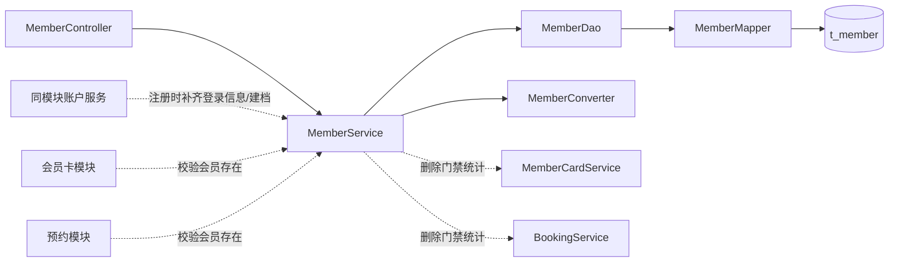

# 瑜伽普拉提会员管理详细设计文档

**更新：2026-10-12。** `t_member` 同时保存登录与会员信息；本节为完整字段与建表 SQL 的唯一依据。用户端注册、登录与鉴权见[用户端接口详细设计](用户端接口详细设计.md) §2.2.4～§2.2.8；管理端会员资料与登录资格统一在本文 §2.2 定义。

# 1、数据架构

## 1.2 数据库逻辑模型

### 1.2.1 `t_member` 字段定义

| 字段 | 中文名        | 类型              | 必填 | 默认值 | 说明 |
|---|------------|-----------------|---|---|---|
| `id` | 会员ID       | bigint unsigned | 是 | — |  |
| `wechat_openid` | 微信 openid  | varchar(64)     | 否 | NULL | 三期预留，二期不写入 |
| `wechat_unionid` | 微信 unionid | varchar(64)     | 否 | NULL | 三期预留，二期不写入 |
| `status` | 账号状态       | tinyint         | 是 | 1 | 1 正常／0 停用，仅控制登录资格 |
| `auth_version` | 登录态版本号 | bigint unsigned | 是 | 0 | 新建会员为 0；每次启停用与 status 同一更新递增；用于撤销旧登录态 |
| `last_login_time` | 最后登录时间     | datetime        | 否 | NULL | 仅登录成功更新 |
| `phone` | 手机号        | varchar(32)     | 是 | — |  |
| `password` | 密码       | varchar(100)    | 否 | NULL | BCrypt；为空表示未注册，仅用户端注册／忘记密码写入 |
| `phone_last4` | 手机号后4位     | varchar(4)      | 是 | — |  |
| `name` | 会员显示名      | varchar(64)     | 是 | — |  |
| `gender` | 性别         | tinyint         | 是 | 0 | `0` 未知；`1` 男；`2` 女 |
| `level` | 会员等级       | tinyint         | 是 | 0 |   |
| `create_by` | 创建人        | bigint unsigned | 否 | NULL | 公共审计填充 |
| `create_time` | 创建时间       | datetime        | 是 | CURRENT_TIMESTAMP | 公共审计填充 |
| `update_by` | 更新人        | bigint unsigned | 否 | NULL | 公共审计填充 |
| `update_time` | 更新时间       | datetime        | 是 | CURRENT_TIMESTAMP | ON UPDATE |

### 1.2.2 枚举值

| 枚举 | 值 | 文案 |
|---|---:|---|
| `gender` | 0 | 未知 |
| `gender` | 1 | 男 |
| `gender` | 2 | 女 |
| `level` | 0 | V0 普通会员 |
| `status` | 1 | 正常 |
| `status` | 0 | 停用 |

### 1.2.3 字段规则

手机号唯一且二期不可修改；显示名由系统生成。管理端会员新增／编辑只维护档案字段，不得接受密码哈希、微信标识、账号状态、登录态版本号或最后登录时间。注册时补齐凭证；管理端不另提供“清除账户凭证”接口，删除会员遵循卡与预约引用门禁，凭证随会员行一并删除。凭证不得通过会员 VO、日志或导出回显。

`auth_version` 是服务端内部撤销标识，不通过会员 VO 或 LoginVO 返回，也不接受客户端设置。新建会员由数据库默认置 0；登录、档案修改、退出登录不递增。每次启停用原子递增，永不重置或回退；给已有未注册档案补齐密码时保留原版本。忘记密码沿用“不批量撤销旧会话”的约定，不修改版本号。请求校验以数据库当前版本为准，不使用可能过期的会员状态缓存。


## 1.3 数据库物理模型

### 1.3.1 建表语句

```sql
CREATE TABLE `t_member` (
  `id`          bigint unsigned NOT NULL COMMENT '会员ID',
  `wechat_openid` varchar(64) DEFAULT NULL COMMENT '微信openid（三期预留）',
  `wechat_unionid` varchar(64) DEFAULT NULL COMMENT '微信unionid（三期预留）',
  `status` tinyint NOT NULL DEFAULT 1 COMMENT '账号状态：1正常 0停用',
  `auth_version` bigint unsigned NOT NULL DEFAULT 0 COMMENT '登录态版本号，每次启停用递增',
  `last_login_time` datetime DEFAULT NULL COMMENT '最后登录时间',
  `phone`       varchar(32)  NOT NULL COMMENT '手机号',
  `password` varchar(100) DEFAULT NULL COMMENT '密码',
  `phone_last4` varchar(4)  NOT NULL COMMENT '手机号后4位',
  `name`        varchar(64)  NOT NULL COMMENT '会员显示名',
  `gender`      tinyint      NOT NULL DEFAULT 0 COMMENT '性别：0未知 1男 2女',
  `level`       tinyint      NOT NULL DEFAULT 0 COMMENT '会员等级',
  `create_by`   bigint unsigned DEFAULT NULL COMMENT '创建人ID',
  `create_time` datetime     NOT NULL DEFAULT CURRENT_TIMESTAMP COMMENT '创建时间',
  `update_by`   bigint unsigned DEFAULT NULL COMMENT '更新人ID',
  `update_time` datetime     NOT NULL DEFAULT CURRENT_TIMESTAMP ON UPDATE CURRENT_TIMESTAMP COMMENT '更新时间',
  PRIMARY KEY (`id`),
  UNIQUE KEY `uk_member_phone` (`phone`),
  INDEX `idx_member_phone_last4` (`phone_last4`),
  UNIQUE KEY `uk_member_wechat_openid` (`wechat_openid`)
) ENGINE=InnoDB DEFAULT CHARSET=utf8mb4 COLLATE=utf8mb4_unicode_ci COMMENT='会员与登录信息表';
```

### 1.3.2 索引设计

| 索引 | 类型     | 用途                                            |
|---|--------|-----------------------------------------------|
| `PRIMARY KEY (id)` | 主键     | 按 ID 查询详情、跨模块引用                               |
| `uk_member_phone (phone)` | 唯一     | 手机号唯一（`BR-会员-004`）；注册时按手机号定位已有档案（`BR-账号-011`） |
| `idx_member_phone_last4 (phone_last4)` | 索引     | 手机号后四位                                        |
| `uk_member_wechat_openid (wechat_openid)` | 唯一（可空） | 微信登录预留；二期允许多条 NULL，不写入                        |

---

# 2、接口

## 2.2 会员管理接口

| # | 方法 | 路径 | 功能 | 登录 |
|---:|---|---|---|:---:|
| 1 | GET | `/admin/members` | 查询会员列表 | 是 |
| 2 | GET | `/admin/members/{memberId}` | 查询会员详情 | 是 |
| 3 | POST | `/admin/members` | 新增会员 | 是 |
| 4 | PUT | `/admin/members/{memberId}` | 修改会员 | 是 |
| 5 | DELETE | `/admin/members/{memberId}` | 删除会员（物理，带引用门禁） | 是 |
| 6 | PUT | `/admin/members/{memberId}/status` | 停用／启用登录资格 | 是 |


### 2.2.1 查询会员列表

`GET /admin/members`

列表按 `id DESC` 排序。支持按手机号、显示名模糊查询，以及按会员等级精确筛选。

#### 请求参数

| 参数 | 位置 | 类型 | 必填 | 说明                              |
|---|---|---|---|---------------------------------|
| `Authorization` | header | string | 是 | Bearer <管理端 token>，不能使用会员 token |
| `phone_last4` | query | string | 否 | 手机号后4位                          |
| `name` | query | string | 否 | 会员显示名，模糊匹配，最长 64                |
| `level` | query | integer | 否 | 会员等级，精确匹配；本期仅支持 0（V0 普通会员）      |
| `pageNum` | query | integer | 否 | 默认 1，最小 1                       |
| `pageSize` | query | integer | 否 | 默认 10，最大 100                    |

> 返回示例

> 200 Response

```json
{
  "total": 1,
  "rows": [
    {
      "id": "1856739201475235901",
      "phone": "13800138000",
      "name": "忻会员8000",
      "gender": 1,
      "genderText": "男",
      "level": 0,
      "levelText": "V0 普通会员",
      "registered": false,
      "status": 1,
      "statusText": "正常",
      "createTime": "2026-10-03 10:00:00",
      "updateTime": "2026-10-03 10:00:00"
    }
  ],
  "code": 200,
  "msg": "查询成功"
}
```

#### 返回结果

| 状态码 | 状态码含义 | 说明 | 数据模型 |
|:---|---|---|---|
| 200 | 成功 | 分页返回会员列表 | `TableDataInfo<MemberListItemVO>` |
| 401 | 登录失效 | 管理端未登录或 token 无效 | `AjaxResult<Void>` |
| 500 | 参数校验失败 | phone 或 name 长度超限、level 取值非法或分页参数超出范围 | `AjaxResult<Void>` |

### 2.2.2 查询会员详情

`GET /admin/members/{memberId}`

返回会员档案详情，字段与列表项一致；不返回密码哈希、微信标识等登录凭证。

#### 请求参数

| 参数 | 位置 | 类型 | 必填 | 说明 |
|---|---|---|---|---|
| `Authorization` | header | string | 是 | Bearer <管理端 token>，不能使用会员 token |
| `memberId` | path | string | 是 | 会员 ID，字符串形式的雪花 ID |

> 返回示例

> 200 Response

```json
{
  "code": 200,
  "msg": "查询成功",
  "data": {
    "id": "1856739201475235901",
    "phone": "13800138000",
    "name": "忻会员8000",
    "gender": 1,
    "genderText": "男",
    "level": 0,
    "levelText": "V0 普通会员",
    "registered": false,
    "status": 1,
    "statusText": "正常",
    "createTime": "2026-10-03 10:00:00",
    "updateTime": "2026-10-03 10:00:00"
  }
}
```

#### 返回结果

| 状态码 | 状态码含义 | 说明 | 数据模型 |
|:---|---|---|---|
| 200 | 成功 | 返回会员详情 | `AjaxResult<MemberDetailVO>` |
| 401 | 登录失效 | 管理端未登录或 token 无效 | `AjaxResult<Void>` |
| 404 | 会员不存在 | 会员不存在或已被删除 | `AjaxResult<Void>` |
| 500 | 参数校验失败 | memberId 缺失或格式非法 | `AjaxResult<Void>` |

### 2.2.3 新增会员

`POST /admin/members`

管理端只建立会员档案，不设置密码或登录凭证。显示名由系统生成；性别与等级缺省取 0。成功不返回新建会员 ID。

#### 请求参数

| 参数 | 位置 | 类型 | 必填 | 说明 |
|---|---|---|---|---|
| `Authorization` | header | string | 是 | Bearer <管理端 token>，不能使用会员 token |
| `phone` | body | string | 是 | 手机号，非空，最长 32，校验手机号格式 |
| `gender` | body | integer | 否 | 0 未知／1 男／2 女；缺省为 0 |
| `level` | body | integer | 否 | 本期仅支持 0（V0 普通会员）；缺省为 0 |


> 返回示例

> 200 Response

```json
{
  "code": 200,
  "msg": "操作成功"
}
```

#### 返回结果

| 状态码 | 状态码含义 | 说明 | 数据模型 |
|:---|---|---|---|
| 200 | 成功 | 建档成功，不返回新建会员 ID | `AjaxResult<Void>` |
| 401 | 登录失效 | 管理端未登录或 token 无效 | `AjaxResult<Void>` |
| 409 | 手机号已建档 | 该手机号已建立会员档案 | `AjaxResult<Void>` |
| 500 | 参数校验失败 | phone 缺失或格式非法、gender 或 level 取值非法 | `AjaxResult<Void>` |

### 2.2.4 修改会员

`PUT /admin/members/{memberId}`

全量编辑会员档案，只维护性别与等级；手机号不可修改，显示名由系统生成。请求中携带 phone、name、登录字段或 registered 时忽略，账号状态与凭证不由本接口维护。

#### 请求参数

| 参数 | 位置 | 类型 | 必填 | 说明 |
|---|---|---|---|---|
| `Authorization` | header | string | 是 | Bearer <管理端 token>，不能使用会员 token |
| `memberId` | path | string | 是 | 会员 ID，字符串形式的雪花 ID |
| `gender` | body | integer | 否 | 0 未知／1 男／2 女，字段约束同 MemberUpdateDTO |
| `level` | body | integer | 否 | 本期仅支持 0（V0 普通会员），字段约束同 MemberUpdateDTO |


> 返回示例

> 200 Response

```json
{
  "code": 200,
  "msg": "操作成功",
  "data": {
    "id": "1856739201475235901",
    "phone": "13800138000",
    "name": "忻会员8000",
    "gender": 1,
    "genderText": "男",
    "level": 0,
    "levelText": "V0 普通会员",
    "registered": false,
    "status": 1,
    "statusText": "正常",
    "createTime": "2026-10-03 10:00:00",
    "updateTime": "2026-10-03 10:00:00"
  }
}
```

#### 返回结果

| 状态码 | 状态码含义 | 说明 | 数据模型 |
|:---|---|---|---|
| 200 | 成功 | 返回更新后的会员详情 | `AjaxResult<MemberDetailVO>` |
| 401 | 登录失效 | 管理端未登录或 token 无效 | `AjaxResult<Void>` |
| 404 | 会员不存在 | 会员不存在或已被删除 | `AjaxResult<Void>` |
| 500 | 参数校验失败 | memberId 格式非法，或 gender、level 取值非法 | `AjaxResult<Void>` |

### 2.2.5 删除会员

`DELETE /admin/members/{memberId}`

物理删除会员，凭证随会员行删除，并撤销该会员全部会话，不自动重建。名下存在会员卡或任何预约时拒绝；引用统计失败同样拒绝，不降级放行。无请求体。

#### 请求参数

| 参数 | 位置 | 类型 | 必填 | 说明 |
|---|---|---|---|---|
| `Authorization` | header | string | 是 | Bearer <管理端 token>，不能使用会员 token |
| `memberId` | path | string | 是 | 会员 ID，字符串形式的雪花 ID |

> 返回示例

> 200 Response

```json
{
  "code": 200,
  "msg": "操作成功"
}
```

#### 返回结果

| 状态码 | 状态码含义 | 说明 | 数据模型 |
|:---|---|---|---|
| 200 | 成功 | 物理删除会员及登录凭证，撤销该会员全部会话 | `AjaxResult<Void>` |
| 401 | 登录失效 | 管理端未登录或 token 无效 | `AjaxResult<Void>` |
| 404 | 会员不存在 | 会员不存在或已被删除 | `AjaxResult<Void>` |
| 409 | 删除门禁不通过 | 名下仍有 N 张会员卡、N 条预约，或引用检查未完成；引用数量拼入提示语 | `AjaxResult<Void>` |
| 500 | 参数校验失败／系统异常 | memberId 格式非法或系统异常 | `AjaxResult<Void>` |

### 2.2.6 停用／启用

`PUT /admin/members/{memberId}/status`

翻转会员当前的登录资格状态：`1` 正常 → `0` 停用，`0` 停用 → `1` 正常。复用 `t_member.status`，数据库默认值为 `1`；客户端不传目标状态，无请求体。数据库在同一语句中执行 `status = 1 - status, auth_version = auth_version + 1`，不由客户端读取旧值后计算。每次成功翻转都递增版本，使该会员此前签发的会话立即失效。

本接口每执行成功一次翻转一次，**不具备幂等性**。前端提交期间禁用按钮；请求超时或结果未知时先重新查询会员状态，不自动重发翻转请求。切换为停用时撤销该会员全部登录态；启用不恢复旧 token，会员需要重新登录。

#### 请求参数

| 参数 | 位置 | 类型 | 必填 | 说明 |
|---|---|---|---|---|
| `Authorization` | header | string | 是 | Bearer <管理端 token>，不能使用会员 token |
| `memberId` | path | string | 是 | 会员 ID；服务端翻转当前状态，不接收目标 status |

> 返回示例

> 200 Response

```json
{
  "code": 200,
  "msg": "操作成功"
}
```

#### 返回结果

| 状态码 | 状态码含义 | 说明 | 数据模型 |
|:---|---|---|---|
| 200 | 成功 | 状态切换成功 | `AjaxResult<Void>` |
| 401 | 登录失效 | 管理端未登录或 token 无效 | `AjaxResult<Void>` |
| 404 | 会员不存在 | 会员不存在或已被删除 | `AjaxResult<Void>` |
| 500 | 参数校验失败／系统异常 | memberId 格式非法、存储状态不是 0／1 或系统异常 | `AjaxResult<Void>` |

## 2.3 数据模型

### 2.3.1 `MemberListItemVO` / `MemberDetailVO`

| 字段 | 类型 | 说明 |
|---|---|---|
| `id` | string | 会员ID（`Long` 自动转字符串） |
| `phone` | string | 手机号 |
| `name` | string | **会员显示名**（系统生成，如 `忻会员1195`；允许重复） |
| `gender` | integer | `0` 未知；`1` 男；`2` 女 |
| `genderText` | string | 性别名称（**码与名成对返回**） |
| `level` | integer | `0` = V0 普通会员 |
| `levelText` | string | 等级名称（**码与名成对返回**） |
| `status` / `statusText` | integer / string | 登录资格状态及文案，不代表会员业务状态 |
| `createTime` / `updateTime` | string | 时间字段（`@JsonFormat(pattern = "yyyy-MM-dd HH:mm:ss")`） |

两个 VO 字段相同（会员字段不多，列表不裁剪）。

### 2.3.2 `MemberCreateDTO` / `MemberUpdateDTO`

| 模型 | 字段 | 校验 |
|---|---|---|
| `MemberCreateDTO` | `phone` | `@NotBlank`、长度 ≤ 32、手机号格式；**不允许携带登录字段** |
| | `gender` / `level` | 可选；`gender` ∈ {0,1,2}；`level` 本期只接受 `0`。**不含 `name`**（显示名由服务端生成） |
| `MemberUpdateDTO` | `gender` / `level` | 同上；**不含 `phone`、`name` 与登录字段** |

### 2.3.3 `MemberQuery`

列表筛选与分页：`phone_last4`、`name`、`level`、`pageNum`、`pageSize`

---

# 3、开发架构

## 3.1 包结构

```text
com.techplant.yoga.member
├─ controller/MemberController.java
├─ service/MemberService.java              （同模块账户业务与会员卡／预约调用：注册、校验会员存在）
├─ service/impl/MemberServiceImpl.java
├─ dao/MemberDao.java、MemberDaoImpl.java
├─ mapper/MemberMapper.java
├─ domain/MemberDO.java
├─ dto/MemberCreateDTO.java、MemberUpdateDTO.java
├─ query/MemberQuery.java
├─ vo/MemberListItemVO.java、MemberDetailVO.java
├─ enums/MemberGenderEnum.java、MemberLevelEnum.java
└─ convert/MemberConverter.java
```


## 3.2 类与职责

| 类 | 职责 |
|---|---|
| `MemberController` | 接收请求、触发 `@Valid`、装配 `AjaxResult` / `TableDataInfo`；**不写业务规则**；方法标 `@Api`／`@ApiOperation` |
| `MemberService` / `MemberServiceImpl` | 会员 CRUD、删除引用门禁与会话撤销；`existsById(memberId)` 供会员卡／预约校验；`registerByPhone(phone, passwordHash)` 在同一事务内补齐已有未注册档案或新建 V0 会员，保留原会员 ID 与资料 |
| `MemberDao` / `MemberDaoImpl` | 组装筛选、分页、稳定排序；屏蔽 Mapper 细节 |
| `MemberMapper` | 继承 MyBatis-Plus `BaseMapper<MemberDO>` |
| `MemberDO` | 与 `t_member` 一一对应；**无逻辑删除字段**；包含仅控制登录资格的账号状态；审计字段标 `@TableField(fill = ...)` |
| `MemberCreateDTO` / `MemberUpdateDTO` | 新增／修改入参 |
| `MemberQuery` | 列表筛选与分页参数 |
| `MemberListItemVO` / `MemberDetailVO` | 接口出参，不暴露持久化实体 |
| `MemberGenderEnum` / `MemberLevelEnum` | 性别与等级的固定枚举及其**码→名**翻译（供出参成对返回） |
| `MemberConverter` | DTO、DO、VO 转换（手写，字段不多） |

## 3.3 调用关系



| 调用方 | 被调方 | 用途 |
|---|---|---|
| 会员 | `MemberCardService` | 删除门禁：统计该会员名下的**会员卡数量** |
| 会员 | `BookingService` | 删除门禁：统计该会员名下的**预约数量** |
| 同模块账户服务（注册） | `MemberService` | 按手机号补齐同一会员的登录信息，无档案则新建 V0 会员 |
| 会员卡 / 预约 | `MemberService` | 校验会员存在 |


---

# 4、运行流程

## 4.1 查询列表

1. Controller 接收并校验 `MemberQuery`（`pageSize` 上限 100）。
2. Service 调 DAO；DAO 选择字段、追加筛选条件与稳定排序（`id DESC`）。
3. Service 将 DO 转 `MemberListItemVO`（枚举翻译成名称、`name` 空值兜底为空字符串），Controller 装配 `TableDataInfo`。

## 4.2 查询详情

1. Service 按 ID 查询；不存在 → `404`。
2. 转 `MemberDetailVO` 返回。

## 4.3 新增会员

1. Controller 校验 `phone` 必填与格式、`gender`／`level` 取值。
2. Service 按 `phone` 查重；已存在 → `409`（"该手机号已建立会员档案"）。
3. Service 生成显示名 `name = "忻会员" + phone 后 4 位`（`BR-会员-010`）；转 DO 插入：`gender`／`level` 缺省取 0，`phone_last4` 取手机号后四位；主键由雪花 ID 生成，审计字段由公共处理器填充。
4. 只返回统一成功响应，不返回新 ID。

## 4.4 修改会员

1. Service 按 ID 查询；不存在 → `404`。
2. 只覆盖 `gender`、`level`；`name`、`phone` 与登录字段一律忽略。
3. 更新并返回最新详情。

## 4.5 删除会员

1. Service 按 ID 查询；不存在 → `404`。
2. 调 `MemberCardService.countByMemberId`；> 0 → `409`（带数量）。
3. 调 `BookingService.countByMemberId`；> 0 → `409`（带数量）。
4. 任一次统计抛异常 → 直接以 `ServiceException` 终止，**不继续删除**。
5. 事务内物理删除会员行，撤销该会员全部会话；Redis 清理及启停用后的会话撤销约定见本文 §4.7。凭证随会员行删除，不再有独立账号，也不自动重建。

## 4.6 注册时补齐登录信息（供同模块账户服务调用）

1. `MemberService.registerByPhone(phone, password)` 按手机号查会员。
2. 已注册拒绝重复注册；
3. 无档案则生成雪花 ID，新建含登录信息的 V0 会员；显示名为“忻会员”加手机号后四位。唯一键冲突返回 `409`，不得覆盖并发建档结果。
4. 全过程在数据库事务内完成，注册不签发 token；登录直接读取该会员，不再绑定账号或补建档案。完整注册与登录流程见用户端设计 §2.2.5～§2.2.8。

## 4.7 停用／启用会员登录资格

1. Controller 校验会员 ID；使用管理端登录态，不接受目标 `status`，不创建 DTO。
2. Service 开启数据库事务，以 `SELECT id, status, auth_version FROM t_member WHERE id = ? FOR UPDATE` 读取并锁定会员行；不存在返回 `404`，状态不在 `{0,1}` 时终止操作。登录的资格与版本读取也使用同一会员行锁。
3. 执行 `UPDATE t_member SET status = 1 - status, auth_version = auth_version + 1 WHERE id = ?`，同时按公共审计约定更新审计字段；在同一事务内取得新状态、新版本。禁止使用客户端旧状态或无锁的“先读、后写”逻辑。
4. 数据库提交即完成旧会话撤销：受保护请求读取会员当前 status 与 auth_version，停用或版本不匹配一律返回 401。随后尝试清理 Redis 旧会话；失败可按既有重试机制继续清理，不回滚已提交的状态，也不影响撤销生效。启用前不再依赖 Redis 全部清理完成，因为旧版本不会恢复有效。
5. 本次清理仅针对翻转前的旧版本，从 `member_token_index:<memberId>:<oldAuthVersion>` 取会话 ID，并核对会话版本等于该旧版本后删除；清理失败的重试也固定使用这个旧版本，不在重试时改成数据库最新版本。更早版本的残留由其原清理重试及会话 TTL 回收。不能整批删除会员所有版本索引，以免误删启用后新签发的会话。新状态为 `1` 时会员需重新登录；返回成功响应，前端刷新会员状态。
6. 每个独立请求都会翻转状态，不把重复请求当作幂等操作。结果未知时客户端先查询；只有明确回滚的数据库死锁／锁等待失败才允许重新执行完整事务，已提交或提交结果未知时不得盲目重试。

