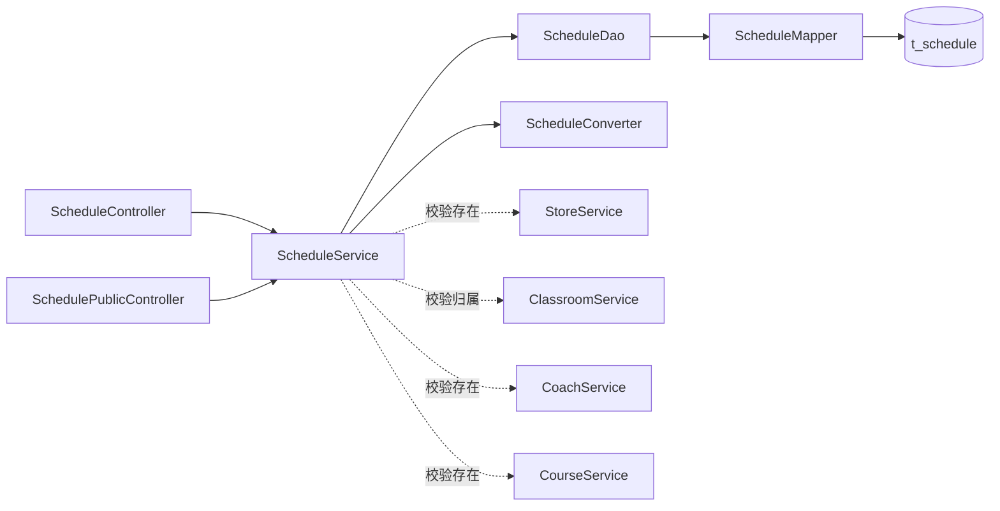

# 瑜伽普拉提排课管理详细设计文档

# 1、数据架构

## 1.1 数据库 ER 模型

略

## 1.2 数据库逻辑模型

### 1.2.1 `t_schedule` 字段定义

| 字段 | 中文名 | 类型 | 必填 | 默认值 | 说明 |
|---|---|---:|:---:|---:|---|
| `id` | 排课ID | bigint unsigned | 是 | — |  |
| `store_id` | 门店 | bigint unsigned | 是 | — | 门店ID |
| `course_id` | 课程 | bigint unsigned | 是 | — | 课程ID |
| `course_type` | 课种快照 | tinyint | 是 | — | `1` 团课；`2` 精品课；`3` 私教课；`4` 特色课 |
| `coach_id` | 教练 | bigint unsigned | 是 | — | 教练ID |
| `classroom_id` | 教室 | bigint unsigned | 是 | — | 教室ID |
| `schedule_date` | 上课日期 | date | 是 | — | 排课日期 |
| `start_time` | 开始时间 | datetime | 是 | — | 开始时间                                     |
| `end_time` | 结束时间 | datetime | 是 | — | 结束时间 |
| `max_persons` | 最大人数 | int | 是 | — | 最大人数 |
| `min_persons` | 最低开课人数 | int | 是 | `2` | 最低开课人数 |
| `booked_persons` | 已预约人数 | int | 是 | `0` | 已预约人数 |
| `status` | 状态 | tinyint | 是 | `1` | `1` 待上架；`2` 已上架；`3` 已取消；`4`已结束 |
| `create_by` | 创建人 | bigint unsigned | 否 | NULL | 公共审计填充 |
| `create_time` | 创建时间 | datetime | 是 | CURRENT_TIMESTAMP | 公共审计填充 |
| `update_by` | 更新人 | bigint unsigned | 否 | NULL | 公共审计填充 |
| `update_time` | 更新时间 | datetime | 是 | CURRENT_TIMESTAMP | ON UPDATE |

### 1.2.2 枚举值与状态全量视图

**落库的 `status` 只有4个值：**

| 值 | 文案 | 用户端可见 | 可编辑 |
|---:|---|:--:|:--:|
| 1 | 待上架 | ❌ | ✅ |
| 2 | 已上架 | ✅ | ❌ |
| 3 | 已取消 | **✅** | ❌ |
| 4 | 已结束 | **✅** | ❌ |


## 1.3 数据库物理模型

### 1.3.1 建表语句

```sql
CREATE TABLE `t_schedule` (
  `id`             bigint unsigned NOT NULL COMMENT '排课ID',
  `store_id`       bigint unsigned NOT NULL COMMENT '门店ID',
  `course_id`      bigint unsigned NOT NULL COMMENT '课程ID',
  `course_type`    tinyint      NOT NULL COMMENT '课种快照：1团课 2精品课 3私教课 4特色课',
  `coach_id`       bigint unsigned NOT NULL COMMENT '教练ID',
  `classroom_id`   bigint unsigned NOT NULL COMMENT '教室ID',
  `schedule_date`  date NOT NULL COMMENT '上课日期',
  `start_time`     datetime NOT NULL COMMENT '开始时间',
  `end_time`       datetime NOT NULL COMMENT '结束时间',
  `max_persons`    int NOT NULL COMMENT '最大人数',
  `min_persons`    int NOT NULL DEFAULT 2 COMMENT '最低开课人数',
  `booked_persons` int NOT NULL DEFAULT 0 COMMENT '已预约人数',
  `status`         tinyint NOT NULL DEFAULT 1 COMMENT '状态：1待上架 2已上架 3已取消 4已结束',
  `create_by`      bigint unsigned DEFAULT NULL COMMENT '创建人ID',
  `create_time`    datetime NOT NULL DEFAULT CURRENT_TIMESTAMP COMMENT '创建时间',
  `update_by`      bigint unsigned DEFAULT NULL COMMENT '更新人ID',
  `update_time`    datetime NOT NULL DEFAULT CURRENT_TIMESTAMP ON UPDATE CURRENT_TIMESTAMP COMMENT '更新时间',
  PRIMARY KEY (`id`)
) ENGINE=InnoDB DEFAULT CHARSET=utf8mb4 COLLATE=utf8mb4_unicode_ci COMMENT='排课信息表';
```

---

# 2、接口


## 2.2 排课管理接口

| # | 方法 | 路径 | 功能 | 登录 |
|---:|---|---|---|:---:|
| 1 | GET | `/admin/schedules` | 查询排课列表 | 是 |
| 2 | GET | `/admin/schedules/{scheduleId}` | 查询排课详情 | 是 |
| 3 | POST | `/admin/schedules` | 新增排课 | 是 |
| 4 | PUT | `/admin/schedules/{scheduleId}` | 修改排课 | 是 |
| 5 | PUT | `/admin/schedules/{scheduleId}/status` | 状态流转（上架／下架／取消） | 是 |
| 6 | DELETE | `/admin/schedules/{scheduleId}` | 删除排课 | 是 |

### 2.2.1 查询排课列表

`GET /admin/schedules`

列表按 `start_time DESC, id DESC` 排序。

#### 请求参数

| 参数 | 位置 | 类型 | 必填 | 说明 |
|---|---|---|---|---|
| `storeId` | query | string | 否 | 门店 ID |
| `courseId` | query | string | 否 | 课程 ID |
| `courseType` | query | integer | 否 | 课种快照：1 团课／2 精品课／3 私教课／4 特色课 |
| `coachId` | query | string | 否 | 教练 ID |
| `startDate` | query | string | 否 | 起始日期（含），yyyy-MM-dd，按 schedule_date 筛选 |
| `endDate` | query | string | 否 | 结束日期（含），yyyy-MM-dd，按 schedule_date 筛选 |
| `status` | query | integer | 否 | 1 待上架／2 已上架／3 已取消／4 已结束|
| `pageNum` | query | integer | 是 | 页码，最小 1 |
| `pageSize` | query | integer | 是 | 每页条数，1～100 |

> 返回示例

> 200 Response

```json
{
  "total": 1,
  "rows": [
    {
      "id": "1856739201475239001",
      "storeId": "1856739201475235901",
      "storeName": "徐汇店",
      "courseId": "1856739201475238001",
      "courseName": "哈他瑜伽",
      "courseType": 1,
      "courseTypeName": "团课",
      "coachId": "1856739201475237001",
      "coachName": "王老师",
      "classroomId": "1856739201475236001",
      "classroomName": "瑜伽团课大教室",
      "scheduleDate": "2026-10-03",
      "startTime": "2026-10-03 19:00:00",
      "endTime": "2026-10-03 20:00:00",
      "maxPersons": 20,
      "minPersons": 2,
      "bookedPersons": 0,
      "status": 2,
      "statusText": "已上架"
    }
  ],
  "code": 200,
  "msg": "查询成功"
}
```

#### 返回结果

| 状态码 | 状态码含义 | 说明 | 数据模型 |
|:---|---|---|---|
| 200 | 成功 | 分页返回排课列表 | `TableDataInfo<ScheduleListItemVO>` |
| 401 | 登录失效 | 管理端未登录或 token 无效 | `AjaxResult<Void>` |
| 400 | 参数校验失败 | ID 或日期格式非法、courseType 或 status 取值非法、分页参数缺失或超出范围 | `AjaxResult<Void>` |

### 2.2.2 查询排课详情

`GET /admin/schedules/{scheduleId}`

返回排课详情，字段与列表项一致。服务端补齐门店、课程、教练与教室名称，并按 `status` 返回 `statusText`。

#### 请求参数

| 参数 | 位置 | 类型 | 必填 | 说明 |
|---|---|---|---|---|
| `scheduleId` | path | string | 是 | 排课 ID，字符串形式的雪花 ID |

> 返回示例

> 200 Response

```json
{
  "code": 200,
  "msg": "查询成功",
  "data": {
    "id": "1856739201475239001",
    "storeId": "1856739201475235901",
    "storeName": "徐汇店",
    "courseId": "1856739201475238001",
    "courseName": "哈他瑜伽",
    "courseType": 1,
    "courseTypeName": "团课",
    "coachId": "1856739201475237001",
    "coachName": "王老师",
    "classroomId": "1856739201475236001",
    "classroomName": "瑜伽团课大教室",
    "scheduleDate": "2026-10-03",
    "startTime": "2026-10-03 19:00:00",
    "endTime": "2026-10-03 20:00:00",
    "maxPersons": 20,
    "minPersons": 2,
    "bookedPersons": 0,
    "status": 2,
    "statusText": "已上架"
  }
}
```

#### 返回结果

| 状态码 | 状态码含义 | 说明 | 数据模型 |
|:---|---|---|---|
| 200 | 成功 | 返回排课详情 | `AjaxResult<ScheduleDetailVO>` |
| 401 | 登录失效 | 管理端未登录或 token 无效 | `AjaxResult<Void>` |
| 404 | 排课不存在 | 排课不存在或已被删除 | `AjaxResult<Void>` |
| 400 | 参数校验失败 | scheduleId 缺失或格式非法 | `AjaxResult<Void>` |

### 2.2.3 新增排课

`POST /admin/schedules`

#### 请求参数

| 参数 | 位置 | 类型 | 必填 | 说明 |
|---|---|---|---|---|
| `storeId` | body | string | 是 | 门店 ID，门店必须存在 |
| `courseId` | body | string | 是 | 课程 ID，课程必须存在；课种快照由服务端读取 |
| `coachId` | body | string | 是 | 教练 ID，教练必须存在 |
| `classroomId` | body | string | 是 | 教室 ID，教室必须存在且归属所选门店 |
| `startTime` | body | string | 是 | 开始时间，yyyy-MM-dd HH:mm:ss；今天起 14 天内 |
| `endTime` | body | string | 是 | 结束时间，yyyy-MM-dd HH:mm:ss；晚于开始时间且同一自然日 |
| `maxPersons` | body | integer | 是 | 最大人数，大于 0 |
| `minPersons` | body | integer | 是 | 最低开课人数，1 ≤ minPersons ≤ maxPersons |

> 返回示例

> 200 Response

```json
{
  "code": 200,
  "msg": "操作成功"
}
```

#### 返回结果

| 状态码 | 状态码含义 | 说明 | 数据模型 |
|:---|---|---|---|
| 200 | 成功 | 新增成功，不返回新建排课 ID | `AjaxResult<Void>` |
| 401 | 登录失效 | 管理端未登录或 token 无效 | `AjaxResult<Void>` |
| 404 | 关联对象不存在 | 门店、课程、教练或教室不存在或已被删除 | `AjaxResult<Void>` |
| 409 | 业务校验失败 | 教室不属所选门店、时间或人数非法、超过排课窗口、重复排课或教练时间冲突 | `AjaxResult<Void>` |
| 400 | 参数校验失败 | 必填字段缺失、ID 或时间格式非法 | `AjaxResult<Void>` |

### 2.2.4 修改排课

`PUT /admin/schedules/{scheduleId}`

#### 请求参数

| 参数 | 位置 | 类型 | 必填 | 说明 |
|---|---|---|---|---|
| `scheduleId` | path | string | 是 | 排课 ID，字符串形式的雪花 ID |
| `storeId` | body | string | 是 | 门店 ID，门店必须存在 |
| `courseId` | body | string | 是 | 课程 ID，课程必须存在；课种快照由服务端读取 |
| `coachId` | body | string | 是 | 教练 ID，教练必须存在 |
| `classroomId` | body | string | 是 | 教室 ID，教室必须存在且归属所选门店 |
| `startTime` | body | string | 是 | 开始时间，yyyy-MM-dd HH:mm:ss；今天起 14 天内 |
| `endTime` | body | string | 是 | 结束时间，yyyy-MM-dd HH:mm:ss；晚于开始时间且同一自然日 |
| `maxPersons` | body | integer | 是 | 最大人数，大于 0 |
| `minPersons` | body | integer | 是 | 最低开课人数，1 ≤ minPersons ≤ maxPersons |

> 返回示例

> 200 Response

```json
{
  "code": 200,
  "msg": "操作成功",
  "data": {
    "id": "1856739201475239001",
    "storeId": "1856739201475235901",
    "storeName": "徐汇店",
    "courseId": "1856739201475238001",
    "courseName": "哈他瑜伽",
    "courseType": 1,
    "courseTypeName": "团课",
    "coachId": "1856739201475237001",
    "coachName": "王老师",
    "classroomId": "1856739201475236001",
    "classroomName": "瑜伽团课大教室",
    "scheduleDate": "2026-10-03",
    "startTime": "2026-10-03 19:00:00",
    "endTime": "2026-10-03 20:00:00",
    "maxPersons": 20,
    "minPersons": 2,
    "bookedPersons": 0,
    "status": 1,
    "statusText": "待上架"
  }
}
```

#### 返回结果

| 状态码 | 状态码含义 | 说明 | 数据模型 |
|:---|---|---|---|
| 200 | 成功 | 返回更新后的排课详情 | `AjaxResult<ScheduleDetailVO>` |
| 401 | 登录失效 | 管理端未登录或 token 无效 | `AjaxResult<Void>` |
| 404 | 排课或关联对象不存在 | 排课、门店、课程、教练或教室不存在或已被删除 | `AjaxResult<Void>` |
| 409 | 编辑门禁或业务校验失败 | 非待上架不可编辑；其他业务校验与新增一致，冲突检查排除自身 | `AjaxResult<Void>` |
| 400 | 参数校验失败 | 必填字段缺失、ID 或时间格式非法 | `AjaxResult<Void>` |

### 2.2.5 状态流转

`PUT /admin/schedules/{scheduleId}/status`

#### 请求参数

| 参数 | 位置 | 类型 | 必填 | 说明 |
|---|---|---|---|---|
| `scheduleId` | path | string | 是 | 排课 ID，字符串形式的雪花 ID |
| `status` | query | integer | 是 | 目标状态：1 下架至待上架／2 上架／3 取消 |

> 返回示例

> 200 Response

```json
{
  "code": 200,
  "msg": "操作成功"
}
```

#### 返回结果

| 状态码 | 状态码含义 | 说明 | 数据模型 |
|:---|---|---|---|
| 200 | 成功 | 状态更新成功；允许的重复设置按幂等成功处理 | `AjaxResult<Void>` |
| 401 | 登录失效 | 管理端未登录或 token 无效 | `AjaxResult<Void>` |
| 404 | 排课不存在 | 排课不存在或已被删除 | `AjaxResult<Void>` |
| 409 | 状态流转非法 | 已取消或已结束不可变更，或当前状态不允许目标操作 | `AjaxResult<Void>` |
| 400 | 参数校验失败 | scheduleId 格式非法，或 status 缺失、不在 1／2／3 中 | `AjaxResult<Void>` |

### 2.2.6 删除排课

`DELETE /admin/schedules/{scheduleId}`

按 ID 删除，无请求体。

#### 请求参数

| 参数 | 位置 | 类型 | 必填 | 说明 |
|---|---|---|---|---|
| `scheduleId` | path | string | 是 | 排课 ID，字符串形式的雪花 ID |

> 返回示例

> 200 Response

```json
{
  "code": 200,
  "msg": "操作成功"
}
```

#### 返回结果

| 状态码 | 状态码含义 | 说明 | 数据模型 |
|:---|---|---|---|
| 200 | 成功 | 删除成功 | `AjaxResult<Void>` |
| 401 | 登录失效 | 管理端未登录或 token 无效 | `AjaxResult<Void>` |
| 404 | 排课不存在 | 排课不存在或已被删除 | `AjaxResult<Void>` |
| 400 | 参数校验失败 | scheduleId 缺失或格式非法 | `AjaxResult<Void>` |

### 2.2.7 结束排课

`JOB /admin/schedules/{scheduleId}`

找到正常上课的课程，课程时间<当前时间，将排课状态置为已结束，半小时执行一次。


## 2.3 数据模型

### 2.3.1 `ScheduleListItemVO` / `ScheduleDetailVO`

| 字段 | 类型 | 说明 |
|---|---|---|
| `id` | string | 排课ID |
| `storeId` / `storeName` | string | 门店 |
| `courseId` / `courseName` | string | 课程 |
| `courseType` | integer | **课种快照**（排课自有字段，不回读课程） |
| `courseTypeName` | string | **课种名称**（按 `CourseTypeEnum` 翻译快照码；用户端卡片与详情页直接显示它） |
| `coachId` / `coachName` | string | 教练 |
| `classroomId` / `classroomName` | string | 教室 |
| `startTime` / `endTime` | string | `yyyy-MM-dd HH:mm:ss` |
| `scheduleDate` | string | **上课日期** `yyyy-MM-dd`（筛选与日期条都用它） |
| `maxPersons` / `minPersons` | integer | 最大人数／最低开课人数 |
| `bookedPersons` | integer | 已预约人数（一期恒 0） |
| `status` | integer | 落库状态码 `1`/`2`/`3`/`4` |
| `statusText` | string | 展示文案：待上架／已上架／已取消／已结束 |

两个 VO 字段相同（列表已经带了排课全部业务字段，不再裁剪）。

### 2.3.2 `ScheduleCreateDTO` / `ScheduleUpdateDTO`

两个请求模型字段相同：`storeId`、`courseId`、`coachId`、`classroomId`、`startTime`、`endTime`、`maxPersons`、`minPersons`。**不含** `status`、`bookedPersons`、**`courseType`** 与 **`scheduleDate`**（课种快照由服务端从课程取、上课日期由服务端从开始时间推导）。使用 `@Valid` 校验非空；业务范围校验在 service。

### 2.3.3 `ScheduleQuery`

列表筛选与分页：`storeId`、`courseId`、`courseType`、`coachId`、`startDate`、`endDate`、`status`、`pageNum`、`pageSize`（上限 100）。

### 2.3.4 状态接口的入参

只有一个字段，直接用查询参数 `status`，**不建 DTO**。

---

# 3、开发架构

## 3.1 包结构

```text
com.techplant.yoga.schedule
├─ controller/ScheduleController.java          （管理端）
├─ controller/SchedulePublicController.java    （用户端，契约见《用户端接口详细设计》）
├─ service/ScheduleService.java                （同时供用户端查询）
├─ service/impl/ScheduleServiceImpl.java
├─ dao/ScheduleDao.java、ScheduleDaoImpl.java
├─ mapper/ScheduleMapper.java
├─ domain/ScheduleDO.java
├─ dto/ScheduleCreateDTO.java、ScheduleUpdateDTO.java
├─ query/ScheduleQuery.java
├─ vo/ScheduleListItemVO.java、ScheduleDetailVO.java
├─ enums/ScheduleStatusEnum.java               （1待上架 2已上架 3已取消 4已结束 ＋ 两套文案）
└─ convert/ScheduleConverter.java
```

## 3.2 类与职责

| 类 | 职责 |
|---|---|
| `ScheduleController` | 管理端请求、校验、装配响应；**不写业务规则** |
| `SchedulePublicController` | 用户端免登录查询（`@Anonymous`），只读 |
| `ScheduleService` / `ScheduleServiceImpl` | 关联对象与教室归属校验、时间与人数校验、14 天窗口、重复排课与教练时间冲突校验、编辑与状态流转校验、排课 CRUD；对外提供用户端查询方法 |
| `ScheduleDao` / `ScheduleDaoImpl` | 组装筛选、分页、稳定排序；区间相交查询与完全同时段查询 |
| `ScheduleMapper` | 继承 `BaseMapper<ScheduleDO>` |
| `ScheduleDO` | 与 `t_schedule` 对应 |
| `ScheduleCreateDTO` / `ScheduleUpdateDTO` | 新增／修改入参（不含 `status`、`bookedPersons`） |
| `ScheduleQuery` | 列表筛选与分页 |
| `ScheduleListItemVO` / `ScheduleDetailVO` | 接口出参 |
| `ScheduleStatusEnum` | 按落库 `status` 返回状态文案；管理端：待上架／已上架／已取消／已结束，用户端：可约／已取消／已结束 |
| `ScheduleConverter` | DTO、DO、VO 转换（含跨模块名称补齐后的装配） |

## 3.3 调用关系



# 4、运行流程

## 4.1 查询列表
1. Controller 校验 `ScheduleQuery`（`pageSize` 上限 100、`status` ∈ {1,2,3,4}；按存储状态筛选）。
2. Service 调 DAO 分页查询（**日期区间直接筛 `schedule_date`**），按 `update_time DESC, id DESC` 排序（管理端列表；用户端排序见用户端接口详细设计）。
3. Service 批量调 `StoreService` / `CourseService` / `CoachService` / `ClassroomService` 补齐名称（**按 ID 去重后批量查，避免 N+1**）。
4. Service 按 `status` 通过 `ScheduleStatusEnum` 翻译 `statusText`，转 VO 返回。

## 4.2 查询详情
1. Service 按 ID 查询；不存在 → `404`。
2. 补齐四个对象的名称，关联资料已删除时名称为空字符串；按 `status` 翻译状态文案并返回。

## 4.3 新增排课

1. Controller 校验必填、ID 与时间格式。
2. Service 调 `StoreService`、`CourseService`、`CoachService`、`ClassroomService` 校验关联对象存在；不存在返回 `404`。
3. 校验教室归属所选门店，`startTime < endTime` 且同一自然日，`maxPersons > 0`、`1 <= minPersons <= maxPersons`，上课日期处于今天起 14 天内（含今天）。
4. **重复排课检查**：查询同一门店、同一课程、完全相同起止时间且 `status <> 3` 的排课；查到返回 `409`：“该门店该课程在此时间已有排课”。
5. **教练时间冲突检查**：查询同一教练、`status <> 3` 且满足 `已有 start_time < 新 endTime AND 已有 end_time > 新 startTime` 的排课；查到返回 `409`：“该教练在此时间段已有排课”。上一节结束时间等于下一节开始时间允许相接。
6. 校验通过后，从课程复制 `course_type`，由开始时间推导 `schedule_date`，插入 `status = 1`、`booked_persons = 0`；主键与审计字段由公共机制处理。
7. 返回统一成功响应，不返回新 ID。

## 4.4 修改排课

1. Controller 校验排课 ID、必填字段与时间格式。
2. Service 按 ID 查询排课；不存在返回 `404`，非待上架返回 `409`。
3. 执行新增流程第 2～5 步的校验；重复排课与教练时间冲突查询增加 `id <> 当前 scheduleId`，排除自身。
4. 更新资料字段；更换课程时刷新课种快照，开始时间变化时刷新 `schedule_date`，保留 `status`、`booked_persons`。
5. 返回最新 `ScheduleDetailVO`。

## 4.5 状态流转
1. Service 按 ID 查询排课；不存在返回 `404`。
2. `status ∈ {3,4}` → `409`（终态）。
3. 目标 = 当前 → **直接按成功返回**（幂等）。
4. 校验合法流转（`1→2`、`2→1`、`2→3`）；非法 → `409`。
5. 只更新 `status` 列；返回统一成功响应。

## 4.6 删除排课

1. Service 按 ID 查询排课；不存在返回 `404`。
2. 按 ID 删除排课记录，返回统一成功响应。

---

## 4.7 结束状态定时维护（后续交付）

1. 后续增加定时任务，以当前时间作为本轮截止时间，分批扫描 `status = 2 AND end_time < 本轮截止时间` 的排课。
2. 按排课 ID 且 `status = 2 AND end_time < 本轮截止时间` 条件更新 `status = 4`；已取消、已结束及已删除的记录不更新。任务只更新排课记录。
3. 更新失败的记录留待下一轮扫描，重复扫描不改变已结束的记录。
4. 任务频率和每批数量在交付时确定。查询与展示只读取 `status`；已结束状态以任务更新为准，查询接口不按时间推导或写入状态。

