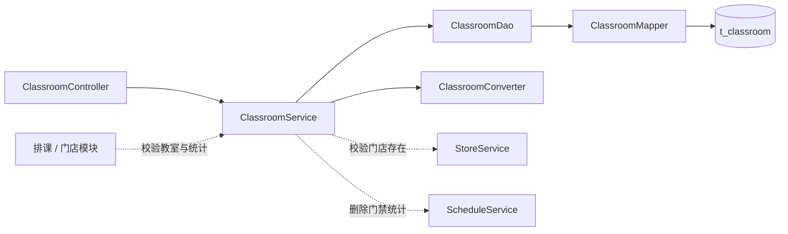

# 瑜伽普拉提教室管理详细设计文档

# 1、数据架构

## 1.1 数据库 ER 模型

略

## 1.2 数据库逻辑模型

### 1.2.1 `t_classroom` 字段定义

| 字段 | 中文名 | 类型 | 必填 | 默认值 | 说明 |
|---|---|---:|:---:|---:|---|
| `id` | 教室ID | bigint unsigned | 是 | — | 雪花 ID，应用侧生成 |
| `store_id` | 所属门店 | bigint unsigned | 是 | — | 归属门店；**只允许在新增时指定** |
| `name` | 教室名称 | varchar(32) | 是 | — | 同一门店内唯一 |
| `create_by` | 创建人 | bigint unsigned | 否 | NULL | 公共审计填充 |
| `create_time` | 创建时间 | datetime | 是 | CURRENT_TIMESTAMP | 公共审计填充 |
| `update_by` | 更新人 | bigint unsigned | 否 | NULL | 公共审计填充 |
| `update_time` | 更新时间 | datetime | 是 | CURRENT_TIMESTAMP | ON UPDATE |

### 1.2.2 枚举值

无

## 1.3 数据库物理模型

### 1.3.1 建表语句

```sql
CREATE TABLE `t_classroom` (
  `id`          bigint unsigned NOT NULL COMMENT '教室ID',
  `store_id`    bigint unsigned NOT NULL COMMENT '所属门店ID',
  `name`        varchar(32)  NOT NULL COMMENT '教室名称（同一门店内唯一）',
  `create_by`   bigint unsigned DEFAULT NULL COMMENT '创建人ID',
  `create_time` datetime NOT NULL DEFAULT CURRENT_TIMESTAMP COMMENT '创建时间',
  `update_by`   bigint unsigned DEFAULT NULL COMMENT '更新人ID',
  `update_time` datetime NOT NULL DEFAULT CURRENT_TIMESTAMP ON UPDATE CURRENT_TIMESTAMP COMMENT '更新时间',
  PRIMARY KEY (`id`),
  UNIQUE KEY `uk_classroom_store_name` (`store_id`, `name`),
  KEY `idx_classroom_store` (`store_id`)
) ENGINE=InnoDB DEFAULT CHARSET=utf8mb4 COLLATE=utf8mb4_unicode_ci COMMENT='教室信息表';
```

# 2、接口

## 2.2 教室管理接口

| # | 方法 | 路径 | 功能 | 登录 |
|---:|---|---|---|:---:|
| 1 | GET | `/admin/classrooms` | 查询教室列表 | 是 |
| 2 | POST | `/admin/classrooms` | 新增教室 | 是 |
| 3 | PUT | `/admin/classrooms/{classroomId}` | 修改教室 | 是 |
| 4 | DELETE | `/admin/classrooms/{classroomId}` | 删除教室| 是 |

### 2.2.1 查询教室列表

`GET /admin/classrooms`

列表按 `store_id ASC, name ASC, id DESC` 排序。排课表单必须传所属门店 ID。

#### 请求参数

| 参数 | 位置 | 类型 | 必填 | 说明 |
|---|---|---|---|---|
| `Authorization` | header | string | 是 | Bearer <管理端 token>，不能使用会员 token |
| `storeId` | query | string | 否 | 所属门店 ID；排课表单必传 |
| `name` | query | string | 否 | 教室名称，模糊匹配，最长 32 |
| `pageNum` | query | integer | 否 | 默认 1，最小 1 |
| `pageSize` | query | integer | 否 | 默认 10，最大 100 |

> 返回示例

> 200 Response

```json
{
  "total": 1,
  "rows": [
    {
      "id": "1856739201475236001",
      "storeId": "1856739201475235901",
      "storeName": "徐汇店",
      "name": "瑜伽团课大教室",
      "createTime": "2026-10-01 10:00:00",
      "updateTime": "2026-10-01 10:00:00"
    }
  ],
  "code": 200,
  "msg": "查询成功"
}
```

#### 返回结果

| 状态码 | 状态码含义 | 说明 | 数据模型 |
|:---|---|---|---|
| 200 | 成功 | 分页返回教室列表 | `TableDataInfo<ClassroomListItemVO>` |
| 401 | 登录失效 | 管理端未登录或 token 无效 | `AjaxResult<Void>` |
| 500 | 参数校验失败 | storeId 格式非法、name 超长或分页参数超出范围 | `AjaxResult<Void>` |


### 2.2.2 新增教室

`POST /admin/classrooms`

同一门店内教室名称唯一；所属门店只在新增时指定。成功不返回新建教室 ID。

#### 请求参数

| 参数 | 位置 | 类型 | 必填 | 说明 |
|---|---|---|---|---|
| `Authorization` | header | string | 是 | Bearer <管理端 token>，不能使用会员 token |
| `storeId` | body | string | 是 | 所属门店 ID，门店必须存在 |
| `name` | body | string | 是 | 教室名称，非空，最长 32，同一门店内唯一 |

> 请求示例

```json
{
  "storeId": "1856739201475235901",
  "name": "普拉提器械教室"
}
```

> 返回示例

> 200 Response

```json
{
  "code": 200,
  "msg": "操作成功"
}
```

#### 返回结果

| 状态码 | 状态码含义 | 说明 | 数据模型 |
|:---|---|---|---|
| 200 | 成功 | 新增成功，不返回新 ID | `AjaxResult<Void>` |
| 401 | 登录失效 | 管理端未登录或 token 无效 | `AjaxResult<Void>` |
| 404 | 门店不存在 | 门店不存在或已被删除 | `AjaxResult<Void>` |
| 409 | 名称重复 | 该门店下已存在同名教室 | `AjaxResult<Void>` |
| 500 | 参数校验失败 | 必填字段缺失、ID 格式非法或名称超长 | `AjaxResult<Void>` |


### 2.2.3 修改教室

`PUT /admin/classrooms/{classroomId}`

只修改名称，不允许换门店，请求中传 storeId 时忽略。同门店内名称不得与其他教室重复；即使存在未结束排课也允许改名。

#### 请求参数

| 参数 | 位置 | 类型 | 必填 | 说明 |
|---|---|---|---|---|
| `Authorization` | header | string | 是 | Bearer <管理端 token>，不能使用会员 token |
| `classroomId` | path | string | 是 | 教室 ID |
| `name` | body | string | 是 | 教室名称，非空，最长 32，同一门店内唯一 |

> 请求示例

```json
{
  "name": "普拉提小班课"
}
```

> 返回示例

> 200 Response

```json
{
  "code": 200,
  "msg": "操作成功"
}
```

#### 返回结果

| 状态码 | 状态码含义 | 说明 | 数据模型 |
|:---|---|---|---|
| 200 | 成功 | 修改成功 | `AjaxResult<Void>` |
| 401 | 登录失效 | 管理端未登录或 token 无效 | `AjaxResult<Void>` |
| 404 | 教室不存在 | 教室不存在或已被删除 | `AjaxResult<Void>` |
| 409 | 名称重复 | 该门店下已存在同名教室 | `AjaxResult<Void>` |
| 500 | 参数校验失败 | classroomId 格式非法、name 缺失或超长 | `AjaxResult<Void>` |


### 2.2.4 删除教室

`DELETE /admin/classrooms/{classroomId}`

物理删除，无请求体。存在未结束且为待上架或已上架的排课引用时拒绝，统计失败同样拒绝，不降级放行。

#### 请求参数

| 参数 | 位置 | 类型 | 必填 | 说明 |
|---|---|---|---|---|
| `Authorization` | header | string | 是 | Bearer <管理端 token>，不能使用会员 token |
| `classroomId` | path | string | 是 | 教室 ID |

> 返回示例

> 200 Response

```json
{
  "code": 200,
  "msg": "操作成功"
}
```

#### 返回结果

| 状态码 | 状态码含义 | 说明 | 数据模型 |
|:---|---|---|---|
| 200 | 成功 | 物理删除成功 | `AjaxResult<Void>` |
| 401 | 登录失效 | 管理端未登录或 token 无效 | `AjaxResult<Void>` |
| 404 | 教室不存在 | 教室不存在或已被删除 | `AjaxResult<Void>` |
| 409 | 删除门禁不通过 | 仍有 N 节未结束排课，或引用检查未完成；数量拼入提示语 | `AjaxResult<Void>` |
| 500 | 参数校验失败／系统异常 | classroomId 格式非法或系统异常 | `AjaxResult<Void>` |


## 2.3 数据模型

### 2.3.1 `ClassroomListItemVO`

| 字段 | 类型 | 说明 |
|---|---|---|
| `id` | string | 教室ID |
| `storeId` | string | 所属门店ID |
| `storeName` | string | 所属门店名称（跨模块补齐） |
| `name` | string | 教室名称 |
| `createTime` / `updateTime` | string | 时间字段 |

### 2.3.2 `ClassroomCreateDTO` / `ClassroomUpdateDTO`

- `ClassroomCreateDTO`：`storeId`、`name`，均必填。
- `ClassroomUpdateDTO`：**只有 `name`**（不定义 `storeId` 字段，从入参层面就杜绝换门店）。

### 2.3.3 `ClassroomQuery`

列表筛选与分页：`storeId`、`name`、`pageNum`、`pageSize`（上限 100）。

## 2.4 错误码

| code | 场景 | 文案 |
|---:|---|---|
| 200 | 成功 | 查询成功／操作成功 |
| 404 | 教室不存在 | 教室不存在或已被删除 |
| 404 | 所属门店不存在 | 门店不存在或已被删除 |
| 409 | 同门店内名称重复 | 该门店下已存在同名教室 |
| 409 | 仍有未结束的排课 | 该教室仍有 N 节未结束的排课，无法删除 |
| 409 | 引用统计失败 | 引用检查未完成，已拒绝本次删除 |
| 500 | 参数校验失败／系统异常 | 由统一异常处理器返回具体字段提示 |

---

# 3、开发架构

## 3.1 包结构

```text
com.techplant.yoga.classroom
├─ controller/ClassroomController.java
├─ service/ClassroomService.java           （同时供跨模块校验教室与统计）
├─ service/impl/ClassroomServiceImpl.java
├─ dao/ClassroomDao.java、ClassroomDaoImpl.java
├─ mapper/ClassroomMapper.java
├─ domain/ClassroomDO.java
├─ dto/ClassroomCreateDTO.java、ClassroomUpdateDTO.java
├─ query/ClassroomQuery.java
├─ vo/ClassroomListItemVO.java
└─ convert/ClassroomConverter.java
```

## 3.2 类与职责

| 类 | 职责 |
|---|---|
| `ClassroomController` | 接收请求、触发校验、装配响应；**不写业务规则** |
| `ClassroomService` / `ClassroomServiceImpl` | 门店存在校验、同门店内名称唯一校验、**删除门禁编排**、事务边界；并**对外**提供「校验教室存在且归属门店一致」与「统计某门店名下教室数」——排课与门店模块**直接依赖本 service**（**全项目统一不另立 QueryService**） |
| `ClassroomDao` / `ClassroomDaoImpl` | 组装筛选、分页、稳定排序 |
| `ClassroomMapper` | 继承 `BaseMapper<ClassroomDO>` |
| `ClassroomDO` | 与 `t_classroom` 对应；**无逻辑删除、无状态字段** |
| `ClassroomCreateDTO` / `ClassroomUpdateDTO` | 新增／修改入参（修改只有名称） |
| `ClassroomQuery` | 列表筛选与分页 |
| `ClassroomListItemVO` | 接口出参（含列表与编辑回填所需的全部字段） |
| `ClassroomConverter` | DTO、DO、VO 转换 |

## 3.3 调用关系




# 4、运行流程

## 4.1 查询列表
1. Controller 校验 `ClassroomQuery`（`pageSize` 上限 100）。
2. Service 调 DAO 分页查询，按 `store_id ASC, name ASC, id DESC` 排序。
3. Service 调 `StoreService` 批量补齐 `storeName`，转 VO 返回。

## 4.2 新增教室
1. Controller 校验 `storeId`、`name` 非空与长度。
2. Service 开启事务，通过 `StoreService.lockByIdsForUpdate` 锁定所属门店行并当前读，门店不存在返回 `404`；该锁与门店删除共用，持有到教室插入后提交，避免门店统计完成后又新增教室。
3. 校验该门店内同名教室不存在；重复 → `409`。
4. 插入并提交；主键与审计字段由公共机制处理。同门店同名教室的并发创建由数据库唯一键兜底，唯一冲突返回 `409`。

## 4.3 修改教室
1. Service 按 ID 查询；不存在 → `404`。
2. 按 `store_id + name` 校验重复（**排除自身**）；重复 → `409`。
3. **只更新 `name`**（`store_id` 不变）；返回统一成功响应。

## 4.4 删除教室

1. Service 在事务外预读所属门店 ID，不存在返回 `404`；预读只用于确定锁集合。
2. 开启数据库事务，先经 `StoreService.lockByIdsForUpdate` 锁所属门店，再按教室主键 `SELECT ... FOR UPDATE` 锁教室并当前读；重新检查存在性及所属门店未变化，不一致时回滚并有限重试。
3. 锁内调用 `ScheduleService.countActiveByClassroomId`，以当前读取得 `end_time > 当前时间 AND status IN (1,2)` 的引用并统计；大于 0 返回 `409`，提示引用数量；统计失败拒绝并回滚。
4. 无阻塞引用才物理删除并提交。持锁期间其他排课写入不能通过本教室存在性检查；删除提交后，后续写请求当前读得到不存在并返回 `404`。历史排课展示仍按空值兜底。
5. 遵循“门店 → 教练 → 课程 → 教室 → 排课”的公共顺序，本流程不需要的对象类型跳过，各类型内部按 ID 升序；明确回滚的死锁／锁超时有限重试，业务冲突不重试。

## 4.5 对外加锁契约

`ClassroomService.lockByIdsForUpdate(ids)` 对 ID 去重、升序后逐行按主键 `SELECT id ... FOR UPDATE`，加入调用方同一事务（不得使用 `REQUIRES_NEW`），对象缺失抛 `404`。锁持有至外层提交或回滚，不返回 DO；排课新增／修改和教室删除锁同一行。历史结束任务使用“仅锁现存行”入口，不能将该宽松口径用于新增或修改。
