# 瑜伽普拉提教练管理详细设计文档


# 1、数据架构

## 1.1 数据库 ER 模型
略

## 1.2 数据库逻辑模型

### 1.2.1 `t_coach` 字段定义

| 字段 | 中文名 | 类型 | 必填 | 默认值 | 说明 |
|---|---|---:|:---:|---:|---|
| `id` | 教练ID | bigint unsigned | 是 | — |  |
| `name` | 姓名 | varchar(32) | 是 | — |                                  |
| `avatar_url` | 头像 | varchar(255) | 否 | NULL | 图片 URL |
| `intro` | 简介 | varchar(512) | 否 | NULL | 纯文本 |
| `phone` | 联系电话 | varchar(32) | 否 | NULL | 管理端专用 |
| `gallery` | 相册 | json | 否 | NULL | **JSON 数组**，最多 5 个图片 URL |
| `level` | 教练等级 | tinyint | 否 | 0 | 教练等级：1-普通教练；2-金牌教练 |
| `create_by` | 创建人 | bigint unsigned | 否 | NULL | 公共审计填充 |
| `create_time` | 创建时间 | datetime | 是 | CURRENT_TIMESTAMP | 公共审计填充 |
| `update_by` | 更新人 | bigint unsigned | 否 | NULL | 公共审计填充 |
| `update_time` | 更新时间 | datetime | 是 | CURRENT_TIMESTAMP | ON UPDATE |

### 1.2.2 枚举值


| 枚举 | 值 | 文案 |
|---|--:|---|
| `level` | 1 | 普通教练 |
| `level` | 2 | 金牌教练 |

## 1.3 数据库物理模型

### 1.3.1 建表语句

```sql
CREATE TABLE `t_coach` (
  `id`          bigint unsigned NOT NULL COMMENT '教练ID',
  `name`        varchar(32)  NOT NULL COMMENT '姓名',
  `avatar_url`  varchar(255) DEFAULT NULL COMMENT '头像URL',
  `intro`       varchar(512) DEFAULT NULL COMMENT '简介',
  `phone`       varchar(32)  DEFAULT NULL COMMENT '联系电话（管理端专用）',
  `gallery`     json DEFAULT NULL COMMENT '相册：JSON数组，最多5个URL',
  `level`     tinyint DEFAULT 1 COMMENT '教练等级：1-普通教练；2-金牌教练',
  `create_by`   bigint unsigned DEFAULT NULL COMMENT '创建人ID',
  `create_time` datetime NOT NULL DEFAULT CURRENT_TIMESTAMP COMMENT '创建时间',
  `update_by`   bigint unsigned DEFAULT NULL COMMENT '更新人ID',
  `update_time` datetime NOT NULL DEFAULT CURRENT_TIMESTAMP ON UPDATE CURRENT_TIMESTAMP COMMENT '更新时间',
  PRIMARY KEY (`id`),
  KEY `idx_coach_name` (`name`)
) ENGINE=InnoDB DEFAULT CHARSET=utf8mb4 COLLATE=utf8mb4_unicode_ci COMMENT='教练信息表';
```

# 2、接口

## 2.2 教练管理接口

| # | 方法 | 路径 | 功能 | 登录 |
|---:|---|---|---|:---:|
| 1 | GET | `/admin/coaches` | 查询教练列表 | 是 |
| 2 | GET | `/admin/coaches/{coachId}` | 查询教练详情 | 是 |
| 3 | POST | `/admin/coaches` | 新增教练 | 是 |
| 4 | PUT | `/admin/coaches/{coachId}` | 修改教练 | 是 |
| 5 | DELETE | `/admin/coaches/{coachId}` | 删除教练 | 是 |

### 2.2.1 查询教练列表

`GET /admin/coaches`

列表按 `update_time DESC, id DESC` 排序。

#### 请求参数

| 参数 | 位置 | 类型 | 必填 | 说明 |
|---|---|---|---|---|
| `Authorization` | header | string | 是 | Bearer <管理端 token>，不能使用会员 token |
| `name` | query | string | 否 | 教练姓名，模糊匹配，最长 32 |
| `pageNum` | query | integer | 否 | 默认 1，最小 1 |
| `pageSize` | query | integer | 否 | 默认 10，最大 100 |

> 返回示例

> 200 Response

```json
{
  "total": 1,
  "rows": [
    {
      "id": "1856739201475237001",
      "name": "王老师",
      "avatarUrl": "https://cdn.example.com/coach/1.jpg",
      "phone": "13800000000",
      "createTime": "2026-10-01 10:00:00",
      "updateTime": "2026-10-01 10:00:00"
    }
  ],
  "code": 200,
  "msg": "查询成功"
}
```

#### 返回结果

| 状态码 | 状态码含义 | 说明 | 数据模型 |
|:---|---|---|---|
| 200 | 成功 | 分页返回教练列表 | `TableDataInfo<CoachListItemVO>` |
| 401 | 登录失效 | 管理端未登录或 token 无效 | `AjaxResult<Void>` |
| 500 | 参数校验失败 | `pageSize` 超过上限 | `AjaxResult<Void>` |


### 2.2.2 查询教练详情

`GET /admin/coaches/{coachId}`

返回详情。

#### 请求参数

| 参数 | 位置 | 类型 | 必填 | 说明 |
|---|---|---|---|---|
| `Authorization` | header | string | 是 | Bearer <管理端 token>，不能使用会员 token |
| `coachId` | path | string | 是 | 教练 ID |

> 返回示例

> 200 Response

```json
{
  "code": 200,
  "msg": "查询成功",
  "data": {
    "id": "1856739201475237001",
    "name": "王老师",
    "avatarUrl": "https://cdn.example.com/coach/1.jpg",
    "phone": "13800000000",
    "createTime": "2026-10-01 10:00:00",
    "updateTime": "2026-10-01 10:00:00",
    "intro": "十年哈他瑜伽经验",
    "gallery": [
      "https://cdn.example.com/coach/1-1.jpg",
      "https://cdn.example.com/coach/1-2.jpg"
    ]
  }
}
```

#### 返回结果

| 状态码 | 状态码含义 | 说明 | 数据模型 |
|:---|---|---|---|
| 200 | 成功 | 返回教练详情，含 `gallery` 数组 | `AjaxResult<CoachDetailVO>` |
| 401 | 登录失效 | 管理端未登录或 token 无效 | `AjaxResult<Void>` |
| 404 | 教练不存在 | 教练不存在或已被删除 | `AjaxResult<Void>` |


### 2.2.3 新增教练

`POST /admin/coaches`

成功不返回新建 ID。

#### 请求参数

| 参数 | 位置 | 类型 | 必填 | 说明 |
|---|---|---|---|---|
| `Authorization` | header | string | 是 | Bearer <管理端 token>，不能使用会员 token |
| `name` | body | string | 是 | 教练姓名，非空，最长 32，可重名 |
| `avatarUrl` | body | string | 否 | 头像 URL，最长 255 |
| `intro` | body | string | 否 | 教练简介，最长 512 |
| `phone` | body | string | 否 | 联系电话，最长 32 |
| `gallery` | body | string[] | 否 | 相册图片 URL 数组，最多 5 项 |

> 请求示例

```json
{
  "name": "王老师",
  "avatarUrl": "https://cdn.example.com/coach/1.jpg",
  "intro": "十年哈他瑜伽经验",
  "phone": "13800000000",
  "gallery": [
    "https://cdn.example.com/coach/1-1.jpg",
    "https://cdn.example.com/coach/1-2.jpg"
  ]
}
```

> 返回示例

> 200 Response

```json
{
  "code": 200,
  "msg": "操作成功"
}
```

#### 返回结果

| 状态码 | 状态码含义 | 说明 | 数据模型 |
|:---|---|---|---|
| 200 | 成功 | 新增成功，**不返回新 ID** | `AjaxResult<Void>` |
| 401 | 登录失效 | 管理端未登录或 token 无效 | `AjaxResult<Void>` |
| 409 | 相册超过上限 | 相册最多 5 张 | `AjaxResult<Void>` |
| 500 | 参数校验失败 | `name` 缺失或长度超限 | `AjaxResult<Void>` |


### 2.2.4 修改教练

`PUT /admin/coaches/{coachId}`

全量编辑，请求字段与新增一致；不做引用检查。

#### 请求参数

| 参数 | 位置 | 类型 | 必填 | 说明 |
|---|---|---|---|---|
| `Authorization` | header | string | 是 | Bearer <管理端 token>，不能使用会员 token |
| `coachId` | path | string | 是 | 教练 ID |
| `name` | body | string | 是 | 教练姓名，非空，最长 32，可重名 |
| `avatarUrl` | body | string | 否 | 头像 URL，最长 255 |
| `intro` | body | string | 否 | 教练简介，最长 512 |
| `phone` | body | string | 否 | 联系电话，最长 32 |
| `gallery` | body | string[] | 否 | 相册图片 URL 数组，最多 5 项 |

> 请求示例

```json
{
  "name": "王老师",
  "avatarUrl": "https://cdn.example.com/coach/1.jpg",
  "intro": "十年哈他瑜伽经验",
  "phone": "13800000000",
  "gallery": [
    "https://cdn.example.com/coach/1-1.jpg",
    "https://cdn.example.com/coach/1-2.jpg"
  ]
}
```

> 返回示例

> 200 Response

```json
{
  "code": 200,
  "msg": "操作成功",
  "data": {
    "id": "1856739201475237001",
    "name": "王老师",
    "avatarUrl": "https://cdn.example.com/coach/1.jpg",
    "phone": "13800000000",
    "createTime": "2026-10-01 10:00:00",
    "updateTime": "2026-10-01 10:00:00",
    "intro": "十年哈他瑜伽经验",
    "gallery": [
      "https://cdn.example.com/coach/1-1.jpg",
      "https://cdn.example.com/coach/1-2.jpg"
    ]
  }
}
```

#### 返回结果

| 状态码 | 状态码含义 | 说明 | 数据模型 |
|:---|---|---|---|
| 200 | 成功 | 返回更新后的教练详情；本接口**不做**引用检查 | `AjaxResult<CoachDetailVO>` |
| 401 | 登录失效 | 管理端未登录或 token 无效 | `AjaxResult<Void>` |
| 404 | 教练不存在 | 教练不存在或已被删除 | `AjaxResult<Void>` |
| 409 | 相册超过上限 | 相册最多 5 张 | `AjaxResult<Void>` |
| 500 | 参数校验失败 | 与新增教练相同 | `AjaxResult<Void>` |


### 2.2.5 删除教练

`DELETE /admin/coaches/{coachId}`

物理删除；未结束且为待上架／已上架的排课引用会阻止删除，引用统计失败同样拒绝。

#### 请求参数

| 参数 | 位置 | 类型 | 必填 | 说明 |
|---|---|---|---|---|
| `Authorization` | header | string | 是 | Bearer <管理端 token>，不能使用会员 token |
| `coachId` | path | string | 是 | 教练 ID |

> 返回示例

> 200 Response

```json
{
  "code": 200,
  "msg": "操作成功"
}
```

#### 返回结果

| 状态码 | 状态码含义 | 说明 | 数据模型 |
|:---|---|---|---|
| 200 | 成功 | 物理删除成功 | `AjaxResult<Void>` |
| 401 | 登录失效 | 管理端未登录或 token 无效 | `AjaxResult<Void>` |
| 404 | 教练不存在 | 教练不存在或已被删除 | `AjaxResult<Void>` |
| 409 | 删除门禁不通过 | 仍有 N 节未结束排课，或引用检查未完成；数量拼入提示语 | `AjaxResult<Void>` |


## 2.3 数据模型

### 2.3.1 `CoachListItemVO`

|名称|类型|必选|约束|中文名|说明|
|---|---|---|---|---|---|
|id|string|true|none|教练 ID|以字符串返回，避免前端整数精度丢失。|
|name|string|true|最长 32 字符|姓名|教练姓名。|
|avatarUrl|string|false|最长 255 字符|头像 URL|教练头像地址。|
|phone|string|false|最长 32 字符|联系电话|教练联系电话。|
|createTime|string|true|yyyy-MM-dd HH:mm:ss|创建时间|教练资料创建时间。|
|updateTime|string|true|yyyy-MM-dd HH:mm:ss|更新时间|教练资料最后更新时间。|

### 2.3.2 CoachDetailVO

|名称|类型|必选|约束|中文名|说明|
|---|---|---|---|---|---|
|id|string|true||教练 ID|以字符串返回，避免前端整数精度丢失。|
|name|string|true|最长 32 字符|姓名|教练姓名。|
|avatarUrl|string|false|最长 255 字符|头像 URL|教练头像地址。|
|phone|string|false|最长 32 字符|联系电话|教练联系电话。|
|intro|string|false|最长 512 字符|简介|教练介绍。|
|gallery|string[]|false|最多 5 项|相册|图片 URL 数组。|
|createTime|string|true|yyyy-MM-dd HH:mm:ss|创建时间|教练资料创建时间。|
|updateTime|string|true|yyyy-MM-dd HH:mm:ss|更新时间|教练资料最后更新时间。|

### 2.3.3 `CoachCreateDTO` / `CoachUpdateDTO`

|名称|类型|必选|约束|中文名|说明|
|---|---|---|---|---|---|
|name|string|true|非空，最长 32 字符|姓名|允许与其他教练重名。|
|avatarUrl|string|false|最长 255 字符|头像 URL|教练头像地址。|
|intro|string|false|最长 512 字符|简介|教练介绍。|
|phone|string|false|最长 32 字符|联系电话|教练联系电话。|
|gallery|string[]|false|最多 5 项|相册|图片 URL 数组；数量由服务层校验。|

### 2.3.4 `CoachQuery`

列表筛选与分页：`name`、`pageNum`、`pageSize`。

|名称|类型|必选|约束|中文名|说明|
|---|---|---|---|---|---|
|name|string|false|none||教练名称|
|pageNum|integer|true|最小1||页码|
|pageSize|integer|true|最大100||页大小|

# 3、开发架构

## 3.1 实现类图

```plantuml
@startuml
title 教练管理 · 实现类图
skinparam classAttributeIconSize 0
skinparam linetype ortho
skinparam nodesep 18
skinparam ranksep 34

package "controller" {
  class CoachController {
    - coachService : CoachService
    --
    + list(query : CoachQuery) : TableDataInfo
    + detail(coachId : Long) : AjaxResult
    + create(dto : CoachCreateDTO) : AjaxResult
    + update(coachId : Long, dto : CoachUpdateDTO) : AjaxResult
    + delete(coachId : Long) : AjaxResult
  }
}

package "service" {
  interface CoachService {
    + page(query : CoachQuery) : PageResult<CoachListItemVO>
    + getDetail(coachId : Long) : CoachDetailVO
    + create(dto : CoachCreateDTO) : void
    + update(coachId : Long, dto : CoachUpdateDTO) : CoachDetailVO
    + delete(coachId : Long) : void
    + existsById(coachId : Long) : boolean
    + mapSummaryByIds(coachIds : Collection<Long>) : Map<Long, CoachListItemVO>
  }
  class CoachServiceImpl {
    - coachDao : CoachDao
    - converter : CoachConverter
    --
    + page(query : CoachQuery) : PageResult<CoachListItemVO>
    + getDetail(coachId : Long) : CoachDetailVO
    + create(dto : CoachCreateDTO) : void
    + update(coachId : Long, dto : CoachUpdateDTO) : CoachDetailVO
    + delete(coachId : Long) : void
    + existsById(coachId : Long) : boolean
    + mapSummaryByIds(coachIds : Collection<Long>) : Map<Long, CoachListItemVO>
    - checkGalleryLimit(gallery : List<String>) : void
    - toGalleryJson(gallery : List<String>) : String
    - parseGallery(gallery : String) : List<String>
  }
}

package "dao" {
  interface CoachDao {
    + selectPage(query : CoachQuery) : IPage<CoachDO>
    + selectById(id : Long) : CoachDO
    + insert(entity : CoachDO) : int
    + updateById(entity : CoachDO) : int
    + deleteById(id : Long) : int
  }
  class CoachDaoImpl {
    - coachMapper : CoachMapper
    --
    + selectPage(query : CoachQuery) : IPage<CoachDO>
    + selectById(id : Long) : CoachDO
    + insert(entity : CoachDO) : int
    + updateById(entity : CoachDO) : int
    + deleteById(id : Long) : int
  }
}

package "mapper" {
  interface CoachMapper {
    + selectPage(page : IPage<CoachDO>, query : CoachQuery) : IPage<CoachDO>
  }
}

package "domain" {
  class CoachDO {
    - id : Long
    - name : String
    - avatarUrl : String
    - intro : String
    - phone : String
    - gallery : String
    - createBy : Long
    - createTime : Date
    - updateBy : Long
    - updateTime : Date
  }
}

package "dto" {
  class CoachCreateDTO {
    - name : String
    - avatarUrl : String
    - intro : String
    - phone : String
    - gallery : List<String>
  }
  class CoachUpdateDTO {
    - name : String
    - avatarUrl : String
    - intro : String
    - phone : String
    - gallery : List<String>
  }
}

package "query" {
  class CoachQuery {
    - name : String
    - pageNum : Integer
    - pageSize : Integer
  }
}

package "vo" {
  class CoachListItemVO {
    - id : String
    - name : String
    - avatarUrl : String
    - phone : String
    - createTime : String
    - updateTime : String
  }
  class CoachDetailVO {
    - id : String
    - name : String
    - avatarUrl : String
    - intro : String
    - phone : String
    - gallery : List<String>
    - createTime : String
    - updateTime : String
  }
}

package "convert" {
  class CoachConverter {
    + toDO(dto : CoachCreateDTO) : CoachDO
    + toListItemVO(entity : CoachDO) : CoachListItemVO
    + toListItemVOList(list : List<CoachDO>) : List<CoachListItemVO>
    + toDetailVO(entity : CoachDO) : CoachDetailVO
  }
}

CoachController --> CoachService
CoachServiceImpl ..|> CoachService
CoachServiceImpl --> CoachDao
CoachServiceImpl --> CoachConverter
CoachDaoImpl ..|> CoachDao
CoachDaoImpl --> CoachMapper
CoachMapper ..> CoachDO
CoachConverter ..> CoachDO
CoachConverter ..> CoachListItemVO
CoachConverter ..> CoachDetailVO
@enduml
```



## 3.2 包设计

```text
com.techplant.yoga.coach
├─ controller/CoachController.java
├─ service/CoachService.java               （对外方法：existsById / mapSummaryByIds）
├─ service/impl/CoachServiceImpl.java
├─ dao/CoachDao.java、CoachDaoImpl.java
├─ mapper/CoachMapper.java（继承 `BaseMapper<CoachDO>`；＋ resources/mapper/coach/CoachMapper.xml）
├─ domain/CoachDO.java
├─ dto/CoachCreateDTO.java、CoachUpdateDTO.java
├─ query/CoachQuery.java
├─ vo/CoachListItemVO.java、CoachDetailVO.java
└─ convert/CoachConverter.java
```

**包依赖方向：**

```text
controller → service → dao → mapper → DB
                ↘ convert（DTO / DO / VO 转换）
```

- 出参一律 VO，**DO 不出 service 层**。


# 4、运行流程

## 4.1 查询列表
1. Controller 校验 `CoachQuery`（`pageSize` 上限 100）。
2. Service 调 DAO 分页查询（只 select `id/name/avatar_url/phone/审计时间`），按 `update_time DESC, id DESC` 排序。
3. 转 `CoachListItemVO` 返回。

## 4.2 查询详情
1. Service 按 ID 查询；不存在 → `404`。
2. 反序列化 `gallery` 为 `List<String>`，转 `CoachDetailVO` 返回。

## 4.3 新增教练
1. Controller 校验 `name` 非空、长度与各字段长度。
2. Service 校验 `gallery` 元素数 ≤ 5；超过 → `409`。
3. 序列化 `gallery` 为 JSON 字符串，插入；主键与审计字段由公共机制处理。

## 4.4 修改教练
1. Service 按 ID 查询；不存在 → `404`。
2. 校验 `gallery` 元素数 ≤ 5；超过 → `409`。
3. 全量覆盖业务字段并更新；返回最新详情。

## 4.5 删除教练

1. Service 开启数据库事务，按主键 `SELECT ... FOR UPDATE` 锁定本教练行并当前读；不存在返回 `404`。这与排课写入时调用 `CoachService.lockByIdsForUpdate` 获取的是同一行锁，不先做无锁引用检查。
2. 锁内调用 `ScheduleService.countActiveByCoachId`，以当前读取得 `end_time > 当前时间 AND status IN (1,2)` 的引用记录并统计；大于 0 返回 `409`，提示“该教练仍有 N 节未结束的排课，无法删除”。已取消或已结束的历史排课不阻塞，历史关联信息按用户端约定空值兜底。
3. 引用统计失败直接终止并回滚，不降级放行。统计与删除必须处于同一数据库事务，同一行锁一直保持到提交／回滚。
4. 无阻塞引用才物理删除并提交。并发排课写请求随后取得教练锁时应发现对象不存在，返回 `404`；已持锁的排课请求若先提交，删除请求取得锁后会看到新引用并被拒绝。死锁或锁等待失败先回滚，再有限重试完整事务，不重试业务门禁失败。

## 4.6 对外加锁契约

`CoachService.lockByIdsForUpdate(ids)` 在调用方已开启的数据库事务内参与执行（不得使用 `REQUIRES_NEW`）。对 ID 去重、升序后逐行按主键 `SELECT id ... FOR UPDATE`，对象缺失抛 `404`；不返回持久化实体，不在方法返回时提前释放锁。排课写入、教练删除锁同一实际数据行；公共顺序为“门店 → 教练 → 课程 → 教室 → 排课”，各类内部按 ID 升序。历史结束任务允许跳过已删除主数据，使用单独的“仅锁现存行”入口，不改变新增／修改排课的存在性要求。
