# 瑜伽普拉提教练管理详细设计文档


# 1、数据架构

## 1.1 数据库 ER 模型
略

## 1.2 数据库逻辑模型

### 1.2.1 `t_coach` 字段定义

| 字段 | 中文名 | 类型 | 必填 | 默认值 | 说明 |
|---|---|---:|:---:|---:|---|
| `id` | 教练ID | bigint unsigned | 是 | — |  |
| `name` | 姓名 | varchar(32) | 是 | — |                                  |
| `avatar_url` | 头像 | varchar(255) | 否 | NULL | 图片 URL |
| `intro` | 简介 | varchar(512) | 否 | NULL | 纯文本 |
| `phone` | 联系电话 | varchar(32) | 否 | NULL | 管理端专用 |
| `gallery` | 相册 | json | 否 | NULL | **JSON 数组**，最多 5 个图片 URL |
| `level` | 教练等级 | tinyint | 是 | 1 | 教练等级：1-普通教练；2-金牌教练 |
| `create_by` | 创建人 | bigint unsigned | 否 | NULL | 公共审计填充 |
| `create_time` | 创建时间 | datetime | 是 | CURRENT_TIMESTAMP | 公共审计填充 |
| `update_by` | 更新人 | bigint unsigned | 否 | NULL | 公共审计填充 |
| `update_time` | 更新时间 | datetime | 是 | CURRENT_TIMESTAMP | ON UPDATE |

教练为**平台级**主数据，不归属门店、不与门店建立关联；排课直接引用教练 ID，不通过门店取教练。`level` 表示教练等级，由独立的等级接口维护，资料新增与编辑不改变等级。

### 1.2.2 枚举值


| 枚举 | 值 | 文案 |
|---|--:|---|
| `level` | 1 | 普通教练 |
| `level` | 2 | 金牌教练 |

新库与存量数据升级后，所有教练默认为普通教练；金牌仅由管理员通过等级接口设置，不做样例数据回填。

## 1.3 数据库物理模型

### 1.3.1 建表语句

```sql
CREATE TABLE `t_coach` (
  `id`          bigint unsigned NOT NULL COMMENT '教练ID',
  `name`        varchar(32)  NOT NULL COMMENT '姓名',
  `avatar_url`  varchar(255) DEFAULT NULL COMMENT '头像URL',
  `intro`       varchar(512) DEFAULT NULL COMMENT '简介',
  `phone`       varchar(32)  DEFAULT NULL COMMENT '联系电话（管理端专用）',
  `gallery`     json DEFAULT NULL COMMENT '相册：JSON数组，最多5个URL',
  `level`       tinyint      NOT NULL DEFAULT 1 COMMENT '教练等级：1普通 2金牌',
  `create_by`   bigint unsigned DEFAULT NULL COMMENT '创建人ID',
  `create_time` datetime NOT NULL DEFAULT CURRENT_TIMESTAMP COMMENT '创建时间',
  `update_by`   bigint unsigned DEFAULT NULL COMMENT '更新人ID',
  `update_time` datetime NOT NULL DEFAULT CURRENT_TIMESTAMP ON UPDATE CURRENT_TIMESTAMP COMMENT '更新时间',
  PRIMARY KEY (`id`),
  KEY `idx_coach_name` (`name`)
) ENGINE=InnoDB DEFAULT CHARSET=utf8mb4 COLLATE=utf8mb4_unicode_ci COMMENT='教练信息表';
```

# 2、接口

## 2.2 教练管理接口

| # | 方法 | 路径 | 功能 | 登录 |
|---:|---|---|---|:---:|
| 1 | GET | `/admin/coaches` | 查询教练列表 | 是 |
| 2 | GET | `/admin/coaches/{coachId}` | 查询教练详情 | 是 |
| 3 | POST | `/admin/coaches` | 新增教练 | 是 |
| 4 | PUT | `/admin/coaches/{coachId}` | 修改教练 | 是 |
| 5 | DELETE | `/admin/coaches/{coachId}` | 删除教练 | 是 |
| 6 | PUT | `/admin/coaches/{coachId}/level` | 设置／取消金牌教练 | 是 |

### 2.2.1 查询教练列表

`GET /admin/coaches`

列表按 `id DESC` 排序。

#### 请求参数

| 参数 | 位置 | 类型 | 必填 | 说明 |
|---|---|---|---|---|
| `Authorization` | header | string | 是 | Bearer <管理端 token>，不能使用会员 token |
| `name` | query | string | 否 | 教练姓名，模糊匹配，最长 32 |
| `pageNum` | query | integer | 否 | 页码，最小 1，未传时默认 1 |
| `pageSize` | query | integer | 否 | 每页条数，1～100，未传时默认 10 |

> 返回示例

> 200 Response

```json
{
  "total": 1,
  "rows": [
    {
      "id": "1856739201475237001",
      "name": "王老师",
      "avatarUrl": "https://cdn.example.com/coach/1.jpg",
      "phone": "13800000000",
      "level": 1,
      "createTime": "2026-10-01 10:00:00",
      "updateTime": "2026-10-01 10:00:00"
    }
  ],
  "code": 200,
  "msg": "查询成功"
}
```

#### 返回结果

| 状态码 | 状态码含义 | 说明 | 数据模型 |
|:---|---|---|---|
| 200 | 成功 | 分页返回教练列表 | `TableDataInfo<CoachListItemVO>` |
| 401 | 登录失效 | 管理端未登录或 token 无效 | `AjaxResult<Void>` |
| 400 | 参数校验失败 | 姓名超长，或 pageNum 小于 1、pageSize 不在 1～100 中 | `AjaxResult<Void>` |


### 2.2.2 查询教练详情

`GET /admin/coaches/{coachId}`

返回详情。

#### 请求参数

| 参数 | 位置 | 类型 | 必填 | 说明 |
|---|---|---|---|---|
| `Authorization` | header | string | 是 | Bearer <管理端 token>，不能使用会员 token |
| `coachId` | path | string | 是 | 教练 ID |

> 返回示例

> 200 Response

```json
{
  "code": 200,
  "msg": "查询成功",
  "data": {
    "id": "1856739201475237001",
    "name": "王老师",
    "avatarUrl": "https://cdn.example.com/coach/1.jpg",
    "phone": "13800000000",
    "level": 1,
    "createTime": "2026-10-01 10:00:00",
    "updateTime": "2026-10-01 10:00:00",
    "intro": "十年哈他瑜伽经验",
    "gallery": [
      "https://cdn.example.com/coach/1-1.jpg",
      "https://cdn.example.com/coach/1-2.jpg"
    ]
  }
}
```

#### 返回结果

| 状态码 | 状态码含义 | 说明 | 数据模型 |
|:---|---|---|---|
| 200 | 成功 | 返回教练详情，含 `gallery` 数组 | `AjaxResult<CoachDetailVO>` |
| 400 | 参数格式非法 | `coachId` 不能转换为整数 | `AjaxResult<Void>` |
| 401 | 登录失效 | 管理端未登录或 token 无效 | `AjaxResult<Void>` |
| 404 | 教练不存在 | 教练不存在或已被删除 | `AjaxResult<Void>` |


### 2.2.3 新增教练

`POST /admin/coaches`

成功不返回新建 ID。新增固定为普通教练（`level = 1`），不接受客户端维护等级。

#### 请求参数

| 参数 | 位置 | 类型 | 必填 | 说明 |
|---|---|---|---|---|
| `Authorization` | header | string | 是 | Bearer <管理端 token>，不能使用会员 token |
| `name` | body | string | 是 | 教练姓名，非空，最长 32，可重名 |
| `avatarUrl` | body | string | 否 | 头像 URL，最长 255 |
| `intro` | body | string | 否 | 教练简介，最长 512 |
| `phone` | body | string | 否 | 联系电话，最长 32 |
| `gallery` | body | string[] | 否 | 相册图片 URL 数组，最多 5 项 |

> 请求示例

```json
{
  "name": "王老师",
  "avatarUrl": "https://cdn.example.com/coach/1.jpg",
  "intro": "十年哈他瑜伽经验",
  "phone": "13800000000",
  "gallery": [
    "https://cdn.example.com/coach/1-1.jpg",
    "https://cdn.example.com/coach/1-2.jpg"
  ]
}
```

> 返回示例

> 200 Response

```json
{
  "code": 200,
  "msg": "操作成功"
}
```

#### 返回结果

| 状态码 | 状态码含义 | 说明 | 数据模型 |
|:---|---|---|---|
| 200 | 成功 | 新增成功，**不返回新 ID** | `AjaxResult<Void>` |
| 401 | 登录失效 | 管理端未登录或 token 无效 | `AjaxResult<Void>` |
| 409 | 相册超过上限 | 相册最多 5 张 | `AjaxResult<Void>` |
| 400 | 参数校验失败 | `name` 缺失或长度超限 | `AjaxResult<Void>` |


### 2.2.4 修改教练

`PUT /admin/coaches/{coachId}`

全量编辑，请求字段与新增一致；不做引用检查。仅覆盖资料字段，保留当前等级；请求中的 `level` 忽略，设置／取消金牌通过独立等级接口操作。

#### 请求参数

| 参数 | 位置 | 类型 | 必填 | 说明 |
|---|---|---|---|---|
| `Authorization` | header | string | 是 | Bearer <管理端 token>，不能使用会员 token |
| `coachId` | path | string | 是 | 教练 ID |
| `name` | body | string | 是 | 教练姓名，非空，最长 32，可重名 |
| `avatarUrl` | body | string | 否 | 头像 URL，最长 255 |
| `intro` | body | string | 否 | 教练简介，最长 512 |
| `phone` | body | string | 否 | 联系电话，最长 32 |
| `gallery` | body | string[] | 否 | 相册图片 URL 数组，最多 5 项 |

> 请求示例

```json
{
  "name": "王老师",
  "avatarUrl": "https://cdn.example.com/coach/1.jpg",
  "intro": "十年哈他瑜伽经验",
  "phone": "13800000000",
  "gallery": [
    "https://cdn.example.com/coach/1-1.jpg",
    "https://cdn.example.com/coach/1-2.jpg"
  ]
}
```

> 返回示例

> 200 Response

```json
{
  "code": 200,
  "msg": "操作成功",
  "data": {
    "id": "1856739201475237001",
    "name": "王老师",
    "avatarUrl": "https://cdn.example.com/coach/1.jpg",
    "phone": "13800000000",
    "level": 1,
    "createTime": "2026-10-01 10:00:00",
    "updateTime": "2026-10-01 10:00:00",
    "intro": "十年哈他瑜伽经验",
    "gallery": [
      "https://cdn.example.com/coach/1-1.jpg",
      "https://cdn.example.com/coach/1-2.jpg"
    ]
  }
}
```

#### 返回结果

| 状态码 | 状态码含义 | 说明 | 数据模型 |
|:---|---|---|---|
| 200 | 成功 | 返回更新后的教练详情；本接口**不做**引用检查 | `AjaxResult<CoachDetailVO>` |
| 401 | 登录失效 | 管理端未登录或 token 无效 | `AjaxResult<Void>` |
| 404 | 教练不存在 | 教练不存在或已被删除 | `AjaxResult<Void>` |
| 409 | 相册超过上限 | 相册最多 5 张 | `AjaxResult<Void>` |
| 400 | 参数校验失败 | 与新增教练相同 | `AjaxResult<Void>` |


### 2.2.5 删除教练

`DELETE /admin/coaches/{coachId}`

按 ID 物理删除，无请求体。删除前统计该教练名下未结束且状态为待上架／已上架的排课，存在引用时拒绝删除；统计失败同样拒绝，不降级放行。

#### 请求参数

| 参数 | 位置 | 类型 | 必填 | 说明 |
|---|---|---|---|---|
| `Authorization` | header | string | 是 | Bearer <管理端 token>，不能使用会员 token |
| `coachId` | path | string | 是 | 教练 ID |

> 返回示例

> 200 Response

```json
{
  "code": 200,
  "msg": "操作成功"
}
```

#### 返回结果

| 状态码 | 状态码含义 | 说明 | 数据模型 |
|:---|---|---|---|
| 200 | 成功 | 删除成功 | `AjaxResult<Void>` |
| 400 | 参数格式非法 | `coachId` 不能转换为整数 | `AjaxResult<Void>` |
| 401 | 登录失效 | 管理端未登录或 token 无效 | `AjaxResult<Void>` |
| 404 | 教练不存在 | 教练不存在或已被删除 | `AjaxResult<Void>` |
| 409 | 删除门禁 | 教练仍有未结束且状态为待上架／已上架的排课；或引用检查未完成（fail-closed） | `AjaxResult<Void>` |


### 2.2.6 设置／取消金牌教练

`PUT /admin/coaches/{coachId}/level`

设置或取消金牌教练，无请求体。由 `CoachController.updateLevel` 承载，与教练资料接口归属同一个 Controller，只要求管理端登录；重复设置同一等级按成功处理。Swagger 按 Java 签名呈现：`coachId` 为路径参数，`level` 为**必填 query 整数**参数。

#### 请求参数

| 参数 | 位置 | 类型 | 必填 | 说明 |
|---|---|---|---|---|
| `Authorization` | header | string | 是 | Bearer <管理端 token>，不能使用会员 token |
| `coachId` | path | string | 是 | 教练 ID，字符串形式的雪花 ID（Swagger 按 `Long` 呈现为整型路径参数） |
| `level` | query | integer | 是 | 目标等级：1 普通教练（取消金牌）；2 金牌教练 |

> 返回示例

> 200 Response

```json
{
  "code": 200,
  "msg": "操作成功"
}
```

#### 返回结果

| 状态码 | 状态码含义 | 说明 | 数据模型 |
|:---|---|---|---|
| 200 | 成功 | 等级设置成功；目标等级与当前等级相同时同样成功 | `AjaxResult<Void>` |
| 400 | 参数校验失败 | `coachId` 格式非法（提示「参数[coachId]格式非法」）；`level` 缺失（提示「参数[level]不能为空」）、非数字（提示「参数[level]格式非法」）或不在 1／2 中（提示「教练等级取值为 1 或 2」） | `AjaxResult<Void>` |
| 401 | 登录失效 | 管理端未登录或 token 无效 | `AjaxResult<Void>` |
| 404 | 教练不存在 | 教练不存在或已被删除 | `AjaxResult<Void>` |

> 上表为统一响应体中的业务码，与 HTTP 状态码分离。参数异常由 `GlobalExceptionHandler` 统一处理，教练管理接口的参数绑定与校验错误统一返回业务码 `400`。

## 2.3 数据模型

### 2.3.1 `CoachListItemVO`

|名称|类型|必选|约束|中文名|说明|
|---|---|---|---|---|---|
|id|string|true|none|教练 ID|以字符串返回，避免前端整数精度丢失。|
|name|string|true|最长 32 字符|姓名|教练姓名。|
|avatarUrl|string|false|最长 255 字符|头像 URL|教练头像地址。|
|phone|string|false|最长 32 字符|联系电话|教练联系电话。|
|level|integer|true|1 或 2|教练等级|1 普通教练；2 金牌教练。|
|createTime|string|true|yyyy-MM-dd HH:mm:ss|创建时间|教练资料创建时间。|
|updateTime|string|true|yyyy-MM-dd HH:mm:ss|更新时间|教练资料最后更新时间。|

### 2.3.2 CoachDetailVO

|名称|类型|必选|约束|中文名|说明|
|---|---|---|---|---|---|
|id|string|true||教练 ID|以字符串返回，避免前端整数精度丢失。|
|name|string|true|最长 32 字符|姓名|教练姓名。|
|avatarUrl|string|false|最长 255 字符|头像 URL|教练头像地址。|
|phone|string|false|最长 32 字符|联系电话|教练联系电话。|
|intro|string|false|最长 512 字符|简介|教练介绍。|
|gallery|string[]|false|最多 5 项|相册|图片 URL 数组。|
|level|integer|true|1 或 2|教练等级|1 普通教练；2 金牌教练。|
|createTime|string|true|yyyy-MM-dd HH:mm:ss|创建时间|教练资料创建时间。|
|updateTime|string|true|yyyy-MM-dd HH:mm:ss|更新时间|教练资料最后更新时间。|

### 2.3.3 `CoachCreateDTO` / `CoachUpdateDTO`

两个 DTO 均不定义 `level`；新增由服务端写入 1，普通资料编辑保留原等级。

|名称|类型|必选|约束|中文名|说明|
|---|---|---|---|---|---|
|name|string|true|非空，最长 32 字符|姓名|允许与其他教练重名。|
|avatarUrl|string|false|最长 255 字符|头像 URL|教练头像地址。|
|intro|string|false|最长 512 字符|简介|教练介绍。|
|phone|string|false|最长 32 字符|联系电话|教练联系电话。|
|gallery|string[]|false|最多 5 项|相册|图片 URL 数组；数量由服务层校验。|

### 2.3.4 `CoachQuery`

列表筛选与分页：`name`、`pageNum`、`pageSize`。

|名称|类型|必选|约束|中文名|说明|
|---|---|---|---|---|---|
|name|string|false|最长 32 字符|教练名称|模糊匹配。|
|pageNum|integer|false|最小 1|页码|未传时默认 1。|
|pageSize|integer|false|1～100|每页条数|未传时默认 10。|

### 2.3.5 等级接口入参

单个查询参数 `level`，仅接受 `1`／`2`，不另建 DTO。等级码由 `CoachDO` 的常量 `LEVEL_NORMAL = 1`、`LEVEL_GOLD = 2` 定义；接口只返回 `level` 数值，管理端按数值映射「普通教练／金牌教练」文案。

## 2.4 登录与菜单配置

教练等级维护与新增、修改、删除一致，只要求管理端登录，不配置额外的方法级权限或按钮权限。游客和会员 token 调用管理端接口返回业务码 401。

管理端继续使用「教练管理」菜单（`sys_menu` 2003）；「设为金牌／取消金牌」按钮按当前等级显示。已有库执行 `backend/sql/yoga_upgrade_v2.6_gold_coach.sql`，补充等级列并清理已废止的等级按钮及其角色绑定，其它菜单与角色授权保持不变；新建库不创建独立等级按钮。

`level` 为必填参数，缺失或格式错误时由 `GlobalExceptionHandler` 在进入等级方法前返回 400。

## 2.5 管理端操作说明

1. 进入【经营基础 → 教练管理】，列表新增「等级」列，按 `level` 显示「金牌」（金牌教练）或「普通」（普通教练）标签。
2. 操作列依次为「修改」、「设为金牌／取消金牌」、「删除」；按当前等级只显示「设为金牌」（普通教练）或「取消金牌」（金牌教练）。
3. 点击后弹出二次确认（如「是否确认将教练"林教练"设为金牌？」），确认后调用 `PUT /admin/coaches/{coachId}/level?level=2`（设为金牌）或 `?level=1`（取消金牌）；成功提示「设为金牌成功／取消金牌成功」并刷新当前列表，失败由请求拦截器提示，列表保持原状态。
4. 新增教练固定为普通教练；资料新增／编辑弹窗不含等级字段，编辑资料后等级保持不变。
5. 等级变更立即影响用户端首页「金牌教练」栏目：用户端在首页再次显示时重新拉取金牌列表；取消金牌不会使已打开的教练资料链接失效。

前端接口统一维护在 `frontend/pc/src/api/coach/coach.js`，等级操作使用 `updateCoachLevel(coachId, level)`，通过查询参数传递等级；页面继续使用 `src/views/coach/index.vue`。

## 2.6 升级与回滚说明

1. **升级**：已有库执行 `backend/sql/yoga_upgrade_v2.6_gold_coach.sql`，缺失时增加 `level` 列，并清理已废止的等级按钮及角色绑定；新建库导入最新 `yoga.sql`。列已存在时不重置等级，清理权限配置不影响教练资料、排课及其它菜单授权，脚本可重复执行。
2. **回滚顺序**：先回退用户端，再回退管理端，最后回退后端。保留 `level` 列与等级数据时旧后端可直接继续运行：资料更新使用显式更新列、不含 `level`，不会改写等级。
3. **撤销列不属于自动回滚**：需要撤销 `level` 列时另行备份并按数据库维护流程执行，不随发布回滚自动 `DROP`，避免丢失金牌配置。等级操作不依赖独立按钮权限，无需恢复等级按钮与角色绑定。

# 3、开发架构

## 3.1 实现类图

```plantuml
@startuml
title 教练管理 · 实现类图
skinparam classAttributeIconSize 0
skinparam linetype ortho
skinparam nodesep 18
skinparam ranksep 34

package "controller" {
  class CoachController {
    - coachService : CoachService
    --
    + list(query : CoachQuery) : TableDataInfo
    + detail(coachId : Long) : AjaxResult
    + create(dto : CoachCreateDTO) : AjaxResult
    + update(coachId : Long, dto : CoachUpdateDTO) : AjaxResult
    + updateLevel(coachId : Long, level : Integer) : AjaxResult
    + delete(coachId : Long) : AjaxResult
  }
  class CoachPublicController {
    - coachService : CoachService
    --
    + featured() : AjaxResult
    + detail(coachId : Long) : AjaxResult
  }
}

package "service" {
  interface CoachService {
    + page(query : CoachQuery) : PageResult<CoachListItemVO>
    + getById(coachId : Long) : CoachDetailVO
    + create(dto : CoachCreateDTO) : void
    + update(coachId : Long, dto : CoachUpdateDTO) : CoachDetailVO
    + delete(coachId : Long) : void
    + updateLevel(coachId : Long, level : Integer) : void
    + featured() : List<CoachFeaturedVO>
    + getPublicDetail(coachId : Long) : CoachPublicDetailVO
    + summaries(ids : Collection<Long>) : List<CoachSummaryVO>
    + getSummary(coachId : Long) : CoachSummaryVO
  }
  class CoachServiceImpl {
    - coachDao : CoachDao
    - scheduleService : ScheduleService
    --
    + page(query : CoachQuery) : PageResult<CoachListItemVO>
    + getById(coachId : Long) : CoachDetailVO
    + create(dto : CoachCreateDTO) : void
    + update(coachId : Long, dto : CoachUpdateDTO) : CoachDetailVO
    + delete(coachId : Long) : void
    + updateLevel(coachId : Long, level : Integer) : void
    + featured() : List<CoachFeaturedVO>
    + getPublicDetail(coachId : Long) : CoachPublicDetailVO
    + summaries(ids : Collection<Long>) : List<CoachSummaryVO>
    + getSummary(coachId : Long) : CoachSummaryVO
    - countActiveSchedules(coachId : Long) : long
    - validateGallery(gallery : List<String>) : void
    - toGalleryJson(gallery : List<String>) : String
    - parseGallery(galleryJson : String) : List<String>
    - normalizeGallery(gallery : List<String>) : List<String>
    - notFound() : ServiceException
  }
}

package "dao" {
  interface CoachDao {
    + selectAdminPage(query : CoachQuery) : IPage<CoachDO>
    + selectById(id : Long) : CoachDO
    + selectSummaryByIds(ids : Collection<Long>) : List<CoachDO>
    + selectFeatured() : List<CoachDO>
    + selectPublicById(id : Long) : CoachDO
    + insert(entity : CoachDO) : int
    + updateById(entity : CoachDO) : int
    + updateLevel(id : Long, level : Integer, updateBy : Long) : int
    + deleteById(id : Long) : int
  }
  class CoachDaoImpl {
    - coachMapper : CoachMapper
    --
    + selectAdminPage(query : CoachQuery) : IPage<CoachDO>
    + selectById(id : Long) : CoachDO
    + selectSummaryByIds(ids : Collection<Long>) : List<CoachDO>
    + selectFeatured() : List<CoachDO>
    + selectPublicById(id : Long) : CoachDO
    + insert(entity : CoachDO) : int
    + updateById(entity : CoachDO) : int
    + updateLevel(id : Long, level : Integer, updateBy : Long) : int
    + deleteById(id : Long) : int
  }
}

package "mapper" {
  class CoachMapper {
    <<MyBatis-Plus BaseMapper<CoachDO>>>
  }
}

package "domain" {
  class CoachDO {
    {static} +LEVEL_NORMAL : int
    {static} +LEVEL_GOLD : int
    - id : Long
    - name : String
    - avatarUrl : String
    - intro : String
    - phone : String
    - gallery : String
    - level : Integer
    - createBy : Long
    - createTime : LocalDateTime
    - updateBy : Long
    - updateTime : LocalDateTime
  }
}

package "dto" {
  class CoachCreateDTO {
    - name : String
    - avatarUrl : String
    - intro : String
    - phone : String
    - gallery : List<String>
  }
  class CoachUpdateDTO {
    - name : String
    - avatarUrl : String
    - intro : String
    - phone : String
    - gallery : List<String>
  }
}

package "query" {
  class CoachQuery {
    - name : String
    - pageNum : Integer
    - pageSize : Integer
  }
}

package "vo" {
  class CoachListItemVO {
    - id : Long
    - name : String
    - avatarUrl : String
    - phone : String
    - level : Integer
    - createTime : LocalDateTime
    - updateTime : LocalDateTime
  }
  class CoachDetailVO {
    - id : Long
    - name : String
    - avatarUrl : String
    - phone : String
    - intro : String
    - gallery : List<String>
    - level : Integer
    - createTime : LocalDateTime
    - updateTime : LocalDateTime
  }
  class CoachFeaturedVO {
    - id : Long
    - name : String
    - avatarUrl : String
    - intro : String
  }
  class CoachPublicDetailVO {
    - id : Long
    - name : String
    - avatarUrl : String
    - intro : String
    - gallery : List<String>
  }
  class CoachSummaryVO {
    - id : Long
    - name : String
    - avatarUrl : String
    - intro : String
  }
}

package "convert" {
  class CoachConverter {
    {static} +toDO(dto : CoachCreateDTO, galleryJson : String) : CoachDO
    {static} +applyUpdate(coach : CoachDO, dto : CoachUpdateDTO, galleryJson : String) : void
    {static} +toListItemVO(entity : CoachDO) : CoachListItemVO
    {static} +toListItemVOList(list : List<CoachDO>) : List<CoachListItemVO>
    {static} +toDetailVO(entity : CoachDO, gallery : List<String>) : CoachDetailVO
    {static} +toFeaturedVOList(list : List<CoachDO>) : List<CoachFeaturedVO>
    {static} +toPublicDetailVO(entity : CoachDO, gallery : List<String>) : CoachPublicDetailVO
  }
}

CoachController --> CoachService
CoachController --|> BaseController
CoachPublicController --> CoachService
CoachPublicController --|> BaseController
CoachServiceImpl ..|> CoachService
CoachServiceImpl --> CoachDao
CoachServiceImpl --> CoachConverter
CoachServiceImpl --> ScheduleService : 删除门禁统计
CoachDaoImpl ..|> CoachDao
CoachDaoImpl --> CoachMapper
CoachMapper ..> CoachDO
CoachConverter ..> CoachDO
CoachConverter ..> CoachListItemVO
CoachConverter ..> CoachDetailVO
CoachConverter ..> CoachFeaturedVO
CoachConverter ..> CoachPublicDetailVO
@enduml
```



> `CoachListItemVO` 等 VO 的 `id`、`coachId` 为 `Long`，JSON 输出按项目统一约定（`JacksonConfig`）序列化为字符串。

## 3.2 包设计

```text
com.techplant.yoga.coach
├─ controller/CoachController.java、CoachPublicController.java
├─ service/CoachService.java               （对外方法：featured / getPublicDetail / summaries / getSummary）
├─ service/impl/CoachServiceImpl.java
├─ dao/CoachDao.java、CoachDaoImpl.java
├─ mapper/CoachMapper.java（继承 `BaseMapper<CoachDO>`）
├─ domain/CoachDO.java（含 LEVEL_NORMAL / LEVEL_GOLD 常量）
├─ dto/CoachCreateDTO.java、CoachUpdateDTO.java
├─ query/CoachQuery.java
├─ vo/CoachListItemVO.java、CoachDetailVO.java、CoachFeaturedVO.java、CoachPublicDetailVO.java、CoachSummaryVO.java
└─ convert/CoachConverter.java
```

**包依赖方向：**

```text
controller → service → dao → mapper → DB
                ↘ convert（DTO / DO / VO 转换）
```

- 出参一律 VO，**DO 不出 service 层**。


# 4、运行流程

## 4.1 查询列表
1. Controller 校验 `CoachQuery`（`pageSize` 上限 100）。
2. Service 调 DAO 分页查询（只 select `id/name/avatar_url/phone/level/审计时间`），按 `id DESC` 排序。
3. 转 `CoachListItemVO`，直接返回 `level` 数值。

## 4.2 查询详情
1. Service 按 ID 查询；不存在 → `404`。
2. 反序列化 `gallery` 为 `List<String>`，转 `CoachDetailVO` 返回（含 `level`）。

## 4.3 新增教练
1. Controller 校验 `name` 非空、长度与各字段长度。
2. Service 校验 `gallery` 元素数 ≤ 5；超过 → `409`。
3. 序列化 `gallery` 为 JSON 字符串，显式写入 `level = 1` 后插入；主键与审计字段由公共机制处理。请求中的等级字段不参与新增。

## 4.4 修改教练
1. Service 按 ID 查询；不存在 → `404`。
2. 校验 `gallery` 元素数 ≤ 5；超过 → `409`。
3. 仅全量覆盖 `name`、`avatar_url`、`intro`、`phone`、`gallery`，不更新 `level`；返回最新详情，包含原等级及文案。

## 4.5 删除教练

1. Service 按 ID 查询教练；不存在返回 `404`。
2. 调排课模块统计该教练名下未结束且状态为待上架／已上架的排课；有引用返回 `409` 并给出数量，统计异常同样返回 `409`（fail-closed）。
3. 按 ID 物理删除教练记录，返回统一成功响应。


## 4.6 设置／取消金牌教练

1. 请求先经管理端安全链校验登录态：未登录、会员 token 或其他无效凭证返回 `401`。
2. 参数绑定：`coachId` 为路径 `Long`、`level` 为必填 query `Integer`；缺失或格式错误由 `GlobalExceptionHandler` 的 `@ExceptionHandler` 在进入方法前返回 `400`——`level` 缺失「参数[level]不能为空」、非数字「参数[level]格式非法」、`coachId` 非法「参数[coachId]格式非法」。
3. 管理员登录后可维护等级，无需额外按钮授权。
4. `CoachService.updateLevel` 校验目标等级只能是 1 或 2，其他数值返回 `400`「教练等级取值为 1 或 2」；调 DAO 按 ID 查询教练，不存在返回 `404`。
5. 当前等级与目标相同时返回成功；否则通过 DAO 的独立等级更新列更新 `level` 与更新人、更新时间，不写回资料字段。
6. 返回统一成功响应。
