# 瑜伽普拉提用户端接口详细设计文档

**当前设计范围：会员登录、排课浏览与我的会员卡查询。** 账户与会员共用 `t_member`；用户端预约操作暂不交付。


## 1、数据架构

“我的会员卡”复用 `t_member_card`，通过 `member_id` 关联登录会员，不新增业务表。字段、卡号、发卡、开卡与停卡规则统一见[会员卡管理详细设计](会员卡管理详细设计.md)。卡片展示状态根据开卡时间、停卡时间、有效期与剩余次数实时计算，不新增数据库状态字段。

## 2、接口

### 2.1.1 接口清单

| # | 方法 | 路径 | 用途 | 登录 |
|---:|---|---|---|---|
| 1 | GET | `/api/stores` | 查询门店列表 | 否 |
| 2 | GET | `/api/schedules` | 查询排课列表 | 否 |
| 3 | GET | `/api/schedules/{scheduleId}` | 查询排课详情 | 否 |
| 4 | POST | `/api/auth/sms-code` | 发送短信验证码 | 否 |
| 5 | POST | `/api/auth/register` | 注册 | 否 |
| 6 | POST | `/api/auth/login` | 登录 | 否 |
| 7 | POST | `/api/auth/reset-password` | 忘记密码 | 否 |
| 8 | POST | `/api/auth/logout` | 退出登录 | 会员会话清理，失效也成功 |
| 9 | GET | `/api/member-cards` | 查询我的会员卡 | 是 |

### 2.2.1 查询门店列表

`GET /api/stores`

列表按 `region_code ASC, name ASC, id DESC` 排序。按区域及门店名称／地址关键字筛选；只返回现存门店，当前门店由小程序本地保存。

#### 请求参数

| 参数 | 位置 | 类型 | 必填 | 说明 |
|---|---|---|---|---|
| `regionCode` | query | string | 否 | 所在区域 code，精确匹配；取值须在 store_region 字典中 |
| `keyword` | query | string | 否 | 门店名称／地址关键字，模糊匹配，最长 64 |
| `pageNum` | query | integer | 是 | 页码，最小 1 |
| `pageSize` | query | integer | 是 | 每页条数，1～100 |

> 返回示例

> 200 Response

```json
{
  "total": 1,
  "rows": [
    {
      "id": "1856739201475235901",
      "name": "徐汇店",
      "storeType": 1,
      "storeTypeName": "主力店",
      "regionCode": "310104",
      "regionName": "徐汇区",
      "phone": "021-12345678",
      "businessHours": "周一至周日 09:00-22:00",
      "address": "漕溪北路 88 号",
      "imageUrl": "https://cdn.example.com/store/1856739201475235901.jpg"
    }
  ],
  "code": 200,
  "msg": "查询成功"
}
```

#### 返回结果

| 状态码 | 状态码含义 | 说明 | 数据模型 |
|:---|---|---|---|
| 200 | 成功 | 分页返回门店列表 | `TableDataInfo<StorePublicItemVO>` |
| 500 | 参数校验失败 | regionCode 取值非法、关键字超长或分页参数缺失或超出范围 | `AjaxResult<Void>` |

### 2.2.2 查询排课列表

`GET /api/schedules`

列表按 `update_time DESC, id DESC` 排序。固定按当前门店、课种快照与上课日期筛选，只展示非待上架排课（`status <> 1`）；已结束、已取消仍可浏览。

#### 请求参数

| 参数 | 位置 | 类型 | 必填 | 说明 |
|---|---|---|---|---|
| `storeId` | query | string | 是 | 当前门店 ID |
| `courseType` | query | integer | 是 | 1 团课／2 精品课／3 私教课／4 特色课 |
| `date` | query | string | 是 | yyyy-MM-dd；仅今天起 14 天内（含今天），由前端默认传今天 |
| `pageNum` | query | integer | 是 | 页码，最小 1 |
| `pageSize` | query | integer | 是 | 每页条数，1～100 |

> 返回示例

> 200 Response

```json
{
  "total": 12,
  "rows": [
    {
      "id": "1856739201475239001",
      "courseName": "哈他瑜伽",
      "courseCoverUrl": "https://cdn.example.com/course/1.jpg",
      "courseType": 1,
      "courseTypeName": "团课",
      "difficulty": 2,
      "scheduleDate": "2026-10-03",
      "startTime": "2026-10-03 19:00:00",
      "endTime": "2026-10-03 20:00:00",
      "coachName": "王老师",
      "storeId": "1856739201475235901",
      "storeName": "徐汇店",
      "classroomName": "瑜伽团课大教室",
      "maxPersons": 20,
      "bookedPersons": 0,
      "remainingPlaces": 20,
      "status": 2,
      "statusText": "可约",
      "bookable": false
    }
  ],
  "code": 200,
  "msg": "查询成功"
}
```

#### 返回结果

| 状态码 | 状态码含义 | 说明 | 数据模型 |
|:---|---|---|---|
| 200 | 成功 | 分页返回排课列表 | `TableDataInfo<ScheduleCardVO>` |
| 404 | 门店不存在 | 门店不存在或已被删除 | `AjaxResult<Void>` |
| 500 | 参数校验失败 | 必填参数缺失、courseType 或 date 非法、分页参数缺失或超出范围 | `AjaxResult<Void>` |

### 2.2.3 查询排课详情

`GET /api/schedules/{scheduleId}`

查询排课详情

#### 请求参数

| 参数 | 位置 | 类型 | 必填 | 说明 |
|---|---|---|---|---|
| `scheduleId` | path | string | 是 | 排课 ID，字符串形式的雪花 ID |

> 返回示例

> 200 Response

```json
{
  "code": 200,
  "msg": "查询成功",
  "data": {
    "id": "1856739201475239001",
    "courseId": "1856739201475238001",
    "courseName": "哈他瑜伽",
    "courseCoverUrl": "https://cdn.example.com/course/1.jpg",
    "courseIntro": "适合初学者的基础课程",
    "courseType": 1,
    "courseTypeName": "团课",
    "difficulty": 2,
    "scheduleDate": "2026-10-03",
    "startTime": "2026-10-03 19:00:00",
    "endTime": "2026-10-03 20:00:00",
    "coachId": "1856739201475237001",
    "coachName": "王老师",
    "coachAvatarUrl": "https://cdn.example.com/coach/1.jpg",
    "coachIntro": "十年哈他瑜伽经验，擅长初学者体态调整",
    "storeId": "1856739201475235901",
    "storeName": "徐汇店",
    "classroomName": "瑜伽团课大教室",
    "status": 2,
    "statusText": "可约",
    "bookable": false,
    "maxPersons": 20,
    "minPersons": 2,
    "bookedPersons": 0,
    "remainingPlaces": 20,
    "bookers": []
  }
}
```

#### 返回结果

| 状态码 | 状态码含义 | 说明 | 数据模型 |
|:---|---|---|---|
| 200 | 成功 | 查询排课详情成功 | `AjaxResult<SchedulePublicDetailVO>` |
| 404 | 排课不存在 | 排课不存在、已删除或处于待上架 | `AjaxResult<Void>` |
| 500 | 参数校验失败 | scheduleId 缺失或格式非法 | `AjaxResult<Void>` |


### 2.2.4 发送短信验证码

`POST /api/auth/sms-code`

免登录。发送间隔 60 秒、有效期 5 分钟。验证码错误允许多次重试，有效期内不限制校验次数。发送新码作废旧码，响应不返回验证码。

#### 请求参数

| 参数 | 位置 | 类型 | 必填 | 说明 |
|---|---|---|---|---|
| `phone` | body | string | 是 | 手机号，最长 32，校验手机号格式 |
| `scene` | body | string | 是 | register 注册／reset 忘记密码 |

> 请求示例

```json
{
  "phone": "13800138000",
  "scene": "register"
}
```

> 返回示例

> 200 Response

```json
{
  "code": 200,
  "msg": "验证码已发送"
}
```

#### 返回结果

| 状态码 | 状态码含义 | 说明 | 数据模型 |
|:---|---|---|---|
| 200 | 成功 | 发送短信验证码成功 | `AjaxResult<Void>` |
| 404 | 手机号未注册 | reset 场景仅允许已注册手机号 | `AjaxResult<Void>` |
| 409 | 状态冲突 | 发送过频，或 register 场景手机号已注册 | `AjaxResult<Void>` |
| 500 | 参数校验失败 | phone 或 scene 缺失或取值非法 | `AjaxResult<Void>` |

### 2.2.5 注册

`POST /api/auth/register`

免登录。有未注册会员档案时补齐同一行登录信息，保留会员 ID 和资料；无档案则新建 V0 会员。已注册拒绝重复注册。注册成功不签发 token、不刷新最后登录时间，前端跳回登录页。

#### 请求参数

| 参数 | 位置 | 类型 | 必填 | 说明 |
|---|---|---|---|---|
| `phone` | body | string | 是 | 手机号，最长 32，校验手机号格式 |
| `smsCode` | body | string | 是 | 6 位数字验证码 |
| `password` | body | string | 是 | 8～20 位，至少包含字母与数字 |

> 返回示例

> 200 Response

```json
{
  "code": 200,
  "msg": "注册成功，请登录"
}
```

#### 返回结果

| 状态码 | 状态码含义 | 说明 | 数据模型 |
|:---|---|---|---|
| 200 | 成功 | 注册成功，不返回登录态 | `AjaxResult<Void>` |
| 409 | 注册冲突 | 手机号已注册、验证码错误／过期或并发注册冲突 | `AjaxResult<Void>` |
| 500 | 参数校验失败 | 必填字段缺失、手机号或密码格式非法 | `AjaxResult<Void>` |

### 2.2.6 登录

`POST /api/auth/login`

免登录。手机号不存在、未注册或密码错误统一提示“手机号或密码错误”。成功刷新最后登录时间，签发登录态，有效期 7 天，不自动续期。

#### 请求参数

| 参数 | 位置 | 类型 | 必填 | 说明 |
|---|---|---|---|---|
| `phone` | body | string | 是 | 手机号，最长 32，校验手机号格式 |
| `password` | body | string | 是 | 登录密码，非空 |

> 返回示例

> 200 Response

```json
{
  "code": 200,
  "msg": "登录成功",
  "data": {
    "token": "<member-token>",
    "expireTime": 1792368000000,
    "memberId": "1856739201475235902",
    "memberName": "忻会员8000"
  }
}
```

#### 返回结果

| 状态码 | 状态码含义 | 说明 | 数据模型 |
|:---|---|---|---|
| 200 | 成功 | 返回会员登录态 | `AjaxResult<LoginVO>` |
| 409 | 登录失败 | 手机号不存在、尚未注册或密码错误，统一提示“手机号或密码错误” | `AjaxResult<Void>` |
| 500 | 参数校验失败 | phone 或 password 缺失或格式非法 | `AjaxResult<Void>` |

### 2.2.7 忘记密码

`POST /api/auth/reset-password`

免登录。仅已注册手机号可重置，经验证码校验后更新 BCrypt 哈希，不需要旧密码；本阶段不批量撤销已有登录态。

#### 请求参数

| 参数 | 位置 | 类型 | 必填 | 说明 |
|---|---|---|---|---|
| `phone` | body | string | 是 | 已注册手机号，最长 32 |
| `smsCode` | body | string | 是 | 6 位数字验证码 |
| `password` | body | string | 是 | 新密码，8～20 位，至少包含字母与数字 |

> 请求示例

```json
{
  "phone": "13800138000",
  "smsCode": "123456",
  "password": "new12345"
}
```

> 返回示例

> 200 Response

```json
{
  "code": 200,
  "msg": "密码已重置"
}
```

#### 返回结果

| 状态码 | 状态码含义 | 说明 | 数据模型 |
|:---|---|---|---|
| 200 | 成功 | 忘记密码成功 | `AjaxResult<Void>` |
| 404 | 手机号未注册 | 该手机号尚未注册 | `AjaxResult<Void>` |
| 409 | 验证码校验失败 | 验证码错误／过期 | `AjaxResult<Void>` |
| 500 | 参数校验失败 | 必填字段缺失、手机号或密码格式非法 | `AjaxResult<Void>` |

### 2.2.8 退出登录

`POST /api/auth/logout`

撤销当前会员会话。幂等：token 缺失、已失效或已删除时也返回成功；有效的会员 token 用于定位待清理会话。

#### 请求参数

| 参数 | 位置 | 类型 | 必填 | 说明 |
|---|---|---|---|---|
| `Authorization` | header | string | 否 | Bearer <会员 token>；有效登录时携带，无请求体 |

> 返回示例

> 200 Response

```json
{
  "code": 200,
  "msg": "退出成功"
}
```

#### 返回结果

| 状态码 | 状态码含义 | 说明 | 数据模型 |
|:---|---|---|---|
| 200 | 成功 | 退出登录成功 | `AjaxResult<Void>` |
| 500 | 系统异常 | 会话清理失败，由统一异常处理器返回提示 | `AjaxResult<Void>` |

### 2.2.9 查询我的会员卡

`GET /api/member-cards`

列表按 `id DESC` 排序，最新发卡在前；返回本人所有门店的现存会员卡，包含未开卡、正常、过期、停卡与次数用尽的卡，不按首页当前门店过滤。会员卡已被物理删除时不返回；无卡或页码超出范围时成功返回空列表。

展示状态按以下顺序匹配，命中后不再判定后续条件：

| 条件 | 状态 |
|---|---|
| 已写入停卡时间 | 停卡 |
| 未写入开卡时间 | 未开卡 |
| 有效期止早于当前时间 | 过期 |
| 次数卡剩余次数为 0 | 已用尽 |
| 其余情况 | 正常 |

#### 请求参数

| 参数 | 位置 | 类型 | 必填 | 说明 |
|---|---|---|---|---|
| `pageNum` | query | integer | 是 | 页码，最小 1 |
| `pageSize` | query | integer | 是 | 每页条数，1～100 |


> 返回示例

> 200 Response

```json
{
  "total": 2,
  "rows": [
    {
      "id": "1856739201475235912",
      "cardNo": "202610140001100000",
      "cardName": "普拉提次卡",
      "cardType": 1,
      "cardTypeText": "次数卡",
      "cardCategoryText": "次数卡",
      "status": 1,
      "statusText": "未开卡",
      "courseScope": 1,
      "courseScopeName": "团课类",
      "storeId": "1856739201475235901",
      "storeName": "徐汇店",
      "storeScopeText": "徐汇店",
      "purchaseTimes": 1,
      "giftTimes": 14,
      "totalTimes": 15,
      "remainingTimes": 15,
      "remainingDays": null,
      "activateTime": null,
      "validStartTime": null,
      "validEndTime": null
    },
    {
      "id": "1856739201475235911",
      "cardNo": "202610030001100000",
      "cardName": "通用年卡",
      "cardType": 2,
      "cardTypeText": "年卡",
      "cardCategoryText": "期限卡",
      "status": 4,
      "statusText": "停卡",
      "courseScope": 1,
      "courseScopeName": "团课类",
      "storeId": null,
      "storeName": null,
      "storeScopeText": "全部门店通用",
      "purchaseTimes": null,
      "giftTimes": null,
      "totalTimes": null,
      "remainingTimes": null,
      "remainingDays": 354,
      "activateTime": "2026-10-03 10:30:00",
      "validStartTime": "2026-10-03 00:00:00",
      "validEndTime": "2027-10-02 23:59:59"
    }
  ],
  "code": 200,
  "msg": "查询成功"
}
```

#### 返回结果

以下状态码为统一响应体中的业务码，与现有用户端接口约定一致。

| 状态码 | 状态码含义 | 说明 | 数据模型 |
|:---|---|---|---|
| 200 | 成功 | 分页返回本人会员卡；无卡仍成功 | `TableDataInfo<MemberCardPublicItemVO>` |
| 401 | 登录失效 | 未登录、会员 token 无效或过期、使用管理端 token，或登录会员已不存在／未注册 | `AjaxResult<Void>` |
| 500 | 参数校验失败／系统异常 | 分页参数缺失或超出范围；数据库等系统异常由统一异常处理器处理 | `AjaxResult<Void>` |

## 2.6 数据模型

### 2.6.1 `StorePublicItemVO`

|名称|类型|必选|约束|中文名|说明|
|---|---|---|---|---|---|
|id|string|true|字符串形式雪花 ID|ID|ID。|
|name|string|true|最长 64 字符|名称|名称。|
|storeType|integer|true|—|门店类型|门店类型。|
|storeTypeName|string|true|—|门店类型名称|门店类型名称。|
|regionCode|string|true|6 位行政区划代码|区域编码|区域编码。|
|regionName|string|true|—|区域名称|区域名称。|
|phone|string|true|最长 32 字符|手机号|手机号。|
|businessHours|string|true|—|营业时间|营业时间。|
|address|string|true|—|地址|地址。|
|imageUrl|string|true|非空 URL|门店图片|默认图片 URL 见门店管理详细设计 §1.2.1。|


### 2.6.2 `ScheduleCardVO`

|名称|类型|必选|约束|中文名|说明|
|---|---|---|---|---|---|
|id|string|true|字符串形式雪花 ID|ID|ID。|
|courseName|string|true|—|课程名称|课程名称。|
|courseCoverUrl|string|false|可为 null|课程封面|未设置或关联课程已删除时返回 null。|
|courseType|integer|true|1～4|课种|课种。|
|courseTypeName|string|true|—|课种名称|课种名称。|
|difficulty|integer|false|1～5|难度|关联课程已删除时为 null。|
|scheduleDate|string|true|yyyy-MM-dd|上课日期|上课日期。|
|startTime|string|true|yyyy-MM-dd HH:mm:ss|开始时间|开始时间。|
|endTime|string|true|yyyy-MM-dd HH:mm:ss|结束时间|结束时间。|
|coachName|string|true|—|教练姓名|教练姓名。|
|storeId|string|true|字符串形式雪花 ID|所属门店 ID|排课所属门店 ID，直接取排课记录；门店资料缺失时仍保留此 ID。|
|storeName|string|false|—|门店名称|门店名称。|
|classroomName|string|true|—|教室名称|教室名称。|
|maxPersons|integer|true|—|最大人数|最大人数。|
|bookedPersons|integer|true|—|已预约人数|读取排课已有值，本阶段不由用户端预约操作维护。|
|remainingPlaces|integer|true|—|剩余名额|maxPersons − bookedPersons，下限为 0。|
|status|integer|true|由对应业务枚举定义|状态|状态。|
|statusText|string|true|—|状态文案|由后端返回，前端不维护映射。|
|bookable|boolean|true|—|是否可约|本阶段固定为 false，暂不提供预约操作。|


### 2.6.3 `SchedulePublicDetailVO`

|名称|类型|必选|约束|中文名|说明|
|---|---|---|---|---|---|
|id|string|true|字符串形式雪花 ID|ID|ID。|
|courseId|string|true|字符串形式雪花 ID|课程 ID|课程 ID。|
|courseName|string|true|—|课程名称|课程名称。|
|courseCoverUrl|string|false|可为 null|课程封面|未设置或关联课程已删除时返回 null。|
|courseIntro|string|false|可为 null|课程简介|未设置或关联课程已删除时返回 null。|
|courseType|integer|true|1～4|课种|课种。|
|courseTypeName|string|true|—|课种名称|课种名称。|
|difficulty|integer|false|1～5|难度|关联课程已删除时为 null。|
|scheduleDate|string|true|yyyy-MM-dd|上课日期|上课日期。|
|startTime|string|true|yyyy-MM-dd HH:mm:ss|开始时间|开始时间。|
|endTime|string|true|yyyy-MM-dd HH:mm:ss|结束时间|结束时间。|
|coachId|string|true|字符串形式雪花 ID|教练 ID|教练 ID。|
|coachName|string|true|—|教练姓名|教练姓名。|
|coachAvatarUrl|string|false|可为 null|教练头像|未设置或关联教练已删除时返回 null。|
|coachIntro|string|false|可为 null|教练简介|未设置或关联教练已删除时返回 null。|
|storeId|string|true|字符串形式雪花 ID|所属门店 ID|排课所属门店 ID，直接取排课记录；门店资料缺失时仍保留此 ID。|
|storeName|string|false|—|门店名称|门店名称。|
|classroomName|string|true|—|教室名称|教室名称。|
|status|integer|true|由对应业务枚举定义|状态|状态。|
|statusText|string|true|—|状态文案|由后端返回，前端不维护映射。|
|bookable|boolean|true|—|是否可约|本阶段固定为 false，暂不提供预约操作。|
|maxPersons|integer|true|—|最大人数|最大人数。|
|minPersons|integer|true|—|开课人数|开课人数。|
|bookedPersons|integer|true|—|已预约人数|读取排课已有值，本阶段不由用户端预约操作维护。|
|remainingPlaces|integer|true|—|剩余名额|maxPersons − bookedPersons，下限为 0。|
|bookers|string[]|true|—|预约会员显示名|本阶段返回空数组，暂不查询预约人员。|


### 2.6.4 `SmsCodeSendDTO`

|名称|类型|必选|约束|中文名|说明|
|---|---|---|---|---|---|
|phone|string|true|最长 32 字符|手机号|手机号。|
|scene|string|true|register／reset|验证码场景|验证码场景。|


### 2.6.5 `RegisterDTO / ResetPasswordDTO`

|名称|类型|必选|约束|中文名|说明|
|---|---|---|---|---|---|
|phone|string|true|最长 32 字符|手机号|手机号。|
|smsCode|string|true|6 位数字|短信验证码|短信验证码。|
|password|string|true|8～20 位，同时包含字母与数字|登录密码|请求明文经 HTTPS 提交，只保存 BCrypt 哈希，永不回显。|


### 2.6.6 `LoginDTO`

|名称|类型|必选|约束|中文名|说明|
|---|---|---|---|---|---|
|phone|string|true|最长 32 字符|手机号|手机号。|
|password|string|true|非空|登录密码|已注册会员的密码；校验非空，不在登录时重复执行设置密码强度规则。|


### 2.6.7 `StorePublicQuery`

|名称|类型|必选|约束|中文名|说明|
|---|---|---|---|---|---|
|regionCode|string|false|6 位行政区划代码|区域编码|区域编码。|
|keyword|string|false|最长 64 字符|搜索关键字|搜索关键字。|
|pageNum|integer|true|最小 1|页码|必填。|
|pageSize|integer|true|1～100|每页条数|必填。|


### 2.6.8 `SchedulePublicQuery`

|名称|类型|必选|约束|中文名|说明|
|---|---|---|---|---|---|
|storeId|string|true|字符串形式雪花 ID|适用门店 ID|当前门店 ID。|
|courseType|integer|true|1～4|课种|课种。|
|date|string|true|yyyy-MM-dd，今天起 14 天内|日期|日期。|
|pageNum|integer|true|最小 1|页码|必填。|
|pageSize|integer|true|1～100|每页条数|必填。|


### 2.6.9 `LoginVO`

|名称|类型|必选|约束|中文名|说明|
|---|---|---|---|---|---|
|token|string|true|—|登录 token|用户端 JWT；与管理端 token 隔离。|
|expireTime|long|true|毫秒时间戳|过期时间戳|过期时间戳。|
|memberId|string|true|字符串形式雪花 ID|会员 ID|服务端登录主体与业务主体，客户端传入值不作为访问依据。|
|memberName|string|true|最长 64 字符|会员显示名|会员显示名。|


### 2.6.10 `MemberLoginUser`

仅存 Redis，不对外返回。JWT 只携带随机会话标识，会员身份与会话有效期存储在登录对象中。

|名称|类型|必选|约束|中文名|说明|
|---|---|---|---|---|---|
|memberId|Long|true|字符串形式雪花 ID|会员 ID|服务端登录主体与业务主体，客户端传入值不作为访问依据。|
|phone|String|true|最长 32 字符|手机号|手机号。|
|loginTime|Long|true|毫秒时间戳|登录时间戳|登录时间戳。|
|expireTime|Long|true|毫秒时间戳|过期时间戳|过期时间戳。|
|ipaddr|String|false|—|登录 IP|登录 IP。|


### 2.6.11 `MemberCardPublicQuery`

|名称|类型|必选|约束|中文名|说明|
|---|---|---|---|---|---|
|pageNum|integer|true|最小 1|页码|仅用于分页，不含会员身份或门店筛选字段。|
|pageSize|integer|true|1～100|每页条数|必填。|

### 2.6.12 `MemberCardPublicItemVO`

所有字段均输出；“必选”为 false 的字段允许值为 `null`。用户端单独定义 VO，不返回管理端的会员姓名、手机号、创建人、停卡原因或审计信息。

|名称|类型|必选|约束|中文名|说明|
|---|---|---|---|---|---|
|id|string|true|字符串形式雪花 ID|会员卡 ID|卡片唯一标识。|
|cardNo|string|true|最长 64 字符|卡号|服务端保存的卡号。|
|cardName|string|true|最长 64 字符|卡名称|不拼接状态后缀。|
|cardType|integer|true|1／2|卡类型|1 次数卡；2 年卡。|
|cardTypeText|string|true|次数卡／年卡|卡类型名称|与管理端卡类型文案一致。|
|cardCategoryText|string|true|次数卡／期限卡|卡片分类文案|UI 角标：次数卡显示“次数卡”，年卡显示“期限卡”。|
|status|integer|true|1～5|展示状态|1 未开卡；2 正常；3 过期；4 停卡；5 已用尽。|
|statusText|string|true|—|状态文案|由后端按统一判定规则生成。|
|courseScope|integer|true|1／2|适用课种范围|1 团课类；2 私教课。|
|courseScopeName|string|true|团课类／私教课|课种范围名称|团课类包含团课、精品课、特色课。|
|storeId|string|false|字符串形式雪花 ID|适用门店 ID|次数卡保留原 ID；年卡为 null。|
|storeName|string|false|—|适用门店名称|年卡或次数卡关联门店已删除时为 null。|
|storeScopeText|string|true|—|适用门店文案|门店名称、“适用门店已删除”或“全部门店通用”。|
|purchaseTimes|integer|false|≥ 0|购买次数|仅次数卡；年卡为 null。|
|giftTimes|integer|false|≥ 0|赠送次数|仅次数卡；年卡为 null。|
|totalTimes|integer|false|购买＋赠送|初始总次数|仅次数卡，包含赠送；年卡为 null。|
|remainingTimes|integer|false|≥ 0|当前剩余次数|仅次数卡；不因过期或停卡清零。|
|remainingDays|integer|false|含今天|剩余天数|仅已开卡且未过期年卡有值，停卡不改变计算口径。|
|activateTime|string|false|yyyy-MM-dd HH:mm:ss|开卡时间|未开卡为 null。|
|validStartTime|string|false|yyyy-MM-dd HH:mm:ss|有效期起|未开卡为 null。|
|validEndTime|string|false|yyyy-MM-dd HH:mm:ss|有效期止|未开卡为 null；其他状态保留原值。|

# 3、开发架构

## 3.1 实现类图

```plantuml
@startuml
title 用户端接口 · 实现类图
skinparam classAttributeIconSize 0
skinparam linetype ortho
skinparam nodesep 18
skinparam ranksep 34

package "controller" {
  class StorePublicController {
    + list(query : StorePublicQuery) : TableDataInfo
  }
  class SchedulePublicController {
    + list(query : SchedulePublicQuery) : TableDataInfo
    + detail(scheduleId : Long) : AjaxResult<SchedulePublicDetailVO>
  }
  class AuthController {
    + sendSmsCode(dto : SmsCodeSendDTO) : AjaxResult
    + register(dto : RegisterDTO) : AjaxResult
    + login(dto : LoginDTO) : AjaxResult
    + resetPassword(dto : ResetPasswordDTO) : AjaxResult
    + logout() : AjaxResult
  }
  class MemberCardPublicController {
    + list(query : MemberCardPublicQuery) : TableDataInfo
  }
}
package "service" {
  interface StoreService
  interface ScheduleService
  interface AccountService {
    + register(dto : RegisterDTO) : void
    + login(dto : LoginDTO) : LoginVO
    + resetPassword(dto : ResetPasswordDTO) : void
  }
  class AccountServiceImpl
  interface MemberService {
    + registerByPhone(phone : String, passwordHash : String) : void
    + existsById(memberId : Long) : boolean
  }
  class MemberServiceImpl
  class MemberTokenService
  class SmsCodeService
  interface MemberCardService {
    + pageForMember(memberId : Long, query : MemberCardPublicQuery) : PageResult<MemberCardPublicItemVO>
  }
  class MemberCardServiceImpl
}
package "dao" {
  interface MemberDao
  class MemberDaoImpl
  interface MemberCardDao {
    + selectPageForMember(memberId : Long, query : MemberCardPublicQuery) : IPage<MemberCardDO>
  }
}
package "mapper" {
  interface MemberMapper
}
package "domain" {
  class MemberDO {
    - id : Long
    - phone : String
    - password : String
    - lastLoginTime : Date
    - name : String
    - gender : Integer
    - level : Integer
  }
}
package "security" {
  class MemberContextUtils {
    + requireMemberId() : Long
  }
  class MemberJwtAuthenticationTokenFilter
  class MemberLoginUser {
    - memberId : Long
    - loginTime : Long
    - expireTime : Long
  }
}
StorePublicController --> StoreService
SchedulePublicController --> ScheduleService
MemberCardPublicController --> MemberContextUtils
MemberCardPublicController --> MemberCardService
MemberCardServiceImpl ..|> MemberCardService
MemberCardServiceImpl --> MemberCardDao
MemberCardServiceImpl --> StoreService
AuthController --> AccountService
AuthController --> SmsCodeService
AuthController --> MemberTokenService
AccountServiceImpl ..|> AccountService
AccountServiceImpl --> MemberService
AccountServiceImpl --> MemberDao
AccountServiceImpl --> MemberTokenService
AccountServiceImpl --> SmsCodeService
MemberServiceImpl ..|> MemberService
MemberServiceImpl --> MemberDao
MemberDaoImpl ..|> MemberDao
MemberDaoImpl --> MemberMapper
MemberMapper ..> MemberDO
MemberJwtAuthenticationTokenFilter --> MemberTokenService
MemberJwtAuthenticationTokenFilter --> MemberDao
MemberTokenService ..> MemberLoginUser
@enduml
```



## 3.2 包设计

```text
com.techplant.yoga.store
└─ controller/StorePublicController.java

com.techplant.yoga.schedule
├─ controller/SchedulePublicController.java
└─ vo/ScheduleCardVO.java、SchedulePublicDetailVO.java

com.techplant.yoga.member
├─ controller/AuthController.java
├─ service/MemberService.java、AccountService.java
├─ service/impl/MemberServiceImpl.java、AccountServiceImpl.java
├─ service/MemberTokenService.java、SmsCodeService.java、SmsSender.java
├─ service/impl/LogSmsSender.java
├─ dao/MemberDao.java、MemberDaoImpl.java
├─ mapper/MemberMapper.java
├─ domain/MemberDO.java
├─ dto/SmsCodeSendDTO.java、RegisterDTO.java、LoginDTO.java、ResetPasswordDTO.java
├─ vo/LoginVO.java
├─ security/MemberLoginUser.java、MemberContextUtils.java
├─ security/MemberJwtAuthenticationTokenFilter.java、MemberAuthenticationEntryPointImpl.java
└─ config/MemberSecurityConfig.java

com.techplant.yoga.membercard
├─ controller/MemberCardPublicController.java
├─ query/MemberCardPublicQuery.java
├─ vo/MemberCardPublicItemVO.java
├─ enums/MemberCardPublicStatusEnum.java
├─ service/MemberCardService.java、service/impl/MemberCardServiceImpl.java
├─ dao/MemberCardDao.java、MemberCardDaoImpl.java
└─ convert/MemberCardConverter.java

```

# 4、运行流程

## 4.1 查询门店列表

1. Controller 校验区域、关键字与分页参数。
2. StoreService 调 DAO 按区域与名称／地址筛选，按 `region_code ASC, name ASC, id DESC` 排序。
3. 转换 StorePublicItemVO，返回 TableDataInfo；当前门店只保存在小程序本地。

## 4.2 查询排课列表与详情

1. 校验门店、课种、日期与分页参数；详情校验排课 ID。
2. 列表固定按门店、课种快照、上课日期及 `status <> 1` 查询；详情对待上架与不存在统一返回 404。
3. 批量读取课程、教练、门店与教室摘要，生成实时资料与状态文案；课程封面、介绍及教练头像、简介未设置或关联资料已删除时返回 null。
4. 按 `update_time DESC, id DESC` 返回列表，详情返回 SchedulePublicDetailVO；与管理端 ScheduleDetailVO 分别定义，避免字段与状态文案混用。

## 4.3 发送短信验证码

1. 校验手机号与场景；按场景检查已注册／未注册条件。
2. 检查 60 秒发送间隔。
3. 按手机号与场景保存 6 位新验证码（5 分钟有效），作废同场景旧码并通过 SmsSender 发送；验证码校验失败不限制校验次数，允许有效期内多次重试。
4. 不回显验证码；开发固定码由配置控制。

## 4.4 注册

1. 校验手机号、注册场景验证码与密码强度；验证码错误返回 409，保留未过期验证码供重试，校验成功后消费验证码。
2. 将明文密码转换为 BCrypt 哈希，调用 `MemberService.registerByPhone`。已注册拒绝；已有未注册档案按会员 ID 且 `password IS NULL` 条件只更新密码哈希，影响行数为 0 返回 409；无档案则创建 V0 会员，具体流程见会员管理详细设计 §4.6。
3. 保留已有会员 ID、资料与业务关联，并发冲突返回 409。
4. 事务成功后返回“注册成功，请登录”，不签发 token、不更新最后登录时间。

## 4.5 登录

1. 按手机号查询 t_member；会员不存在、未注册（password 为空）或 BCrypt 密码校验失败时，统一返回 409：“手机号或密码错误”。
2. 校验通过后刷新 last_login_time。数据库更新成功后签发会员 JWT，并写入 Redis `member_tokens:<uuid>`，保存 MemberLoginUser 与过期时间；有效期 7 天，不自动续期。
3. 返回 LoginVO（token、expireTime、memberId、memberName）。Redis 会话写入失败不返回成功 token，按统一异常处理；不维护批量会话反向索引。

## 4.6 忘记密码与退出登录

1. 忘记密码校验已注册会员与重置密码场景验证码；验证码错误返回 409，保留未过期验证码供重试，校验成功后消费验证码并覆盖 BCrypt 哈希；保留现有“不批量撤销旧会话”的契约。
2. 退出解析当前会员 token，删除该 token 对应的 Redis 会话，不影响该会员其他会话。
3. token 缺失、过期或已删除时退出仍幂等成功；安全链允许退出处理器执行会话清理。

## 4.7 请求鉴权判定

公开浏览、发验证码、注册、登录、忘记密码按 §2.1.2 放行清单处理；需会员身份的请求按以下顺序校验：

1. 验证会员 JWT，取得 `member_tokens:<uuid>` 登录对象，检查存在性与过期时间；不接受管理端 token。
2. 从会话取得 memberId，检查对应会员仍存在且已注册。会员不存在或 password 为空时返回业务码 401，并尽力删除本次请求对应的失效会话；数据库查询失败不降级放行。
3. 校验通过才写入登录上下文。登录态自然到期或当前用户退出后失效，不维护额外撤销标识与批量会话反向索引。
4. 退出接口允许失效会话幂等清理，不阻止退出处理器执行。当前未交付的业务接口不因存在登录态而开放。

## 4.8 查询我的会员卡

1. 会员鉴权链按 §4.7 校验登录态与会员存在性，失败返回 401；本接口不配置匿名放行。
2. Controller 校验分页参数，调用 `MemberContextUtils.requireMemberId()` 获取会员 ID，将其作为独立参数传给 `MemberCardService.pageForMember`。
3. DAO 以 `member_id = 当前会员 ID` 为固定条件分页查询，按 `id DESC` 排序并统计本人会员卡总数；不增加当前门店或可用状态条件。无卡直接返回空 rows 与 total = 0。
4. 批量读取当前页次数卡适用门店信息；年卡不将开卡门店作为适用门店。门店已删除时保留卡记录与门店 ID，生成缺失门店文案。
5. 统一取本次请求的上海时区当前时间，按 §2.2.9 计算展示状态、总次数与年卡剩余天数，转换为 `MemberCardPublicItemVO`。不修改会员卡、有效期、剩余次数或流水。
6. Controller 将分页结果包装为 TableDataInfo。前端按卡片分类展示对应样式，根据空值展示未开卡提示，并依据 total 控制翻页与底部文案。
