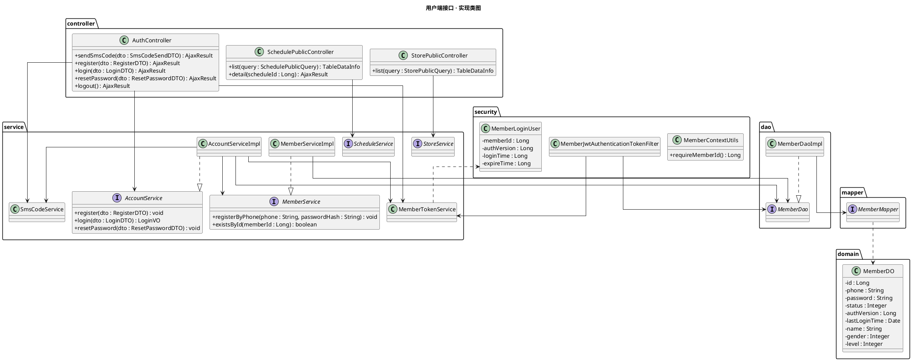

# 瑜伽普拉提用户端接口详细设计文档

**当前阶段：会员登录与排课浏览。** 账户与会员共用 `t_member`；预约和会员卡用户端能力暂不交付。


## 1、数据架构

无

## 2、接口

### 2.1.1 接口清单

| # | 方法 | 路径 | 用途 | 登录 |
|---:|---|---|---|---|
| 1 | GET | `/api/stores` | 查询门店列表 | 否 |
| 2 | GET | `/api/schedules` | 查询排课列表 | 否 |
| 3 | GET | `/api/schedules/{scheduleId}` | 查询排课详情 | 否 |
| 4 | POST | `/api/auth/sms-code` | 发送短信验证码 | 否 |
| 5 | POST | `/api/auth/register` | 注册 | 否 |
| 6 | POST | `/api/auth/login` | 登录 | 否 |
| 7 | POST | `/api/auth/reset-password` | 忘记密码 | 否 |
| 8 | POST | `/api/auth/logout` | 退出登录 | 会员会话清理，失效也成功 |

本阶段共 8 个用户端接口。管理端会员资料与登录资格管理统一见[会员管理详细设计](会员管理详细设计.md) §2.2，不另设账户管理接口。

### 2.1.2 鉴权与放行清单

**会员端 token 只作用于 `/api/**`**；`/admin/**` 与 `sys_*` 一切照旧（仍走 `sys_user` JWT）。

| # | 路径 | 放行方式 | 说明 |
|---:|---|---|---|
| 1 | `/api/auth/sms-code` | **免登录** | 发验证码本身不需要身份 |
| 2 | `/api/auth/register` | **免登录** | 注册 |
| 3 | `/api/auth/login` | **免登录** | 登录 |
| 4 | `/api/auth/reset-password` | **免登录** | 忘记密码（靠验证码证明手机号归属） |
| 5 | `/api/auth/logout` | 允许会话清理 | 携带有效 token 时撤销会话，缺失或失效也幂等成功 |
| 6 | `/api/stores` | **免登录**（保留一期 `@Anonymous`） | 首页换店；`BR-用户端-002` 明确换店不拦截 |
| 7 | `/api/schedules` | **免登录**（保留一期 `@Anonymous`） | 约课页浏览 |
| 8 | `/api/schedules/{scheduleId}` | **免登录**（保留一期 `@Anonymous`） | 课程详情浏览 |
| 9 | 其余 `/api/**` | 不提供本阶段业务接口 | 不因已登录而开放未交付能力 |

> **一期三个免登录接口的行为不变**（仍可匿名访问），这是回归验收点之一：二期**不得**把 `/api/stores`、`/api/schedules` 变成需要登录。
>
> 管理端 `/admin/members/**` 使用若依管理员登录态，与会员 token 隔离；本表只决定用户端 `/api/**` 的放行。


### 2.2.1 查询门店列表

`GET /api/stores`

列表按 `region_code ASC, name ASC, id DESC` 排序。按区域及门店名称／地址关键字筛选；只返回现存门店，当前门店由小程序本地保存。

#### 请求参数

| 参数 | 位置 | 类型 | 必填 | 说明 |
|---|---|---|---|---|
| `regionCode` | query | string | 否 | 所在区域 code，精确匹配；取值须在 store_region 字典中 |
| `keyword` | query | string | 否 | 门店名称／地址关键字，模糊匹配，最长 64 |
| `pageNum` | query | integer | 否 | 默认 1，最小 1 |
| `pageSize` | query | integer | 否 | 默认 10，最大 100 |

> 返回示例

> 200 Response

```json
{
  "total": 1,
  "rows": [
    {
      "id": "1856739201475235901",
      "name": "徐汇店",
      "storeType": 1,
      "storeTypeName": "主力店",
      "regionCode": "310104",
      "regionName": "徐汇区",
      "phone": "021-12345678",
      "businessHours": "周一至周日 09:00-22:00",
      "address": "漕溪北路 88 号",
      "imageUrl": "https://cdn.example.com/store/1856739201475235901.jpg"
    }
  ],
  "code": 200,
  "msg": "查询成功"
}
```

#### 返回结果

| 状态码 | 状态码含义 | 说明 | 数据模型 |
|:---|---|---|---|
| 200 | 成功 | 分页返回门店列表 | `TableDataInfo<StorePublicItemVO>` |
| 500 | 参数校验失败 | regionCode 取值非法、关键字超长或分页参数超出范围 | `AjaxResult<Void>` |

### 2.2.2 查询排课列表

`GET /api/schedules`

列表按 `update_time DESC, id DESC` 排序。固定按当前门店、课种快照与上课日期筛选，只展示非待上架排课（`status <> 1`）；已结束、已取消仍可浏览。

#### 请求参数

| 参数 | 位置 | 类型 | 必填 | 说明 |
|---|---|---|---|---|
| `storeId` | query | string | 是 | 当前门店 ID |
| `courseType` | query | integer | 是 | 1 团课／2 精品课／3 私教课／4 特色课 |
| `date` | query | string | 是 | yyyy-MM-dd；仅今天起 14 天内（含今天），由前端默认传今天 |
| `pageNum` | query | integer | 否 | 默认 1，最小 1 |
| `pageSize` | query | integer | 否 | 默认 10，最大 100 |

> 返回示例

> 200 Response

```json
{
  "total": 12,
  "rows": [
    {
      "id": "1856739201475239001",
      "courseName": "哈他瑜伽",
      "courseCoverUrl": "https://cdn.example.com/course/1.jpg",
      "courseType": 1,
      "courseTypeName": "团课",
      "difficulty": 2,
      "scheduleDate": "2026-10-03",
      "startTime": "2026-10-03 19:00:00",
      "endTime": "2026-10-03 20:00:00",
      "coachName": "王老师",
      "storeId": "1856739201475235901",
      "storeName": "徐汇店",
      "classroomName": "瑜伽团课大教室",
      "maxPersons": 20,
      "bookedPersons": 0,
      "remainingPlaces": 20,
      "status": 2,
      "statusText": "可约",
      "bookable": false
    }
  ],
  "code": 200,
  "msg": "查询成功"
}
```

#### 返回结果

| 状态码 | 状态码含义 | 说明 | 数据模型 |
|:---|---|---|---|
| 200 | 成功 | 分页返回排课列表 | `TableDataInfo<ScheduleCardVO>` |
| 404 | 门店不存在 | 门店不存在或已被删除 | `AjaxResult<Void>` |
| 500 | 参数校验失败 | 必填参数缺失、courseType 或 date 非法、分页参数超出范围 | `AjaxResult<Void>` |

### 2.2.3 查询排课详情

`GET /api/schedules/{scheduleId}`

排课必须存在且非待上架，否则统一按不存在处理。本阶段 `bookable = false`、`bookers = []`，仅展示排课信息。课种取排课快照，课程难度、封面、介绍与教练资料实时读取；历史关联资料缺失时名称以空字符串兜底。

#### 请求参数

| 参数 | 位置 | 类型 | 必填 | 说明 |
|---|---|---|---|---|
| `scheduleId` | path | string | 是 | 排课 ID，字符串形式的雪花 ID |

> 返回示例

> 200 Response

```json
{
  "code": 200,
  "msg": "查询成功",
  "data": {
    "id": "1856739201475239001",
    "courseId": "1856739201475238001",
    "courseName": "哈他瑜伽",
    "courseCoverUrl": "https://cdn.example.com/course/1.jpg",
    "courseIntro": "适合初学者的基础课程",
    "courseType": 1,
    "courseTypeName": "团课",
    "difficulty": 2,
    "scheduleDate": "2026-10-03",
    "startTime": "2026-10-03 19:00:00",
    "endTime": "2026-10-03 20:00:00",
    "coachId": "1856739201475237001",
    "coachName": "王老师",
    "coachAvatarUrl": "https://cdn.example.com/coach/1.jpg",
    "coachIntro": "十年哈他瑜伽经验，擅长初学者体态调整",
    "storeId": "1856739201475235901",
    "storeName": "徐汇店",
    "classroomName": "瑜伽团课大教室",
    "status": 2,
    "statusText": "可约",
    "bookable": false,
    "maxPersons": 20,
    "minPersons": 2,
    "bookedPersons": 0,
    "remainingPlaces": 20,
    "bookers": []
  }
}
```

#### 返回结果

| 状态码 | 状态码含义 | 说明 | 数据模型 |
|:---|---|---|---|
| 200 | 成功 | 查询排课详情成功 | `AjaxResult<ScheduleDetailVO>` |
| 404 | 排课不存在 | 排课不存在、已删除或处于待上架 | `AjaxResult<Void>` |
| 500 | 参数校验失败 | scheduleId 缺失或格式非法 | `AjaxResult<Void>` |


### 2.2.4 发送短信验证码

`POST /api/auth/sms-code`

免登录。发送间隔 60 秒、有效期 5 分钟；连续校验错误 5 次锁定 15 分钟。发送新码作废旧码，响应不返回验证码。

#### 请求参数

| 参数 | 位置 | 类型 | 必填 | 说明 |
|---|---|---|---|---|
| `phone` | body | string | 是 | 手机号，最长 32，校验手机号格式 |
| `scene` | body | string | 是 | register 注册／reset 忘记密码 |

> 请求示例

```json
{
  "phone": "13800138000",
  "scene": "register"
}
```

> 返回示例

> 200 Response

```json
{
  "code": 200,
  "msg": "验证码已发送"
}
```

#### 返回结果

| 状态码 | 状态码含义 | 说明 | 数据模型 |
|:---|---|---|---|
| 200 | 成功 | 发送短信验证码成功 | `AjaxResult<Void>` |
| 404 | 手机号未注册 | reset 场景仅允许已注册手机号 | `AjaxResult<Void>` |
| 409 | 状态冲突 | 发送过频、手机号锁定，或 register 场景手机号已注册 | `AjaxResult<Void>` |
| 500 | 参数校验失败 | phone 或 scene 缺失或取值非法 | `AjaxResult<Void>` |

### 2.2.5 注册

`POST /api/auth/register`

免登录。有未注册会员档案时补齐同一行登录信息，保留会员 ID 和资料；无档案则新建 V0 会员。已注册拒绝重复注册。注册成功不签发 token、不刷新最后登录时间，前端跳回登录页。

#### 请求参数

| 参数 | 位置 | 类型 | 必填 | 说明 |
|---|---|---|---|---|
| `phone` | body | string | 是 | 手机号，最长 32，校验手机号格式 |
| `smsCode` | body | string | 是 | 6 位数字验证码 |
| `password` | body | string | 是 | 8～20 位，至少包含字母与数字 |

> 返回示例

> 200 Response

```json
{
  "code": 200,
  "msg": "注册成功，请登录"
}
```

#### 返回结果

| 状态码 | 状态码含义 | 说明 | 数据模型 |
|:---|---|---|---|
| 200 | 成功 | 注册成功，不返回登录态 | `AjaxResult<Void>` |
| 409 | 注册冲突 | 手机号已注册、验证码错误／过期／锁定或并发注册冲突 | `AjaxResult<Void>` |
| 500 | 参数校验失败 | 必填字段缺失、手机号或密码格式非法 | `AjaxResult<Void>` |

### 2.2.6 登录

`POST /api/auth/login`

免登录。手机号不存在、未注册或密码错误统一提示“手机号或密码错误”；停用账号拒绝登录。成功刷新最后登录时间，登录态有效期 7 天，不自动续期；Redis 登录对象保存本次 auth_version 快照，版本不对外返回。

#### 请求参数

| 参数 | 位置 | 类型 | 必填 | 说明 |
|---|---|---|---|---|
| `phone` | body | string | 是 | 手机号，最长 32，校验手机号格式 |
| `password` | body | string | 是 | 登录密码，非空 |

> 返回示例

> 200 Response

```json
{
  "code": 200,
  "msg": "登录成功",
  "data": {
    "token": "<member-token>",
    "expireTime": 1792368000000,
    "memberId": "1856739201475235902",
    "memberName": "忻会员8000"
  }
}
```

#### 返回结果

| 状态码 | 状态码含义 | 说明 | 数据模型 |
|:---|---|---|---|
| 200 | 成功 | 返回会员登录态 | `AjaxResult<LoginVO>` |
| 409 | 登录失败 | 手机号或密码错误、账号已停用，或签发期间资格／版本发生变化 | `AjaxResult<Void>` |
| 500 | 参数校验失败 | phone 或 password 缺失或格式非法 | `AjaxResult<Void>` |

### 2.2.7 忘记密码

`POST /api/auth/reset-password`

免登录。仅已注册手机号可重置，经验证码校验后更新 BCrypt 哈希，不需要旧密码；本阶段不批量撤销已有登录态。

#### 请求参数

| 参数 | 位置 | 类型 | 必填 | 说明 |
|---|---|---|---|---|
| `phone` | body | string | 是 | 已注册手机号，最长 32 |
| `smsCode` | body | string | 是 | 6 位数字验证码 |
| `password` | body | string | 是 | 新密码，8～20 位，至少包含字母与数字 |

> 请求示例

```json
{
  "phone": "13800138000",
  "smsCode": "123456",
  "password": "new12345"
}
```

> 返回示例

> 200 Response

```json
{
  "code": 200,
  "msg": "密码已重置"
}
```

#### 返回结果

| 状态码 | 状态码含义 | 说明 | 数据模型 |
|:---|---|---|---|
| 200 | 成功 | 忘记密码成功 | `AjaxResult<Void>` |
| 404 | 手机号未注册 | 该手机号尚未注册 | `AjaxResult<Void>` |
| 409 | 验证码校验失败 | 验证码错误／过期或手机号处于锁定状态 | `AjaxResult<Void>` |
| 500 | 参数校验失败 | 必填字段缺失、手机号或密码格式非法 | `AjaxResult<Void>` |

### 2.2.8 退出登录

`POST /api/auth/logout`

撤销当前会员会话。幂等：token 缺失、已失效或已删除时也返回成功；有效的会员 token 用于定位待清理会话。

#### 请求参数

| 参数 | 位置 | 类型 | 必填 | 说明 |
|---|---|---|---|---|
| `Authorization` | header | string | 否 | Bearer <会员 token>；有效登录时携带，无请求体 |

> 返回示例

> 200 Response

```json
{
  "code": 200,
  "msg": "退出成功"
}
```

#### 返回结果

| 状态码 | 状态码含义 | 说明 | 数据模型 |
|:---|---|---|---|
| 200 | 成功 | 退出登录成功 | `AjaxResult<Void>` |
| 500 | 系统异常 | 会话清理失败，由统一异常处理器返回提示 | `AjaxResult<Void>` |

## 2.6 数据模型

### 2.6.1 `StorePublicItemVO`

|名称|类型|必选|约束|中文名|说明|
|---|---|---|---|---|---|
|id|string|true|字符串形式雪花 ID|ID|ID。|
|name|string|true|最长 64 字符|名称|名称。|
|storeType|integer|true|—|门店类型|门店类型。|
|storeTypeName|string|true|—|门店类型名称|门店类型名称。|
|regionCode|string|true|6 位行政区划代码|区域编码|区域编码。|
|regionName|string|true|—|区域名称|区域名称。|
|phone|string|true|最长 32 字符|手机号|手机号。|
|businessHours|string|true|—|营业时间|营业时间。|
|address|string|true|—|地址|地址。|
|imageUrl|string|true|—|门店图片|门店图片。|


### 2.6.2 `ScheduleCardVO`

|名称|类型|必选|约束|中文名|说明|
|---|---|---|---|---|---|
|id|string|true|字符串形式雪花 ID|ID|ID。|
|courseName|string|true|—|课程名称|课程名称。|
|courseCoverUrl|string|true|—|课程封面|课程封面。|
|courseType|integer|true|1～4|课种|课种。|
|courseTypeName|string|true|—|课种名称|课种名称。|
|difficulty|integer|true|1～5|难度|难度。|
|scheduleDate|string|true|yyyy-MM-dd|上课日期|上课日期。|
|startTime|string|true|yyyy-MM-dd HH:mm:ss|开始时间|开始时间。|
|endTime|string|true|yyyy-MM-dd HH:mm:ss|结束时间|结束时间。|
|coachName|string|true|—|教练姓名|教练姓名。|
|storeId|string|false|字符串形式雪花 ID|适用门店 ID|次数卡限定适用门店；年卡为空。|
|storeName|string|false|—|门店名称|门店名称。|
|classroomName|string|true|—|教室名称|教室名称。|
|maxPersons|integer|true|—|最大人数|最大人数。|
|bookedPersons|integer|true|—|已预约人数|读取排课已有值，本阶段不由用户端预约操作维护。|
|remainingPlaces|integer|true|—|剩余名额|maxPersons − bookedPersons，下限为 0。|
|status|integer|true|由对应业务枚举定义|状态|状态。|
|statusText|string|true|—|状态文案|由后端返回，前端不维护映射。|
|bookable|boolean|true|—|是否可约|本阶段固定为 false，暂不提供预约操作。|


### 2.6.3 `ScheduleDetailVO`

|名称|类型|必选|约束|中文名|说明|
|---|---|---|---|---|---|
|id|string|true|字符串形式雪花 ID|ID|ID。|
|courseId|string|true|字符串形式雪花 ID|课程 ID|课程 ID。|
|courseName|string|true|—|课程名称|课程名称。|
|courseCoverUrl|string|true|—|课程封面|课程封面。|
|courseIntro|string|true|—|课程简介|课程简介。|
|courseType|integer|true|1～4|课种|课种。|
|courseTypeName|string|true|—|课种名称|课种名称。|
|difficulty|integer|true|1～5|难度|难度。|
|scheduleDate|string|true|yyyy-MM-dd|上课日期|上课日期。|
|startTime|string|true|yyyy-MM-dd HH:mm:ss|开始时间|开始时间。|
|endTime|string|true|yyyy-MM-dd HH:mm:ss|结束时间|结束时间。|
|coachId|string|true|字符串形式雪花 ID|教练 ID|教练 ID。|
|coachName|string|true|—|教练姓名|教练姓名。|
|coachAvatarUrl|string|true|—|教练头像|教练头像。|
|coachIntro|string|true|—|教练简介|教练简介。|
|storeId|string|false|字符串形式雪花 ID|适用门店 ID|次数卡限定适用门店；年卡为空。|
|storeName|string|false|—|门店名称|门店名称。|
|classroomName|string|true|—|教室名称|教室名称。|
|status|integer|true|由对应业务枚举定义|状态|状态。|
|statusText|string|true|—|状态文案|由后端返回，前端不维护映射。|
|bookable|boolean|true|—|是否可约|本阶段固定为 false，暂不提供预约操作。|
|maxPersons|integer|true|—|最大人数|最大人数。|
|minPersons|integer|true|—|开课人数|开课人数。|
|bookedPersons|integer|true|—|已预约人数|读取排课已有值，本阶段不由用户端预约操作维护。|
|remainingPlaces|integer|true|—|剩余名额|maxPersons − bookedPersons，下限为 0。|
|bookers|string[]|true|—|预约会员显示名|本阶段返回空数组，暂不查询预约人员。|


### 2.6.4 `SmsCodeSendDTO`

|名称|类型|必选|约束|中文名|说明|
|---|---|---|---|---|---|
|phone|string|true|最长 32 字符|手机号|手机号。|
|scene|string|true|register／reset|验证码场景|验证码场景。|


### 2.6.5 `RegisterDTO / ResetPasswordDTO`

|名称|类型|必选|约束|中文名|说明|
|---|---|---|---|---|---|
|phone|string|true|最长 32 字符|手机号|手机号。|
|smsCode|string|true|6 位数字|短信验证码|短信验证码。|
|password|string|true|8～20 位，同时包含字母与数字|登录密码|请求明文经 HTTPS 提交，只保存 BCrypt 哈希，永不回显。|


### 2.6.6 `LoginDTO`

|名称|类型|必选|约束|中文名|说明|
|---|---|---|---|---|---|
|phone|string|true|最长 32 字符|手机号|手机号。|
|password|string|true|非空|登录密码|已注册会员的密码；校验非空，不在登录时重复执行设置密码强度规则。|


### 2.6.7 `StorePublicQuery`

|名称|类型|必选|约束|中文名|说明|
|---|---|---|---|---|---|
|regionCode|string|false|6 位行政区划代码|区域编码|区域编码。|
|keyword|string|false|最长 64 字符|搜索关键字|搜索关键字。|
|pageNum|integer|false|默认 1，最小 1|页码|页码。|
|pageSize|integer|false|默认 10，最大 100|页大小|页大小。|


### 2.6.8 `SchedulePublicQuery`

|名称|类型|必选|约束|中文名|说明|
|---|---|---|---|---|---|
|storeId|string|true|字符串形式雪花 ID|适用门店 ID|当前门店 ID。|
|courseType|integer|true|1～4|课种|课种。|
|date|string|true|yyyy-MM-dd，今天起 14 天内|日期|日期。|
|pageNum|integer|false|默认 1，最小 1|页码|页码。|
|pageSize|integer|false|默认 10，最大 100|页大小|页大小。|


### 2.6.9 `LoginVO`

|名称|类型|必选|约束|中文名|说明|
|---|---|---|---|---|---|
|token|string|true|—|登录 token|用户端 JWT；与管理端 token 隔离。|
|expireTime|long|true|毫秒时间戳|过期时间戳|过期时间戳。|
|memberId|string|true|字符串形式雪花 ID|会员 ID|服务端登录主体与业务主体，客户端传入值不作为访问依据。|
|memberName|string|true|最长 64 字符|会员显示名|会员显示名。|


### 2.6.10 `MemberLoginUser`

仅存 Redis，不对外返回。JWT 保持只携带随机会话标识，版本存储在本登录对象中；旧会话缺少版本字段时视为失效，要求重新登录。

|名称|类型|必选|约束|中文名|说明|
|---|---|---|---|---|---|
|memberId|Long|true|字符串形式雪花 ID|会员 ID|服务端登录主体与业务主体，客户端传入值不作为访问依据。|
|authVersion|Long|true|非负整数，必须等于数据库当前 auth_version|登录态版本号|签发时的会员版本快照；只供服务端校验，不接受客户端传入。|
|phone|String|true|最长 32 字符|手机号|手机号。|
|loginTime|Long|true|毫秒时间戳|登录时间戳|登录时间戳。|
|expireTime|Long|true|毫秒时间戳|过期时间戳|过期时间戳。|
|ipaddr|String|false|—|登录 IP|登录 IP。|


# 3、开发架构

## 3.1 实现类图



## 3.2 包设计

```text
com.techplant.yoga.store
└─ controller/StorePublicController.java

com.techplant.yoga.schedule
└─ controller/SchedulePublicController.java

com.techplant.yoga.member
├─ controller/AuthController.java
├─ service/MemberService.java、AccountService.java
├─ service/impl/MemberServiceImpl.java、AccountServiceImpl.java
├─ service/MemberTokenService.java、SmsCodeService.java、SmsSender.java
├─ service/impl/LogSmsSender.java
├─ dao/MemberDao.java、MemberDaoImpl.java
├─ mapper/MemberMapper.java
├─ domain/MemberDO.java
├─ dto/SmsCodeSendDTO.java、RegisterDTO.java、LoginDTO.java、ResetPasswordDTO.java
├─ vo/LoginVO.java
├─ security/MemberLoginUser.java、MemberContextUtils.java
├─ security/MemberJwtAuthenticationTokenFilter.java、MemberAuthenticationEntryPointImpl.java
├─ config/MemberSecurityConfig.java
└─ enums/AccountStatusEnum.java

```


# 4、运行流程

## 4.1 查询门店列表

1. Controller 校验区域、关键字与分页参数。
2. StoreService 调 DAO 按区域与名称／地址筛选，按 `region_code ASC, name ASC, id DESC` 排序。
3. 转换 StorePublicItemVO，返回 TableDataInfo；当前门店只保存在小程序本地。

## 4.2 查询排课列表与详情

1. 校验门店、课种、日期与分页参数；详情校验排课 ID。
2. 列表固定按门店、课种快照、上课日期及 `status <> 1` 查询；详情对待上架与不存在统一返回 404。
3. 批量读取课程、教练、门店与教室摘要，生成实时资料与状态文案。
4. 按 `update_time DESC, id DESC` 返回列表，详情返回 ScheduleDetailVO。

## 4.3 发送短信验证码

1. 校验手机号与场景；按场景检查已注册／未注册条件。
2. 检查锁定与 60 秒发送间隔。
3. 写入 6 位新验证码（5 分钟有效），作废旧码并通过 SmsSender 发送。
4. 不回显验证码；开发固定码由配置控制。

## 4.4 注册

1. 校验手机号、验证码与密码强度；验证通过后消费验证码。
2. 按手机号查询统一会员表；已注册拒绝，已有未注册档案条件更新密码哈希与状态，无档案则创建 V0 会员。
3. 保留已有会员 ID、资料与业务关联，并发冲突返回 409。
4. 事务成功后返回“注册成功，请登录”，不签发 token、不更新最后登录时间。

## 4.5 登录

1. Service 开启数据库事务，按手机号以 `SELECT ... FOR UPDATE` 当前读会员行，与启停用共用行锁；不存在、未注册或密码错误统一提示。
2. 校验数据库当前 `status = 1`，停用拒绝；读取 `auth_version` 作为本次登录版本快照。版本由数据库提供，不从登录请求取值。
3. 刷新最后登录时间并提交数据库事务。数据库提交成功后才签发 token 并写入 `member_tokens:<uuid>`，其中 `MemberLoginUser.authVersion` 保存版本快照；反向索引使用 `member_token_index:<memberId>:<authVersion>`，索引 TTL 覆盖该版本仍有效的会话。
4. Redis 会话写入后、返回前再次读取数据库资格与版本；如会员已被删除、停用或版本已变化，删除本次新建会话及索引成员，返回 `409`：“登录状态已变化，请重新登录”。不能将旧版本快照刷新为新版本来绕过校验，后续请求也必须独立验证版本，以覆盖返回后的状态变化。
5. 返回 LoginVO（token、expireTime、memberId、memberName），不返回 authVersion。登录本身不递增版本；Redis 写入失败不返回成功 token，并清理本次已创建的会话。

## 4.6 忘记密码与退出登录

1. 忘记密码校验已注册会员与验证码，成功后覆盖 BCrypt 哈希，不递增 auth_version、不批量撤销旧 token，保持现有契约。
2. 退出解析当前会员 token，删除 Redis 会话，并按该会话保存的会员 ID 与 authVersion 从对应版本反向索引移除；不影响该会员其他会话。
3. 失效 token 的退出仍幂等成功；安全链须允许退出处理器执行清理。

## 4.7 请求鉴权判定

公开浏览、发验证码、注册、登录、忘记密码按 §2.1 放行清单处理；其他用户端业务请求按以下顺序校验：

1. 验证会员 JWT，取得 Redis 登录对象，检查存在性与过期时间；管理端 token 不被接受，缺少 authVersion 的旧会话视为失效。
2. 从会话取 memberId，读取数据库当前会员行。会员不存在、密码为空（未注册）或 status 不是 1，返回业务码 401。
3. 严格比较会话 authVersion 与数据库 auth_version，不相等返回 401，并尽力删除该旧会话及其版本索引成员；版本相等才写入登录上下文。不得在数据库查询失败时降级为仅凭 Redis 放行，也不使用延迟更新的状态／版本缓存。
4. 状态翻转的数据库提交是撤销生效点；提交后开始鉴权的新请求不得继续接受旧版本。已完成鉴权并在执行中的请求不被自动回滚，后续如新增敏感写操作，应在业务事务内重新校验会员资格与版本。
5. 退出接口允许失效会话幂等清理，不因版本不匹配而阻止退出处理器执行。
