# 瑜伽普拉提课程管理详细设计文档

# 1、数据架构

## 1.1 数据库 ER 模型

略

## 1.2 数据库逻辑模型

### 1.2.1 `t_course` 字段定义

| 字段 | 中文名 | 类型 | 必填 | 默认值 | 说明 |
|---|---|---:|:---:|---:|---|
| `id` | 课程ID | bigint unsigned | 是 | — | 雪花 ID，应用侧生成 |
| `name` | 课程名称 | varchar(64) | 是 | — | **全平台唯一** |
| `course_type` | 课种 | tinyint | 是 | — | `1` 团课；`2` 精品课；`3` 私教课；`4` 特色课 |
| `cover_url` | 课程封面 | varchar(255) | 否 | NULL | **单图**，存 URL |
| `intro` | 课程介绍 | varchar(1024) | 否 | NULL | 纯文本 |
| `difficulty` | 课程难度 | tinyint | 是 | — | `1` ~ `5` 星 |
| `create_by` | 创建人 | bigint unsigned | 否 | NULL | 公共审计填充 |
| `create_time` | 创建时间 | datetime | 是 | CURRENT_TIMESTAMP | 公共审计填充 |
| `update_by` | 更新人 | bigint unsigned | 否 | NULL | 公共审计填充 |
| `update_time` | 更新时间 | datetime | 是 | CURRENT_TIMESTAMP | ON UPDATE |

### 1.2.2 枚举值

| 枚举 | 值 | 文案 |
|---|---:|---|
| `course_type` | 1 | 团课 |
| `course_type` | 2 | 精品课 |
| `course_type` | 3 | 私教课 |
| `course_type` | 4 | 特色课 |

| 枚举 | 取值 |
|---|---|
| `difficulty` | 1、2、3、4、5（星） |


## 1.3 数据库物理模型

### 1.3.1 建表语句

```sql
CREATE TABLE `t_course` (
  `id`          bigint unsigned NOT NULL COMMENT '课程ID',
  `name`        varchar(64)   NOT NULL COMMENT '课程名称（全平台唯一）',
  `course_type` tinyint       NOT NULL COMMENT '课种：1团课 2精品课 3私教课 4特色课',
  `cover_url`   varchar(255)  DEFAULT NULL COMMENT '课程封面URL（单图）',
  `intro`       varchar(1024) DEFAULT NULL COMMENT '课程介绍',
  `difficulty`  tinyint       NOT NULL COMMENT '课程难度：1~5星',
  `create_by`   bigint unsigned DEFAULT NULL COMMENT '创建人ID',
  `create_time` datetime NOT NULL DEFAULT CURRENT_TIMESTAMP COMMENT '创建时间',
  `update_by`   bigint unsigned DEFAULT NULL COMMENT '更新人ID',
  `update_time` datetime NOT NULL DEFAULT CURRENT_TIMESTAMP ON UPDATE CURRENT_TIMESTAMP COMMENT '更新时间',
  PRIMARY KEY (`id`),
  UNIQUE KEY `uk_course_name` (`name`)
) ENGINE=InnoDB DEFAULT CHARSET=utf8mb4 COLLATE=utf8mb4_unicode_ci COMMENT='课程基础信息表';
```

---

# 2、接口

## 2.2 课程管理接口

| # | 方法 | 路径 | 功能 | 登录 |
|---:|---|---|---|:---:|
| 1 | GET | `/admin/courses` | 查询课程列表 | 是 |
| 2 | GET | `/admin/courses/{courseId}` | 查询课程详情 | 是 |
| 3 | POST | `/admin/courses` | 新增课程 | 是 |
| 4 | PUT | `/admin/courses/{courseId}` | 修改课程 | 是 |
| 5 | DELETE | `/admin/courses/{courseId}` | 删除课程| 是 |

### 2.2.1 查询课程列表

`GET /admin/courses`

列表按 `update_time DESC, id DESC` 排序。

#### 请求参数

| 参数 | 位置 | 类型 | 必填 | 说明 |
|---|---|---|---|---|
| `Authorization` | header | string | 是 | Bearer <管理端 token>，不能使用会员 token |
| `name` | query | string | 否 | 课程名称，模糊匹配，最长 64 |
| `courseType` | query | integer | 否 | 1～4，不传不限 |
| `pageNum` | query | integer | 否 | 默认 1，最小 1 |
| `pageSize` | query | integer | 否 | 默认 10，最大 100 |

> 返回示例

> 200 Response

```json
{
  "total": 1,
  "rows": [
    {
      "id": "1856739201475238001",
      "name": "哈他瑜伽",
      "courseType": 1,
      "courseTypeName": "团课",
      "coverUrl": "https://cdn.example.com/course/1.jpg",
      "difficulty": 2,
      "createTime": "2026-10-01 10:00:00",
      "updateTime": "2026-10-01 10:00:00"
    }
  ],
  "code": 200,
  "msg": "查询成功"
}
```

#### 返回结果

| 状态码 | 状态码含义 | 说明 | 数据模型 |
|:---|---|---|---|
| 200 | 成功 | 分页返回课程列表 | `TableDataInfo<CourseListItemVO>` |
| 401 | 登录失效 | 管理端未登录或 token 无效 | `AjaxResult<Void>` |
| 500 | 参数校验失败 | `courseType` 不在 1~4；`pageSize` 超过上限 | `AjaxResult<Void>` |


### 2.2.2 查询课程详情

`GET /admin/courses/{courseId}`

返回详情。

#### 请求参数

| 参数 | 位置 | 类型 | 必填 | 说明 |
|---|---|---|---|---|
| `Authorization` | header | string | 是 | Bearer <管理端 token>，不能使用会员 token |
| `courseId` | path | string | 是 | 课程 ID |

> 返回示例

> 200 Response

```json
{
  "code": 200,
  "msg": "查询成功",
  "data": {
    "id": "1856739201475238001",
    "name": "哈他瑜伽",
    "courseType": 1,
    "courseTypeName": "团课",
    "coverUrl": "https://cdn.example.com/course/1.jpg",
    "difficulty": 2,
    "createTime": "2026-10-01 10:00:00",
    "updateTime": "2026-10-01 10:00:00",
    "intro": "适合初学者的基础课程"
  }
}
```

#### 返回结果

| 状态码 | 状态码含义 | 说明 | 数据模型 |
|:---|---|---|---|
| 200 | 成功 | 返回课程详情，**含 `intro`** | `AjaxResult<CourseDetailVO>` |
| 401 | 登录失效 | 管理端未登录或 token 无效 | `AjaxResult<Void>` |
| 404 | 课程不存在 | 课程不存在或已被删除 | `AjaxResult<Void>` |


### 2.2.3 新增课程

`POST /admin/courses`

成功不返回新建 ID。

#### 请求参数

| 参数 | 位置 | 类型 | 必填 | 说明 |
|---|---|---|---|---|
| `Authorization` | header | string | 是 | Bearer <管理端 token>，不能使用会员 token |
| `name` | body | string | 是 | 课程名称，非空，最长 64，全平台唯一 |
| `courseType` | body | integer | 是 | 1 团课／2 精品课／3 私教课／4 特色课 |
| `coverUrl` | body | string | 否 | 封面 URL，最长 255；修改时传 null 表示清空 |
| `intro` | body | string | 否 | 课程介绍，最长 1024；修改时传 null 表示清空 |
| `difficulty` | body | integer | 是 | 课程难度，1～5 星 |

> 请求示例

```json
{
  "name": "哈他瑜伽",
  "courseType": 1,
  "coverUrl": "https://cdn.example.com/course/1.jpg",
  "intro": "适合初学者的基础课程",
  "difficulty": 2
}
```

> 返回示例

> 200 Response

```json
{
  "code": 200,
  "msg": "操作成功"
}
```

#### 返回结果

| 状态码 | 状态码含义 | 说明 | 数据模型 |
|:---|---|---|---|
| 200 | 成功 | 新增成功，**不返回新 ID** | `AjaxResult<Void>` |
| 401 | 登录失效 | 管理端未登录或 token 无效 | `AjaxResult<Void>` |
| 409 | 名称重复 | 课程名称已存在 | `AjaxResult<Void>` |
| 500 | 参数校验失败 | `courseType` 不在 1~4；`difficulty` 不在 1~5；必填缺失或长度超限 | `AjaxResult<Void>` |


### 2.2.4 修改课程

`PUT /admin/courses/{courseId}`

全量编辑，请求字段与新增一致；不做引用检查。

#### 请求参数

| 参数 | 位置 | 类型 | 必填 | 说明 |
|---|---|---|---|---|
| `Authorization` | header | string | 是 | Bearer <管理端 token>，不能使用会员 token |
| `courseId` | path | string | 是 | 课程 ID |
| `name` | body | string | 是 | 课程名称，非空，最长 64，全平台唯一 |
| `courseType` | body | integer | 是 | 1 团课／2 精品课／3 私教课／4 特色课 |
| `coverUrl` | body | string | 否 | 封面 URL，最长 255；修改时传 null 表示清空 |
| `intro` | body | string | 否 | 课程介绍，最长 1024；修改时传 null 表示清空 |
| `difficulty` | body | integer | 是 | 课程难度，1～5 星 |

> 请求示例

```json
{
  "name": "哈他瑜伽",
  "courseType": 1,
  "coverUrl": "https://cdn.example.com/course/1.jpg",
  "intro": "适合初学者的基础课程",
  "difficulty": 2
}
```

> 返回示例

> 200 Response

```json
{
  "code": 200,
  "msg": "操作成功",
  "data": {
    "id": "1856739201475238001",
    "name": "哈他瑜伽",
    "courseType": 1,
    "courseTypeName": "团课",
    "coverUrl": "https://cdn.example.com/course/1.jpg",
    "difficulty": 2,
    "createTime": "2026-10-01 10:00:00",
    "updateTime": "2026-10-01 10:00:00",
    "intro": "适合初学者的基础课程"
  }
}
```

#### 返回结果

| 状态码 | 状态码含义 | 说明 | 数据模型 |
|:---|---|---|---|
| 200 | 成功 | 返回更新后的课程详情（含 `intro`）；本接口**不做**引用检查 | `AjaxResult<CourseDetailVO>` |
| 401 | 登录失效 | 管理端未登录或 token 无效 | `AjaxResult<Void>` |
| 404 | 课程不存在 | 课程不存在或已被删除 | `AjaxResult<Void>` |
| 409 | 名称重复 | 课程名称已存在 | `AjaxResult<Void>` |
| 500 | 参数校验失败 | 与新增课程相同 | `AjaxResult<Void>` |


### 2.2.5 删除课程

`DELETE /admin/courses/{courseId}`

物理删除；未结束且为待上架／已上架的排课引用会阻止删除，引用统计失败同样拒绝。

#### 请求参数

| 参数 | 位置 | 类型 | 必填 | 说明 |
|---|---|---|---|---|
| `Authorization` | header | string | 是 | Bearer <管理端 token>，不能使用会员 token |
| `courseId` | path | string | 是 | 课程 ID |

> 返回示例

> 200 Response

```json
{
  "code": 200,
  "msg": "操作成功"
}
```

#### 返回结果

| 状态码 | 状态码含义 | 说明 | 数据模型 |
|:---|---|---|---|
| 200 | 成功 | 物理删除成功 | `AjaxResult<Void>` |
| 401 | 登录失效 | 管理端未登录或 token 无效 | `AjaxResult<Void>` |
| 404 | 课程不存在 | 课程不存在或已被删除 | `AjaxResult<Void>` |
| 409 | 删除门禁不通过 | 仍有 N 节未结束排课，或引用检查未完成；数量拼入提示语 | `AjaxResult<Void>` |


## 2.3 数据模型

### 2.3.1 `CourseListItemVO` / `CourseDetailVO`

| 字段 | 类型 | 列表 | 详情 | 说明 |
|---|---|:--:|:--:|---|
| `id` | string | ✅ | ✅ | 课程ID |
| `name` | string | ✅ | ✅ | 课程名称 |
| `courseType` | integer | ✅ | ✅ | `1`~`4` |
| `courseTypeName` | string | ✅ | ✅ | 课种名称（如「团课」「私教课」），由 `CourseTypeEnum` 翻译 |
| `coverUrl` | string | ✅ | ✅ | 课程封面 URL（单图，可空） |
| `difficulty` | integer | ✅ | ✅ | `1`~`5` |
| `intro` | string | ❌ | ✅ | 课程介绍（列表不返回大字段） |
| `createTime` / `updateTime` | string | ✅ | ✅ | 时间字段 |

### 2.3.2 `CourseCreateDTO` / `CourseUpdateDTO`


|名称|类型|必选|约束|中文名|说明|
|---|---|---|---|---|---|
|name|string|true|非空，最长 64 字符|课程名称|全平台唯一。|
|courseType|integer|true|1～4|课种|1 团课、2 精品课、3 私教课、4 特色课。|
|coverUrl|string|false|最长 255 字符|课程封面 URL|单图；修改时传 `null` 表示清空。|
|intro|string|false|最长 1024 字符|课程介绍|修改时传 `null` 表示清空。|
|difficulty|integer|true|1～5|课程难度|以星级表示。|

### 2.3.3 `CourseQuery`

|名称|类型|必选|约束|中文名|说明|
|---|---|---|---|---|---|
|name|string|false|最长 64 字符|课程名称|模糊匹配。|
|courseType|integer|false|1～4|课种|不传则不限课种。|
|pageNum|integer|false|最小 1|页码|默认 1。|
|pageSize|integer|false|1～100|每页条数|默认 10。|

---

# 3、开发架构

## 3.1 实现类图

```plantuml
@startuml
title 课程管理 · 实现类图（一期）
skinparam classAttributeIconSize 0
skinparam linetype ortho
skinparam nodesep 18
skinparam ranksep 34

package "controller" {
  class CourseController {
    - courseService : CourseService
    --
    + list(query : CourseQuery) : TableDataInfo
    + detail(courseId : Long) : AjaxResult
    + create(dto : CourseCreateDTO) : AjaxResult
    + update(courseId : Long, dto : CourseUpdateDTO) : AjaxResult
    + delete(courseId : Long) : AjaxResult
  }
}

package "service" {
  interface CourseService {
    + page(query : CourseQuery) : PageResult<CourseListItemVO>
    + getDetail(courseId : Long) : CourseDetailVO
    + create(dto : CourseCreateDTO) : void
    + update(courseId : Long, dto : CourseUpdateDTO) : CourseDetailVO
    + delete(courseId : Long) : void
    + existsById(courseId : Long) : boolean
    + mapSummaryByIds(courseIds : Collection<Long>) : Map<Long, CourseListItemVO>
  }
  class CourseServiceImpl {
    - courseDao : CourseDao
    - converter : CourseConverter
    --
    + page(query : CourseQuery) : PageResult<CourseListItemVO>
    + getDetail(courseId : Long) : CourseDetailVO
    + create(dto : CourseCreateDTO) : void
    + update(courseId : Long, dto : CourseUpdateDTO) : CourseDetailVO
    + delete(courseId : Long) : void
    + existsById(courseId : Long) : boolean
    + mapSummaryByIds(courseIds : Collection<Long>) : Map<Long, CourseListItemVO>
    - checkNameUnique(name : String, excludeId : Long) : void
  }
}

package "dao" {
  interface CourseDao {
    + selectPage(query : CourseQuery) : IPage<CourseDO>
    + selectById(id : Long) : CourseDO
    + selectByName(name : String) : CourseDO
    + insert(entity : CourseDO) : int
    + updateById(entity : CourseDO) : int
    + deleteById(id : Long) : int
  }
  class CourseDaoImpl {
    - courseMapper : CourseMapper
    --
    + selectPage(query : CourseQuery) : IPage<CourseDO>
    + selectById(id : Long) : CourseDO
    + selectByName(name : String) : CourseDO
    + insert(entity : CourseDO) : int
    + updateById(entity : CourseDO) : int
    + deleteById(id : Long) : int
  }
}

package "mapper" {
  interface CourseMapper {
    + selectPage(page : IPage<CourseDO>, query : CourseQuery) : IPage<CourseDO>
    + selectByName(name : String) : CourseDO
  }
}

package "domain" {
  class CourseDO {
    - id : Long
    - name : String
    - courseType : Integer
    - coverUrl : String
    - intro : String
    - difficulty : Integer
    - createBy : Long
    - createTime : Date
    - updateBy : Long
    - updateTime : Date
  }
}

package "dto" {
  class CourseCreateDTO {
    - name : String
    - courseType : Integer
    - coverUrl : String
    - intro : String
    - difficulty : Integer
  }
  class CourseUpdateDTO {
    - name : String
    - courseType : Integer
    - coverUrl : String
    - intro : String
    - difficulty : Integer
  }
}

package "query" {
  class CourseQuery {
    - name : String
    - courseType : Integer
    - pageNum : Integer
    - pageSize : Integer
  }
}

package "vo" {
  class CourseListItemVO {
    - id : String
    - name : String
    - courseType : Integer
    - courseTypeName : String
    - coverUrl : String
    - difficulty : Integer
    - createTime : String
    - updateTime : String
  }
  class CourseDetailVO {
    - id : String
    - name : String
    - courseType : Integer
    - courseTypeName : String
    - coverUrl : String
    - intro : String
    - difficulty : Integer
    - createTime : String
    - updateTime : String
  }
}

package "enums" {
  enum CourseTypeEnum {
    TUANKE
    JINGPINKE
    SIJIAOKE
    TESEKE
    --
    - code : Integer
    - name : String
    --
    + of(code : Integer) : CourseTypeEnum
    + nameOf(code : Integer) : String
    + getCode() : Integer
    + getName() : String
  }
}

package "convert" {
  class CourseConverter {
    + toDO(dto : CourseCreateDTO) : CourseDO
    + toListItemVO(entity : CourseDO) : CourseListItemVO
    + toListItemVOList(list : List<CourseDO>) : List<CourseListItemVO>
    + toDetailVO(entity : CourseDO) : CourseDetailVO
  }
}

CourseController --> CourseService
CourseServiceImpl ..|> CourseService
CourseServiceImpl --> CourseDao
CourseServiceImpl --> CourseConverter
CourseServiceImpl ..> CourseTypeEnum : 码 → 名
CourseDaoImpl ..|> CourseDao
CourseDaoImpl --> CourseMapper
CourseMapper ..> CourseDO
CourseConverter ..> CourseDO
CourseConverter ..> CourseListItemVO
CourseConverter ..> CourseDetailVO
@enduml
```



## 3.2 包设计

```text
com.techplant.yoga.course
├─ controller/CourseController.java
├─ service/CourseService.java              （对外三方法：existsById / mapSummaryByIds / getDetail）
├─ service/impl/CourseServiceImpl.java
├─ dao/CourseDao.java、CourseDaoImpl.java
├─ mapper/CourseMapper.java（继承 `BaseMapper<CourseDO>`；＋ resources/mapper/course/CourseMapper.xml）
├─ domain/CourseDO.java
├─ dto/CourseCreateDTO.java、CourseUpdateDTO.java
├─ query/CourseQuery.java
├─ vo/CourseListItemVO.java、CourseDetailVO.java
├─ enums/CourseTypeEnum.java
└─ convert/CourseConverter.java
```

**包依赖方向（单向，不反向、不跨包读表）：**

```text
controller → service → dao → mapper → DB
                ↘ convert（DTO / DO / VO 转换）
                ↘ enums（码 ↔ 名）
```

- 出参一律 VO，**DO 不出 service 层**；`domain` 包不被 `controller` 引用。

# 4、运行流程

## 4.1 查询列表
1. Controller 校验 `CourseQuery`（`pageSize` 上限 100、`courseType` 取值范围）。
2. Service 调 DAO 分页查询（只 select `id/name/course_type/cover_url/difficulty/审计时间`），按 `update_time DESC, id DESC` 排序。
3. 转 `CourseListItemVO` 返回。

## 4.2 查询详情
1. Service 按 ID 查询；不存在 → `404`。
2. 转 `CourseDetailVO`（含 `intro`）返回。

## 4.3 新增课程
1. Controller 校验必填、长度与取值范围（`courseType` ∈ 1~4；`difficulty` ∈ 1~5）。
2. Service 按 `name` 查重；重复 → `409`。
3. 转 DO 插入；主键与审计字段由公共机制处理。

## 4.4 修改课程
1. Service 按 ID 查询；不存在 → `404`。
2. 按 `name` 查重（**排除自身**）；重复 → `409`。
3. 全量覆盖业务字段并更新；返回最新详情。

## 4.5 删除课程

1. Service 开启数据库事务，按主键 `SELECT ... FOR UPDATE` 锁定本课程行并当前读；不存在返回 `404`。这与排课写入时调用 `CourseService.lockByIdsForUpdate` 获取的是同一行锁，不先做无锁引用检查。
2. 锁内调用 `ScheduleService.countActiveByCourseId`，以当前读取得 `end_time > 当前时间 AND status IN (1,2)` 的引用记录并统计；大于 0 返回 `409`，提示“该课程仍有 N 节未结束的排课，无法删除”。已取消或已结束的历史排课不阻塞，历史关联信息按用户端约定空值兜底。
3. 引用统计失败直接终止并回滚，不降级放行。统计与删除必须处于同一数据库事务，同一行锁一直保持到提交／回滚。
4. 无阻塞引用才物理删除并提交。并发排课写请求随后取得课程锁时应发现对象不存在，返回 `404`；已持锁的排课请求若先提交，删除请求取得锁后会看到新引用并被拒绝。死锁或锁等待失败先回滚，再有限重试完整事务，不重试业务门禁失败。

## 4.6 对外加锁契约

`CourseService.lockByIdsForUpdate(ids)` 在调用方已开启的数据库事务内参与执行（不得使用 `REQUIRES_NEW`）。对 ID 去重、升序后逐行按主键 `SELECT id ... FOR UPDATE`，对象缺失抛 `404`；不返回持久化实体，不在方法返回时提前释放锁。排课写入、课程删除锁同一实际数据行；公共顺序为“门店 → 教练 → 课程 → 教室 → 排课”，各类内部按 ID 升序。历史结束任务允许跳过已删除主数据，使用单独的“仅锁现存行”入口，不改变新增／修改排课的存在性要求。
