# 瑜伽普拉提门店管理详细设计文档

# 1、数据架构

## 1.1 数据库 ER 模型
略

## 1.2 数据库逻辑模型

### 1.2.1 `t_store` 字段定义

| 字段 | 中文名 | 类型 | 必填 | 默认值 | 说明 |
|---|-----|---|---|---|---|
| `id` | 门店ID | bigint unsigned | 是 | — |  |
| `store_no` | 门店编号 | char(4) | 是 | — | 服务端自动分配，`0001`～`9999`，全平台唯一；创建后不可修改，删除后不复用 |
| `name` | 门店名称 | varchar(64) | 是 | — | 门店名称 |
| `store_type` | 门店类型 | tinyint | 是 | — | `1` 主力店；`2` 精品店 |
| `region_code` | 所在区域 | varchar(6) | 是 | — | 上海市市辖区的**行政区划代码**，取值由字典 `store_region` 校验 |
| `phone` | 联系电话 | varchar(32) | 是 | — | 联系电话 |
| `business_hours` | 营业时间 | varchar(64) | 是 | — | 固定保存一段展示文本 |
| `address` | 地址 | varchar(255) | 是 | — | 用户端门店卡展示 |
| `image_url` | 门店图片 | varchar(255) | 是 | 默认图片 URL（见下文） | **单图**，存 URL |
| `create_by` | 创建人 | bigint unsigned | 否 | NULL | 公共审计填充 |
| `create_time` | 创建时间 | datetime | 是 | CURRENT_TIMESTAMP | 公共审计填充 |
| `update_by` | 更新人 | bigint unsigned | 否 | NULL | 公共审计填充 |
| `update_time` | 更新时间 | datetime | 是 | CURRENT_TIMESTAMP | ON UPDATE |

默认图片URL `https://loremflickr.com/cache/resized/4322_35262033823_278218688c_n_320_240_nofilter.jpg`

新增／修改时，`imageUrl` 省略、为 `null`、空字符串或纯空白时，均使用默认图片。

### 1.2.2 枚举值

| 枚举 | 值 | 文案 |
|---|---:|---|
| `store_type` | 1 | 主力店 |
| `store_type` | 2 | 精品店 |

region_code

| code | 区名 | code | 区名 |
|---|---|---|---|
| 310101 | 黄浦区 | 310114 | 嘉定区 |
| 310104 | 徐汇区 | 310115 | 浦东新区 |
| 310105 | 长宁区 | 310116 | 金山区 |
| 310106 | 静安区 | 310117 | 松江区 |
| 310107 | 普陀区 | 310118 | 青浦区 |
| 310109 | 虹口区 | 310120 | 奉贤区 |
| 310110 | 杨浦区 | 310151 | 崇明区 |
| 310112 | 闵行区 | | |
| 310113 | 宝山区 | | |

## 1.3 数据库物理模型

### 1.3.1 建表语句

```sql
CREATE TABLE `t_store` (
  `id`             bigint unsigned NOT NULL COMMENT '门店ID',
  `store_no`       char(4) NOT NULL COMMENT '门店编号',
  `name`           varchar(64)  NOT NULL COMMENT '门店名称',
  `store_type`     tinyint      NOT NULL COMMENT '门店类型：1主力店 2精品店',
  `region_code`    varchar(6)   NOT NULL COMMENT '所在区域',
  `phone`          varchar(32)  NOT NULL COMMENT '联系电话',
  `business_hours` varchar(64)  NOT NULL COMMENT '营业时间展示文本',
  `address`        varchar(255) NOT NULL COMMENT '地址',
  `image_url`      varchar(255) NOT NULL DEFAULT 'https://loremflickr.com/cache/resized/4322_35262033823_278218688c_n_320_240_nofilter.jpg' COMMENT '门店图片URL',
  `create_by`      bigint unsigned DEFAULT NULL COMMENT '创建人ID',
  `create_time`    datetime NOT NULL DEFAULT CURRENT_TIMESTAMP COMMENT '创建时间',
  `update_by`      bigint unsigned DEFAULT NULL COMMENT '更新人ID',
  `update_time`    datetime NOT NULL DEFAULT CURRENT_TIMESTAMP ON UPDATE CURRENT_TIMESTAMP COMMENT '更新时间',
  PRIMARY KEY (`id`),
  UNIQUE KEY `uk_store_name` (`name`),
  UNIQUE KEY `uk_store_no` (`store_no`)
) ENGINE=InnoDB DEFAULT CHARSET=utf8mb4 COLLATE=utf8mb4_unicode_ci COMMENT='门店基础信息表';
```

### 1.3.2 门店编号计数器

```sql
CREATE TABLE `t_store_no_counter` (
  `id`      tinyint unsigned NOT NULL COMMENT '固定为1',
  `last_no` int unsigned NOT NULL COMMENT '已分配的最大门店编号',
  PRIMARY KEY (`id`)
) ENGINE=InnoDB DEFAULT CHARSET=utf8mb4 COMMENT='门店编号计数器';

INSERT INTO `t_store_no_counter` (`id`, `last_no`) VALUES (1, 0);
```

初始化语句仅适用于全新数据库；已有数据按 §4.3.1 初始化，不得重置正在使用的计数器。计数器记录须在开放新增门店前存在，由门店模块在数据库事务中读取并更新。

# 2、接口

## 2.2 门店管理接口

| # | 方法 | 路径 | 功能 | 登录 |
|---:|---|---|---|:---:|
| 1 | GET | `/admin/stores` | 查询门店列表 | 是 |
| 2 | GET | `/admin/stores/{storeId}` | 查询门店详情 | 是 |
| 3 | POST | `/admin/stores` | 新增门店 | 是 |
| 4 | PUT | `/admin/stores/{storeId}` | 修改门店 | 是 |
| 5 | DELETE | `/admin/stores/{storeId}` | 删除门店 | 是 |

### 2.2.1 查询门店列表

`GET /admin/stores`

列表按 `update_time DESC, id DESC` 排序

#### 请求参数

| 参数 | 位置 | 类型 | 必填 | 说明 |
|---|---|---|---|---|
| `name` | query | string | 否 | 门店名称，模糊匹配，最长 64 |
| `regionCode` | query | string | 否 | 所在区域 code |
| `storeType` | query | integer | 否 | `1` 主力店；`2` 精品店 |
| `pageNum` | query | integer | 是 | 页码，最小 1 |
| `pageSize` | query | integer | 是 | 每页条数，1～100 |

> 返回示例

> 200 Response

```json
{
  "total": 1,
  "rows": [
    {
      "id": "1856739201475235901",
      "storeNo": "0001",
      "name": "徐汇店",
      "storeType": 1,
      "regionCode": "310104",
      "regionName": "徐汇区",
      "phone": "021-12345678",
      "businessHours": "周一至周日 09:00-22:00",
      "address": "漕溪北路 88 号",
      "imageUrl": "https://cdn.example.com/store/1856739201475235901.jpg",
      "createTime": "2026-10-01 10:00:00",
      "updateTime": "2026-10-01 10:00:00"
    }
  ],
  "code": 200,
  "msg": "查询成功"
}
```

#### 返回结果

| 状态码 | 状态码含义 | 说明 | 数据模型 |
|:---|---|---|---|
| 200 | 成功 | 分页返回门店列表 | `TableDataInfo<StoreListItemVO>` |
| 400 | 参数校验失败 | `storeType` 或 `regionCode` 取值非法；分页参数缺失或超出范围 | `AjaxResult<Void>` |

### 2.2.2 查询门店详情

`GET /admin/stores/{storeId}`

#### 请求参数

| 参数 | 位置 | 类型 | 必填 | 说明 |
|---|---|---|---|---|
| `storeId` | path | string | 是 | 门店 ID |

> 返回示例

> 200 Response

```json
{
  "code": 200,
  "msg": "操作成功",
  "data": {
    "id": "1856739201475235901",
    "storeNo": "0001",
    "name": "徐汇店",
    "storeType": 1,
    "regionCode": "310104",
    "regionName": "徐汇区",
    "phone": "021-12345678",
    "businessHours": "周一至周日 09:00-22:00",
    "address": "漕溪北路 88 号",
    "imageUrl": "https://cdn.example.com/store/1856739201475235901.jpg",
    "createTime": "2026-10-01 10:00:00",
    "updateTime": "2026-10-01 10:00:00"
  }
}
```

#### 返回结果

| 状态码 | 状态码含义 | 说明 | 数据模型 |
|:---|---|---|---|
| 200 | 成功 | 返回门店详情，字段与列表项一致 | `AjaxResult<StoreDetailVO>` |
| 404 | 门店不存在 | 门店不存在或已被删除 | `AjaxResult<Void>` |

### 2.2.3 新增门店

`POST /admin/stores`

#### 请求参数

| 参数 | 位置 | 类型 | 必填 | 说明 |
|---|---|---|---|---|
| `name` | body | string | 是 | 门店名称，最长 64，全平台唯一 |
| `storeType` | body | integer | 是 | `1` 主力店；`2` 精品店 |
| `regionCode` | body | string | 是 | 所在区域 code，须在 `store_region` 字典中 |
| `phone` | body | string | 是 | 联系电话，最长 32 |
| `businessHours` | body | string | 是 | 营业时间，最长 64 |
| `address` | body | string | 是 | 地址，最长 255 |
| `imageUrl` | body | string | 否 | 门店图片 URL，单图，最长 255；省略或为空时使用默认图片 |

> 返回示例

> 200 Response

```json
{
  "code": 200,
  "msg": "操作成功"
}
```

#### 返回结果

| 状态码 | 状态码含义 | 说明 | 数据模型 |
|:---|---|---|---|
| 200 | 成功 | 新增成功，不返回新 ID | `AjaxResult<Void>` |
| 409 | 名称重复 | 门店名称已存在 | `AjaxResult<Void>` |
| 409 | 编号冲突或已用尽 | 自动生成的门店编号发生唯一键冲突，提示稍后重试；编号超过 9999 时拒绝新增 | `AjaxResult<Void>` |
| 400 | 参数校验失败 | 必填字段缺失、长度超限或门店类型、所在区域取值非法 | `AjaxResult<Void>` |

### 2.2.4 修改门店

`PUT /admin/stores/{storeId}`

#### 请求参数

| 参数 | 位置 | 类型 | 必填 | 说明 |
|---|---|---|---|---|
| `storeId` | path | string | 是 | 门店 ID |
| `name` | body | string | 是 | 门店名称，最长 64，全平台唯一 |
| `storeType` | body | integer | 是 | `1` 主力店；`2` 精品店 |
| `regionCode` | body | string | 是 | 所在区域 code，须在 `store_region` 字典中 |
| `phone` | body | string | 是 | 联系电话，最长 32 |
| `businessHours` | body | string | 是 | 营业时间，最长 64 |
| `address` | body | string | 是 | 地址，最长 255 |
| `imageUrl` | body | string | 否 | 门店图片 URL，单图，最长 255；省略或为空时使用默认图片 |

> 返回示例

> 200 Response

```json
{
  "code": 200,
  "msg": "操作成功",
  "data": {
    "id": "1856739201475235901",
    "storeNo": "0001",
    "name": "徐汇店",
    "storeType": 1,
    "regionCode": "310104",
    "regionName": "徐汇区",
    "phone": "021-12345678",
    "businessHours": "周一至周日 09:00-22:00",
    "address": "漕溪北路 88 号",
    "imageUrl": "https://cdn.example.com/store/1.jpg",
    "createTime": "2026-10-01 10:00:00",
    "updateTime": "2026-10-01 11:00:00"
  }
}
```

#### 返回结果

| 状态码 | 状态码含义 | 说明 | 数据模型 |
|:---|---|---|---|
| 200 | 成功 | 返回更新后的门店详情；不做引用检查 | `AjaxResult<StoreDetailVO>` |
| 404 | 门店不存在 | 门店不存在或已被删除 | `AjaxResult<Void>` |
| 409 | 名称重复 | 门店名称与其它门店重复 | `AjaxResult<Void>` |
| 400 | 参数校验失败 | 与新增门店相同 | `AjaxResult<Void>` |

### 2.2.5 删除门店

`DELETE /admin/stores/{storeId}`

#### 请求参数

| 参数 | 位置 | 类型 | 必填 | 说明 |
|---|---|---|---|---|
| `storeId` | path | string | 是 | 门店 ID |

> 返回示例

> 200 Response

```json
{
  "code": 200,
  "msg": "操作成功"
}
```

#### 返回结果

| 状态码 | 状态码含义 | 说明 | 数据模型 |
|:---|---|---|---|
| 200 | 成功 | 删除成功 | `AjaxResult<Void>` |
| 404 | 门店不存在 | 门店不存在或已被删除 | `AjaxResult<Void>` |

## 2.3 数据模型

### 2.3.1 `StoreListItemVO` / `StoreDetailVO`

| 字段 | 类型 | 说明 |
|---|---|---|
| `id` | string | 门店ID |
| `storeNo` | string | 四位门店编号，如 `0001`；只读 |
| `name` | string | 门店名称 |
| `storeType` | integer | `1` 主力店；`2` 精品店 |
| `regionCode` | string | 所在区域 code |
| `regionName` | string | 所在区域名称 |
| `phone` | string | 联系电话 |
| `businessHours` | string | 营业时间 |
| `address` | string | 地址 |
| `imageUrl` | string | 门店图片 URL，非空；默认图片见 §1.2.1 |
| `createTime` / `updateTime` | string | 时间字段 |


### 2.3.2 `StoreCreateDTO` / `StoreUpdateDTO`


|名称|类型|必选|约束|中文名|说明|
|---|---|---|---|---|---|
|name|string|true|非空，最长 64 字符|门店名称|全平台唯一。|
|storeType|integer|true|1 或 2|门店类型|1 主力店；2 精品店。|
|regionCode|string|true|非空，最长 6 字符；须在 `store_region` 字典中|所在区域|上海市行政区划代码。|
|phone|string|true|非空，最长 32 字符|联系电话|门店联系电话。|
|businessHours|string|true|非空，最长 64 字符|营业时间|用于展示的营业时间文本。|
|address|string|true|非空，最长 255 字符|地址|门店详细地址。|
|imageUrl|string|false|最长 255 字符|门店图片 URL|省略、null、空字符串或纯空白均使用默认图片。|

### 2.3.3 `StoreQuery`

|名称|类型|必选|约束|中文名|说明|
|---|---|---|---|---|---|
|name|string|false|最长 64 字符|门店名称|模糊匹配。|
|regionCode|string|false|最长 6 字符；须在 `store_region` 字典中|所在区域|精确匹配；不传则不限区域。|
|storeType|integer|false|1 或 2|门店类型|不传则不限类型。|
|pageNum|integer|true|最小 1|页码|必填。|
|pageSize|integer|true|1～100|每页条数|必填。|

---

# 3、开发架构

## 3.1 实现类图

```plantuml
@startuml
title 门店管理 · 实现类图
skinparam classAttributeIconSize 0
skinparam linetype ortho
skinparam nodesep 18
skinparam ranksep 34

package "controller" {
  class StoreController {
    - storeService : StoreService
    --
    + list(query : StoreQuery) : TableDataInfo
    + detail(storeId : Long) : AjaxResult
    + create(dto : StoreCreateDTO) : AjaxResult
    + update(storeId : Long, dto : StoreUpdateDTO) : AjaxResult
    + remove(storeId : Long) : AjaxResult
  }
  class StorePublicController {
    - storeService : StoreService
    --
    + list(query : StorePublicQuery) : TableDataInfo
  }
}

package "service" {
  interface StoreService {
    + page(query : StoreQuery) : PageResult<StoreListItemVO>
    + publicPage(query : StorePublicQuery) : PageResult<StorePublicItemVO>
    + getById(storeId : Long) : StoreDetailVO
    + create(dto : StoreCreateDTO) : void
    + update(storeId : Long, dto : StoreUpdateDTO) : StoreDetailVO
    + delete(storeId : Long) : void
    + summaries(ids : Collection<Long>) : List<StoreSummaryVO>
  }
  class StoreServiceImpl {
    - storeDao : StoreDao
    - storeRegionDictDao : StoreRegionDictDao
    --
    + page(query : StoreQuery) : PageResult<StoreListItemVO>
    + publicPage(query : StorePublicQuery) : PageResult<StorePublicItemVO>
    + getById(storeId : Long) : StoreDetailVO
    + create(dto : StoreCreateDTO) : void
    + update(storeId : Long, dto : StoreUpdateDTO) : StoreDetailVO
    + delete(storeId : Long) : void
    + summaries(ids : Collection<Long>) : List<StoreSummaryVO>
  }
}

package "dao" {
  interface StoreDao {
    + selectPage(query : StoreQuery) : IPage<StoreDO>
    + selectPublicPage(query : StorePublicQuery) : IPage<StoreDO>
    + selectById(id : Long) : StoreDO
    + selectByName(name : String) : StoreDO
    + selectByIds(ids : Collection<Long>) : List<StoreDO>
    + insert(store : StoreDO) : int
    + updateById(store : StoreDO) : int
    + deleteById(id : Long) : int
  }
  class StoreDaoImpl {
    - storeMapper : StoreMapper
  }
  interface StoreRegionDictDao {
    + selectRegionLabelMap() : Map<String, String>
  }
  class StoreRegionDictDaoImpl {
    - storeRegionDictMapper : StoreRegionDictMapper
  }
}

package "mapper" {
  interface StoreMapper
  interface StoreRegionDictMapper
}

package "domain" {
  class StoreDO
  class StoreRegionDictDO
}

package "dto" {
  class StoreCreateDTO
  class StoreUpdateDTO
}

package "query" {
  class StoreQuery
  class StorePublicQuery
}

package "vo" {
  class StoreListItemVO
  class StoreDetailVO
  class StorePublicItemVO
  class StoreSummaryVO
}

package "convert" {
  class StoreConverter {
    + toDO(dto : StoreCreateDTO) : StoreDO
    + applyUpdate(store : StoreDO, dto : StoreUpdateDTO) : void
    + toListItemVO(store : StoreDO, regionName : String) : StoreListItemVO
    + toDetailVO(store : StoreDO, regionName : String) : StoreDetailVO
  }
}

package "enums" {
  enum StoreTypeEnum
}

StoreController --> StoreService
StorePublicController --> StoreService
StoreServiceImpl ..|> StoreService
StoreServiceImpl --> StoreDao
StoreServiceImpl --> StoreRegionDictDao
StoreServiceImpl --> StoreConverter
StoreServiceImpl --> StoreTypeEnum
StoreDaoImpl ..|> StoreDao
StoreDaoImpl --> StoreMapper
StoreRegionDictDaoImpl ..|> StoreRegionDictDao
StoreRegionDictDaoImpl --> StoreRegionDictMapper
StoreMapper ..> StoreDO
StoreRegionDictMapper ..> StoreRegionDictDO
StoreConverter ..> StoreDO
StoreConverter ..> StoreListItemVO
StoreConverter ..> StoreDetailVO
@enduml
```



## 3.2 包设计

```text
com.techplant.yoga.store
├─ controller/StoreController.java
├─ service/StoreService.java
├─ service/impl/StoreServiceImpl.java
├─ dao/StoreDao.java、StoreDaoImpl.java
├─ mapper/StoreMapper.java、StoreNoCounterMapper.java
├─ domain/StoreDO.java、StoreNoCounterDO.java
├─ dto/StoreCreateDTO.java、StoreUpdateDTO.java
├─ query/StoreQuery.java
├─ vo/StoreListItemVO.java、StoreDetailVO.java
├─ enums/StoreTypeEnum.java
└─ convert/StoreConverter.java
```

---

# 4、运行流程

## 4.1 查询列表

1. Controller 接收并校验 `StoreQuery`（`pageSize` 上限 100）。
2. Service 调 DAO；DAO 选择字段、追加筛选条件与稳定排序。
3. Service 将 DO 转为 `StoreListItemVO`，Controller 装配 `TableDataInfo`。

## 4.2 查询详情

1. Service 按 ID 查询；不存在 → `404`。
2. 转 `StoreDetailVO` 返回。

## 4.3 新增门店

1. Controller 校验必填、长度与枚举（`storeType` ∈ {1,2}；`regionCode` ∈ 字典 `store_region`）；Service 将省略或为空的 `imageUrl` 替换为默认图片后入库。
2. Service 按 `name` 查重；重复 → `409`。
3. 开启数据库事务，锁定 `t_store_no_counter` 中 `id = 1` 的记录；`last_no` 已为 `9999` 时返回 `409`：“门店编号已用尽”。否则递增计数器，将新值补零为四位并写入 DO 的 `store_no`。
4. 在同一事务内插入 DO；主键由雪花 ID 生成，审计字段由公共处理器填充，计数器与门店记录一起提交或回滚。数据库 `uk_store_no` 兜底；编号唯一键冲突回滚并返回 `409`：“门店编号生成冲突，请稍后重试”，不自动重试。`uk_store_name` 冲突仍返回名称重复，其他数据库异常不得归为编号冲突。
5. 只返回统一成功响应，不返回新 ID。

### 4.3.1 门店编号分配规则

1. 门店编号按创建顺序递增，固定为四位数字，从 `0001` 开始，最大为 `9999`；`0000` 不使用。门店 ID 继续使用雪花 ID，业务关联使用 ID，编号用于展示和生成会员卡卡号。
2. 编号由服务端分配，不接受客户端指定或修改。门店改名、搬迁、变更店型时编号保持不变；删除门店后不回收编号，允许跳号。
3. 使用独立的数据库计数器记录已分配的最大编号，不使用门店表的 `MAX(store_no) + 1`。新增门店的事务中，通过 `SELECT ... FOR UPDATE` 锁定计数器，检查上限后递增，将数值补零为四位并写入门店；计数器更新与门店插入一起提交或回滚。
4. 全新数据库将计数器初始化为 `0`。已有数据接入时，先为缺少编号的门店分配唯一编号，将已有编号统一补零为四位，再初始化计数器；初值不得低于任何历史已分配编号。既有会员卡卡号保持不变。
5. 达到 `9999` 后拒绝新增门店并返回 `409`：“门店编号已用尽”。计数器不随门店删除而降低。

## 4.4 修改门店

1. Service 按 ID 查询；不存在 → `404`。
2. 按 `name` 查重（**排除自身**）；重复 → `409`。
3. 将省略或为空的 `imageUrl` 替换为默认图片，覆盖请求中的业务字段并更新；`store_no` 保持不变，返回最新详情。
4. **不做引用检查**——已被排课引用时仍允许修改。

## 4.5 删除门店

1. Service 按 ID 查询门店；不存在返回 `404`。
2. 按 ID 删除门店记录，不回收门店编号、不降低编号计数器，返回统一成功响应。
