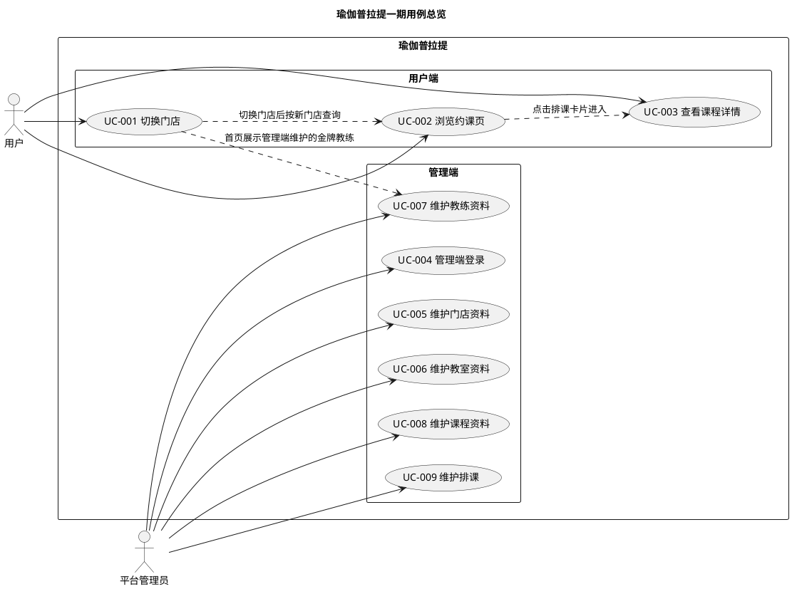

# 用例总览

## 1. 总用例图

## 2. 参与者

| 参与者 | 类型 | 说明 |
|---|---|---|
| **用户** | 人员 | 用户端使用者 |
| **平台管理员** | 人员（需登录） | 管理端角色 |

## 3. 用例清单

| 编号 | 用例名称 | 端 | 主要参与者 | 包含的业务功能 | 详细描述 |
|---|---|---|---|---|---|
| UC-001 | 切换门店 | 用户端 | 用户 | 门店列表（只返回未删除、**分页**、**按区域筛选与名称／地址关键字搜索**）、默认选中第一家、切换并记住当前门店、无门店空态；首页展示**平台级金牌教练栏目**（全量展示、独立加载／空态／重试、点击进入该教练「约教练」页） | [UC-001](用例/UC-001-切换门店.md) |
| UC-002 | 浏览约课页 | 用户端 | 用户 | 门店 ＋ 日期查询、14 天日期条默认今天、固定过滤条件（排除「待上架」）、课种 Tab 四类、排课卡片要素（含状态）、空态 | [UC-002](用例/UC-002-浏览约课页.md) |
| UC-003 | 查看课程详情 | 用户端 | 用户 | 课程资料（封面／课种／难度／介绍）、本次上课信息（时间／教练姓名头像**简介**／门店／教室）、状态、最大人数、最低开课人数、预约人员、剩余名额、「立即预约」提示敬请期待 | [UC-003](用例/UC-003-查看课程详情.md) |
| UC-004 | 管理端登录 | 管理端 | 平台管理员 | 用户名 ＋ 密码登录、必须登录才能访问管理端 | [UC-004](用例/UC-004-管理端登录.md) |
| UC-005 | 维护门店资料 | 管理端 | 平台管理员 | 查询、新增、修改、删除门店；名称唯一；门店类型枚举、所在区域走字典；**不设「联系人」**；无状态；删除门禁（名下教室、未结束的排课） | [UC-005](用例/UC-005-维护门店资料.md) |
| UC-006 | 维护教室资料 | 管理端 | 平台管理员 | 查询、新增、修改（只改名称）、删除教室；同门店内不重名；无状态；删除门禁 | [UC-006](用例/UC-006-维护教室资料.md) |
| UC-007 | 维护教练资料 | 管理端 | 平台管理员 | 查询、新增、修改、删除教练；名称允许重名；相册上限 5 张；**金牌等级维护**（设置／取消金牌，只要求管理员登录，资料编辑不改等级）；删除门禁 | [UC-007](用例/UC-007-维护教练资料.md) |
| UC-008 | 维护课程资料 | 管理端 | 平台管理员 | 查询、新增、修改、删除课程；名称全平台唯一；课种四类；难度 1~5 星；封面单图；**课种由排课做快照**；删除门禁 | [UC-008](用例/UC-008-维护课程资料.md) |
| UC-009 | 维护排课 | 管理端 | 平台管理员 | 查询、新增、修改、删除排课；四项要素与人数校验；教练时间不重叠；同门店＋课程＋完全相同起止时间不重复；14 天窗口；待上架／已上架／已取消的流转与删除限制；**课种快照**；**只有「待上架」可编辑**；已预约人数只读 | [UC-009](用例/UC-009-维护排课.md) |

> 说明：用户端新增的单教练「约教练」页（P9，由首页金牌教练卡片携带教练 ID 进入）不单列用例，作为 UC-001 首页金牌教练栏目的一部分维护；接口契约见[用户端接口详细设计](../详细设计/用户端接口详细设计.md) §2.2.14～§2.2.16，页面与跳转见 `docs/产品分析/`。
