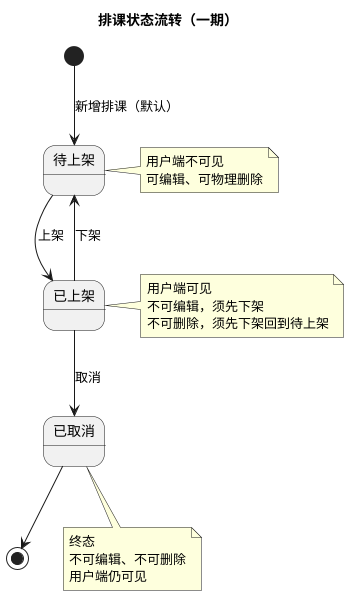
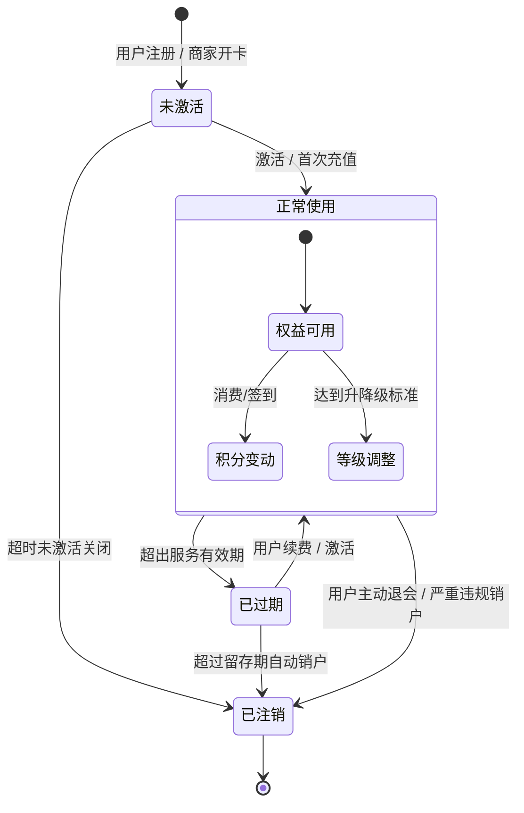

# 状态流转图

**文档版本：v2.0（重置版）**（2026-10-01）

> **一期门店、教室、课程都没有状态**（`BR-门店-008`、`BR-教室-003`、`BR-课程-007`），需要状态流转的只有**排课**。
> 本文件原名「课程状态流转图」，现描述**排课状态流转**；建议更名为 `排课状态流转图.md`。

## 1. 落库状态只有三个

**待上架 / 已上架 / 已取消**。「已结束」**不落库**，由「结束时间不晚于当前时间」推导（`BR-排课-010`）。

## 会员卡状态图

