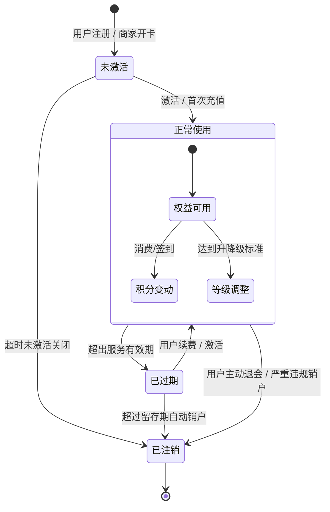

# 状态流转图

## 排课状态图

- 待上架
- 已上架
- 已取消。开课前两小时，预约人数未达到开课人数，自动取消。
- 停课。老师有事，或者场地有问题，听课。
- 已过期。当前时间>开课时间，即不可预约。
- 已结束。当前时间>结束时间，即课程已正常结束。

## 会员卡状态图

## 预约状态图

预约有

- 待签到：用户预约成功后，预约的初始状态为待签到
- 已签到：用户正常签到。
- 已取消：预约是待签到状态时，用户在课程开始前2小时取消预约，预约状态变为已取消；预约是待签到状态时，课程在开始前2小时人数不足，预约状态变为已取消。
- 已结束：用户上完课，预约状态变为已结束。
