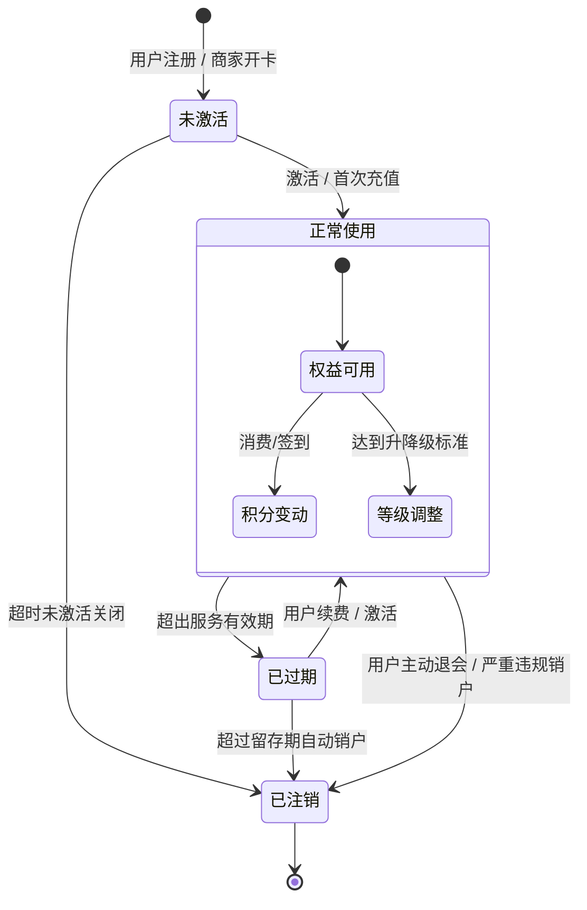
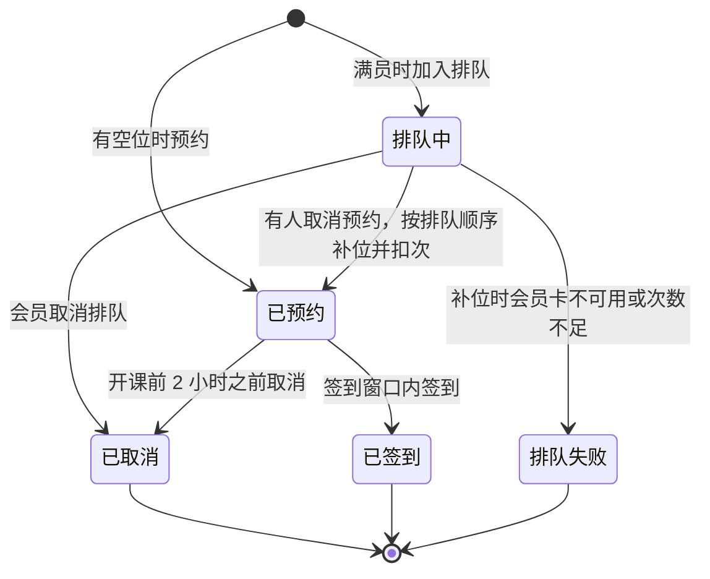

# 状态流转图

## 排课状态图

- 待上架
- 已上架
- 已取消。开课前两小时，预约人数未达到开课人数，自动取消。
- 停课。老师有事，或者场地有问题，听课。
- 已过期。当前时间>开课时间，即不可预约。
- 已结束。当前时间>结束时间，即课程已正常结束。

## 会员卡状态图

## 预约状态图

- 排队中：课程满员时加入排队，不占名额、不扣次；开课前 2 小时之后不能再排队，也不再补位。
- 排队失败：补位时被跳过；排队中的课程被取消或过了补位截止，同样显示为排队失败。
- 排队规则见[预约管理详细设计](../详细设计/预约管理详细设计.md)。

预约有

- 待签到：用户预约成功后，预约的初始状态为待签到
- 已签到：用户正常签到。
- 已取消：预约是待签到状态时，用户在课程开始前2小时取消预约，预约状态变为已取消；预约是待签到状态时，课程在开始前2小时人数不足，预约状态变为已取消。
- 已结束：用户上完课，预约状态变为已结束。
